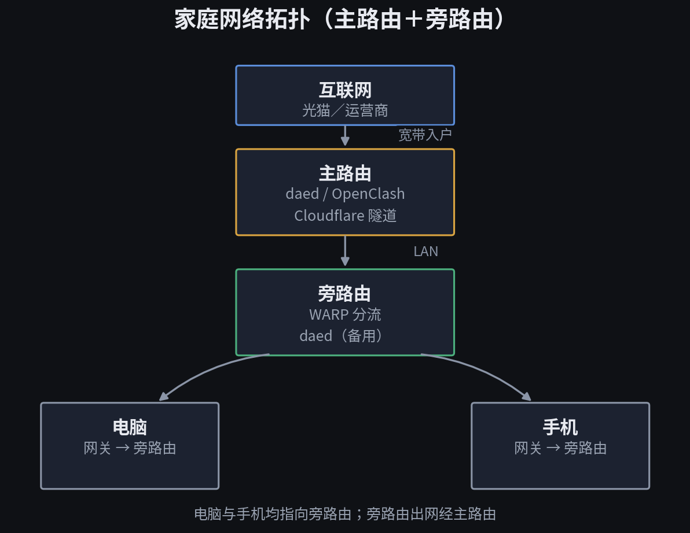
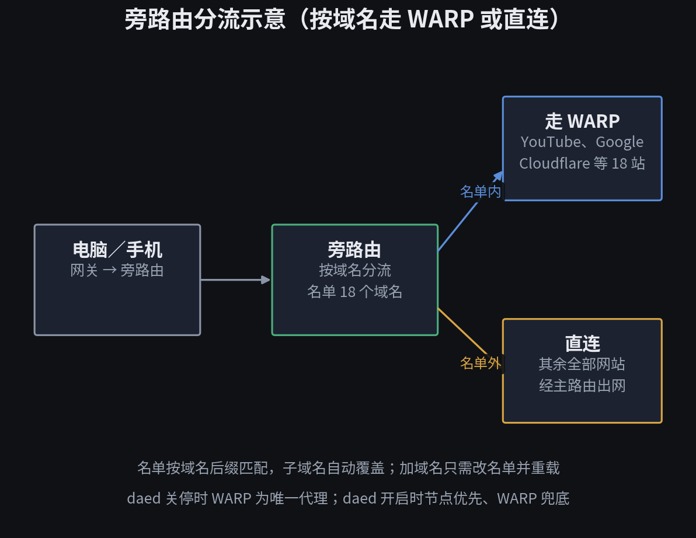

## 为什么加旁路由

主路由要稳，不想在它上面折腾代理。单独加一台旁路由做分流：电脑和手机的网关指向旁路由，旁路由按域名决定流量走 WARP 还是直连；主路由只负责出网和 Cloudflare 隧道。主路由配置不动，旁路由随便调，坏了也不影响全家上网。

## 网络拓扑

- 互联网进主路由，主路由上有 daed、OpenClash 和 Cloudflare 隧道。
- 旁路由挂在主路由下面，跑 WARP 分流，daed 备用。
- 电脑和手机的网关都指向旁路由，DNS 也指向旁路由。
- 旁路由出网经主路由，不直接拨号。

## WARP 分流怎么做

核心就三件：一个 WARP 接口（WireGuard）、一份域名名单、一套策略路由。

- 域名名单里有 18 个站（YouTube、Google 全家、Cloudflare、几个 AI 站等），走 WARP。
- 名单外的站全部直连，经主路由出网。
- 名单按域名后缀匹配，子域名自动覆盖，不用一条条加。
- DNS 也分流：名单内的域名用 WARP 上游解析，其余用主路由解析；同时过滤 AAAA，避免 IPv6 绕过分流。

分流用 nftables 实现：域名解析结果进一个带超时的 IP 集合，打上标记，走独立路由表经 WARP 接口出去。开机自动拉起，接口断线重连后补路由。

## daed 是备用的

旁路由上也装了 daed，节点都配好了（订阅里的节点全进代理组，策略按延迟选最优），路由规则：名单里的域名走代理组，其余直连，兜底也是代理组。

同一时间只开一个主代理。daed 开着时，节点优先级高于 WARP（透明代理先抢流量）；daed 关了，WARP 就是唯一代理。目前 daed 关着，18 个站走 WARP，其余直连。想用节点时，把 daed 启动就行，组和规则都在。

## WireGuard 节点筛选

手里有一批 WireGuard 节点链接（115 个），逐个实测：只握手不通流量的不算，能用的才算。最后只有 5 个真正能用（握手成功且隧道内流量通），做成一条订阅文件。

教训：节点列表里写着“能用”的不一定真能用，握手成功不等于流量通，必须实测隧道内流量。5 个里还有 1 个是 IPv6 端点，在 IPv6 不通的环境下用不了。

## PVE 里让旁路由显示 IP

旁路由是 PVE 里的虚拟机，默认在 PVE 列表里不显示 IP。装上 QEMU Guest Agent，在虚拟机配置里打开 Guest Agent，重启一次，PVE 就能读到虚拟机上报的网卡地址，列表里就显示 IP 了。

## 加域名的方法

想让某个站也走 WARP，不用进路由器敲命令：往域名名单文件里追加一行，重载分流脚本。子域名自动覆盖，改完立即生效，不用重启路由。

## 踩过的坑

- **重启后 WARP 隧道不握手**：旁路由重启后，WARP 接口显示 UP，但一次握手都没成功（只发不收），走 WARP 的站全打不开。只看接口 UP 不够，必须查握手状态。修法是把 WARP 接口重启一次（先关后开），握手立刻通了。
- **Windows 手动设 IP 的两个坑**：首选和备用 DNS 不能填同一个地址（都填旁路由会报“无法保存 IP 设置”），备用留空；“子网前缀长度”只填数字 24，填 255.255.255.0 会被拒。
- **Cloudflare One 免费版**：50 用户内免费，登团队用 WARP 不收费，也不影响现有的隧道和 Workers。但设备上开 WARP 客户端会接管该设备流量、绕过旁路由分流，电脑上别开。
- **主路由的 WireGuard 节点不通**：5 个可用节点在主路由上实测全不通，主路由的 WireGuard 路线作罢，节点只走旁路由。

## 现态

- 电脑和手机走旁路由，18 个站走 WARP，其余直连。
- daed 关着，组和规则都在，想用节点时启动即生效。
- 旁路由在 PVE 里显示 IP，WARP 隧道正常。
