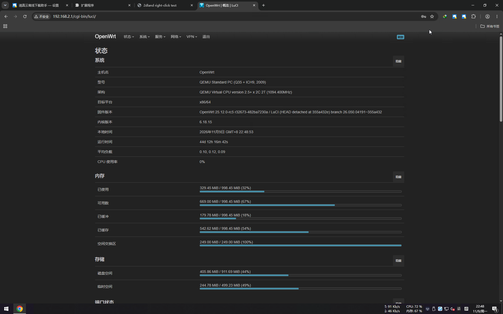
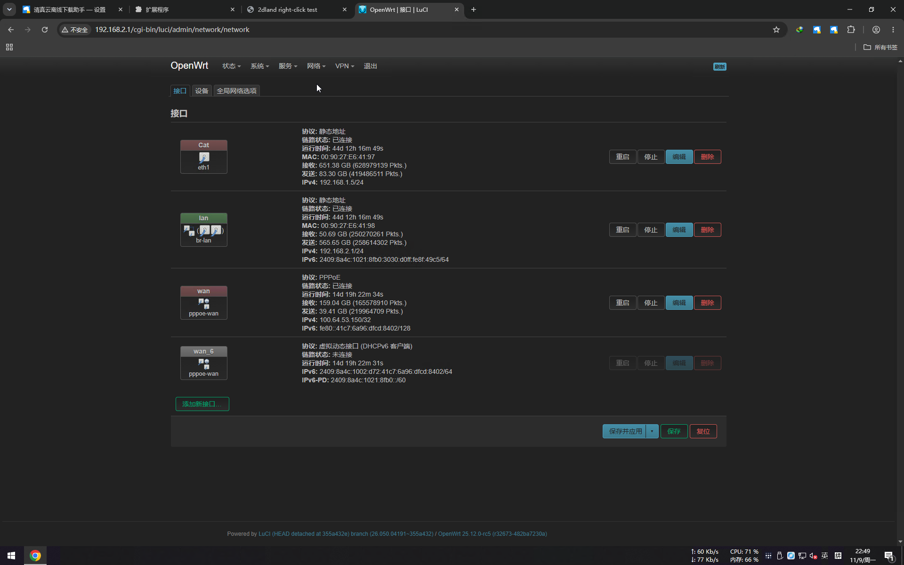

## 这篇是干什么的

教你把小米 AX6000 刷成 OpenWrt，刷完正常用起来。第一次刷机的人，照着下面一步步做就行。

只适用小米 AX6000（RA72）。RA70 是另一台机器（AX9000），绝不能刷，刷了必砖。刷机本身有变砖风险，但按本文步骤来、有恢复路，最危险的一步（bootloader）本文根本不碰。

推荐刷 NSS 版 R8021 fc86e 标准版（2026-11-20 已刷上机并复核通过，当前最新推荐）。它和 25.12 标准版的区别只有速度：NSS 版有线接近原厂水平，标准版只有一半左右；内核、插件、刷机步骤都一样。这版把 WiFi 驱动从 CT 版换成标准 ath10k（换版原因与深查结论见附录 A），其余与三修复版 fa7dc 一致：主机名写死 ax6000、LAN 口 IP 写死 192.168.2.1，mDNS 响应器（umdns）和二次验证（luci-app-totp）烤进了固件，刷完直接用 192.168.2.1 或 ax6000.local 进后台。注意：二次验证默认关闭，刷完须手动启用才会接管登录（见附录 A）。这版还删了 LuCI 系统菜单里的挂载点入口和 Plugins 入口（菜单 13 项），定时重启菜单改成中文名“定时重启”，WireGuard 已移除（内存只有 512MB，daed 与 OpenClash 别同时开）。

现状（2026-11-20 21:10）：AX6000 已刷 fc86e 标准版，现当 AP 用（192.168.2.209），刷后一次没断（截至 21:10 连续运行约 7.3 小时，ath10k 零重启，14 台设备在线），24 小时稳定性观察至 2026-11-21 14:00 出结论；武汉主路由（192.168.2.1）已刷 x86_64 新版 310eb（run 44702626047，B 方案：中文全烤＋nlbwmon），2026-11-20 20:03 编完、经 LuCI 刷入，中文包 13 个、总包 318，nlbwmon 在跑，配置保留，OTA 已删，主机名 OpenWrt；AX3000T 在另一套房子当主路由；搬家后 AX6000 过去当主路由＋跑代理（PPPoE、DHCP、DNS、NAT 固件里都留着），AX3000T 改当 AP。全部版本、大小、哈希与下载链都在[软件图书馆](https://softlib.hench.cc.cd/)。

!video[【软路由9】Xiaomi Ax6000 RA72 刷入OpenWRT 并搭建标准跨境电商网络](https://www.youtube.com/watch?v=gg4KD8qLGSI&t=428s)

先看一遍视频，心里有数。视频从 7:08 开始是刷机部分。文字版是哈利的配套博客 [hali.life/?p=1861](https://hali.life/?p=1861)。

## 准备

### 工具清单

- [xmir-patcher（本 fork）](https://github.com/aliporcins/xmir-patcher)：开 SSH、备份分区用。fork 自上游 [openwrt-xiaomi/xmir-patcher](https://github.com/openwrt-xiaomi/xmir-patcher)。
- 固件（11-20 NSS fc86e 标准版，最新推荐）：临时固件用瘦版 ImmortalWrt initramfs `immortalwrt-25.12.2-qualcommax-ipq50xx-xiaomi_ax6000-initramfs-factory.ubi`（19,660,800 B，公开下载），正式固件 `AutoBuild-openwrt-nss-edma-xiaomi_ax6000-R8021-20261120-Full-fc86e.bin`。直链在附录，正式固件是私有仓、需 GitHub 登录。注意：不要用 fc86e 自带的 initramfs（485e0.ubi，74MB）走菜单 7——它塞不进 36MB 的 rootfs_1 分区，会报 md5 -8，菜单 7 只能用 ≤36MB 的瘦版。
- MIWIFIRepairTool：小米官方 TFTP 恢复工具（Windows），刷坏了刷回原厂用。
- 一根网线、一台 Windows 电脑。

⚠️ **IP 冲突提醒**：这版 AX6000 与新版 AX3000T oc48007 版的 LAN IP 都是 192.168.2.1，两台不要同时接在同一个局域网里，刷机前先确认。

### 网线接法

全程有线，不用 WiFi。电脑网口—网线—路由器任一 LAN 口，刷机、开 SSH、传固件、sysupgrade 全走这根线。路由器 WAN 口接光猫，刷机时可不接（开 SSH 那步建议保持接上）。电脑 IP 平时自动获取就行。

TFTP 恢复时例外：还是这根线，LAN 口不触发就改插 WAN 口，电脑 IP 手动设 192.168.31.x。

### 刷前三件事

缺一项都别动手：

1. 底部标签核实为 **RA72**。
2. 备份已做：原厂全量提取（25 个 MTD 分区）2026-11-09 已完成并保存。
3. TFTP 备好：Windows 电脑、网线、RA72 原厂固件、MIWIFIRepairTool 就绪。

## 刷机步骤

先记住四条红线：

- **只认 RA72**，RA70 绝不能刷。
- **只写对面槽**：原厂是双系统槽（两个系统分区，互为备份），刷机只写当前没在用的那个槽，能跑的原厂系统原样保留。
- **绝不点 xmir-patcher 里的 bootloader 安装项**。
- **daed 与 OpenClash 别同时开**（内存只有 512MB）。

然后按顺序做：

1. **连路由器**：打开 xmir-patcher 里的 `run.bat`，菜单 `2 – Connect to device`，输路由器管理密码。连上后 exploit 装好、SSH 开了。
2. **装永久 SSH**：菜单 `6 – Install permanent SSH`。以前装过就跳过这步。
3. **备份原厂分区**：菜单 `4 – Create full backup`。2026-11-09 已做过全量提取，没做过就跑一次。
4. **查当前分区**：SSH 进路由器，执行 `nvram get flag_boot_rootfs`。返回 0 表示当前在用 rootfs（mtd18），返回 1 表示在用 rootfs_1（mtd19）。下一步刷对面那个。
5. **刷临时固件**：initramfs 是临时系统，只在内存里跑、重启就没，用来先验证。把瘦版 ImmortalWrt initramfs `immortalwrt-25.12.2-qualcommax-ipq50xx-xiaomi_ax6000-initramfs-factory.ubi`（19,660,800 B）放进 xmir-patcher 的 `firmware` 文件夹，菜单 `7 – Install firmware`。也可以手动刷：把文件传到路由器 `/tmp`，执行 `ubiformat /dev/mtd19 -y -f /tmp/immortalwrt-25.12.2-qualcommax-ipq50xx-xiaomi_ax6000-initramfs-factory.ubi && nvram set flag_boot_rootfs=1 && nvram set flag_last_success=1 && nvram commit`（当前为 1 时改刷 mtd18、flags 置 0）。注意：fc86e 自带的 initramfs（485e0.ubi，74MB）塞不进 36MB 的 rootfs_1 分区，菜单 7 会报 md5 -8，不要用它；瘦版只是个跳板，进临时系统后下一步就刷正式固件。
6. **重启验证**：重启后进内存里的 OpenWrt，打开 192.168.2.1 或 ax6000.local（这版已把 LAN 写死 192.168.2.1，umdns 已烤进），确认 LuCI 和 daed 面板能打开。daed 需要内核 BTF 支持，面板能开就说明没问题。
7. **刷正式固件**：sysupgrade 是 OpenWrt 自带的正式刷机方式，刷完重启就是新系统。把 `AutoBuild-openwrt-nss-edma-xiaomi_ax6000-R8021-20261120-Full-fc86e.bin` 传到 `/tmp`，执行 `sysupgrade -n -v /tmp/AutoBuild-openwrt-nss-edma-xiaomi_ax6000-R8021-20261120-Full-fc86e.bin`。

出厂固件本次流程用不上，不用管它。

## 刷完设置

1. **首次登录**：打开 192.168.2.1 或 ax6000.local，root 空密码登录，先设密码。
2. **配 WiFi**：LuCI「网络 → 无线」，2.4G 和 5G 各建一个接入点，填 SSID，加密选 WPA2-PSK 或 WPA3-SAE，设密码。
3. **接上网**：WAN 口接光猫。LuCI「网络 → 接口 → WAN」，按宽带方式选 PPPoE（填账号密码）或 DHCP。
4. **开 daed**：面板在 http://192.168.2.1:2023，导入订阅。别同时开 OpenClash（见红线）。
5. **OpenClash 提醒**：视频里提醒 0.47.156 版有大 bug，用之前先在插件里更新到 0.48.002。
6. **WoL（网络唤醒）**：LuCI 里找 Wake on LAN（服务或网络菜单下），填目标设备 MAC 点唤醒；或 SSH 执行 `etherwake <MAC>`。目标设备须在 BIOS／网卡里开着 WoL，且与路由器同局域网。
7. **用 ax6000.local 访问**：这版已把 mDNS 响应器（umdns）烤进固件，刷完 ax6000.local 直接能用，不用再手动装。Windows、macOS、iOS 都认 .local；安卓设备不认 .local，只能用 IP 192.168.2.1。

## 刷机后怎么设置 AP

只想让 AX6000 当无线 AP 补覆盖、不当主路由时用。dumb AP 的意思：只发 WiFi，不管路由、DHCP、DNS、防火墙，这些全交给主路由。

1. **定 LAN IP**：LuCI「网络 → 接口 → LAN → 编辑」，协议选「静态地址」。填一个与主路由同网段、又不在主路由 DHCP 池里的地址。示例按武汉主路由网段 192.168.2.0/24：主路由是 192.168.2.1，就给 AP 填 192.168.2.2（先确认没被占用）。另一套房子按当地主路由的网段改。改完 IP 就变了，之后用新 IP 进 LuCI。
2. **网关与 DNS 指回主路由**：同一页里，IPv4 网关填主路由 IP（例 192.168.2.1），「使用自定义 DNS 服务器」也填主路由 IP。
3. **关 LAN 的 DHCP**：同一页「DHCP 服务器」里勾选「忽略此接口」。一个网里只能有一个 DHCP 服务器，两个同时开会抢地址、断网。
4. **关防火墙／DNS／odhcpd**：LuCI「系统 → 启动项」，把 firewall、dnsmasq、odhcpd 三个服务停用并禁用，重启后也不再起来。AP 不路由、不做 NAT，防火墙没用了；DNS 与 DHCP 都归主路由管。
5. **接网线**：网线一头插 AX6000 的任一 LAN 口，另一头插主路由的 LAN 口。不要插 WAN 口。也可以在「网络 → 接口」里把 WAN、WAN6 接口删掉。
6. **配 WiFi**：LuCI「网络 → 无线」，2.4G 与 5G 各建一个接口，模式选「接入点（Access Point）」，填 SSID，加密选 WPA2-PSK 或 WPA3-SAE、设密码，接口的「网络」选 LAN。想跟主路由同名同密码漫游也可以，信道错开主路由用的信道。

DHCP 关掉后，AP 自身不会再分配地址。忘了 AP 的固定 IP 就只能复位重来，所以把 IP 记下来，最好在主路由上按 MAC 给 AP 做 DHCP 静态保留。

## 出问题怎么办

- **刷到错机型（RA70／AX9000）**：bootloader 完好，用 MIWIFIRepairTool TFTP 刷回正确原厂固件。唯一防线是刷前核标签 RA72。
- **NAND 批次问题**：TFTP 刷回原厂。刷前先查颗粒型号（原厂 dmesg 或 xmir-patcher read_info）。
- **initramfs 刷后无 DHCP／SSH／Web**：原厂在另一槽，TFTP 刷回原厂。
- **刷写中断电**：ubiformat 阶段只坏对面槽，原厂完好；sysupgrade 阶段 OpenWrt 分区损坏，TFTP 刷回原厂。
- **bootloader 损坏**：需拆机编程器。标准流程到不了这一步。

恢复路径（按优先级）：

1. **双槽回切**：bootloader 按失败计数自动回切另一槽；或在已跑起的 OpenWrt 里执行 `fw_setenv flag_last_success 0; fw_setenv flag_boot_rootfs 0` 手动切回原厂槽。无需工具、不拆机。
2. **MIWIFIRepairTool TFTP 恢复**（小米官方工具，Windows）：关机→按住 Reset 通电→黄灯闪烁进恢复模式→电脑有线连路由（LAN 口不触发改接 WAN 口）→电脑设 192.168.31.x→工具选 RA72 原厂固件刷回。
3. **串口 UART**：板上有 UART 排针（需拆机），115200 8N1 进 U-Boot，可 TFTP 引导 initramfs／手动刷写。需 USB-TTL 线。
4. **NAND 编程器拆焊**：仅 bootloader 本身损坏时需要。

## AX3000T（另一套房子）

小米 AX3000T，联发科 MT7981B（filogic 平台），不是高通，没有 NSS。硬件加速走联发科的流卸载，不是 NSS。

在另一套房子当主路由，不在武汉网络，武汉主路由不动。系统 ImmortalWrt 24.10.6。AX6000 刷好后接替主路由，AX3000T 改当 AP 补覆盖。

### 六个变体

- **oc48007 挂载点修复版（推荐主用）**：`AX3000T-std-24.10.6-daed-openclash-wireguard-wol-totp-cf20261004-addr-mdns-oc48007-sysupgrade.bin`，72,151,866 B，SHA256 `ba379f777ad7b947a25f24c5d9c9dde12c8b03c55983227e2607ab5f8ed8c32e`。[Release 直链](https://github.com/aliporcins/AutoBuild-Actions-BETA/releases/download/AutoUpdate-NSS/AX3000T-std-24.10.6-daed-openclash-wireguard-wol-totp-cf20261004-addr-mdns-oc48007-sysupgrade.bin)（私有仓，需 GitHub 登录）。主机名 ax3000t、LAN 口 IP 192.168.2.1，标准 sysupgrade 直接升；与 oc48006 完全一致，只改一处——按深度审计 S1 建议隐藏 LuCI 挂载点入口（挂载点页调已删的 `/sbin/block`，打开即报错），其余 12 项菜单逐字节不动，manifest 仍 255 行、内核逐字节一致，闪存余量 59.19 MiB；PPP 拨号保留（另一套房子是 PPPoE）；其余 S1/S2、cloudflared arm64 2026.11.1、firewall 中文、计划重启、DDNS（luci-app-ddns）、daed 2.1.1、filemanager／ramfree、ttyd 1.7.7-r2 均不变；umdns 仍 2026.06.16，刷完 ax3000t.local 即通（Windows、macOS、iOS 可用，安卓只能用 IP）。注意：与新版 AX6000 同为 192.168.2.1，两台不要同时接同一局域网。（oc48008 版曾建好但已被否决作废，不推荐，继续用 oc48007。）

上一版 oc48006 版（已被 oc48007 版取代，历史记录）：`AX3000T-std-24.10.6-daed-openclash-wireguard-wol-totp-cf20261004-addr-mdns-oc48006-sysupgrade.bin`，72,151,866 B，SHA256 `dbc890b9b3062760ea3869f680275a56567d8eb8409eb62f5e2113e9dfd58ab8`。[Release 直链](https://github.com/aliporcins/AutoBuild-Actions-BETA/releases/download/AutoUpdate-NSS/AX3000T-std-24.10.6-daed-openclash-wireguard-wol-totp-cf20261004-addr-mdns-oc48006-sysupgrade.bin)（私有仓，需 GitHub 登录）。该版 LuCI 挂载点页还调已删的 `/sbin/block`，打开即报错，已被 oc48007 隐藏入口修好。

上一版 oc48005 版（已被 oc48006 版取代，历史记录）：`AX3000T-std-24.10.6-daed-openclash-wireguard-wol-totp-cf20261004-addr-mdns-oc48005-sysupgrade.bin`，85,535,546 B，SHA256 `cadc42fb6ab21e8a1c7caf888e89dabaa3b27bdf1e0abf77763294e0f2498d2a`。[Release 直链](https://github.com/aliporcins/AutoBuild-Actions-BETA/releases/download/AutoUpdate-NSS/AX3000T-std-24.10.6-daed-openclash-wireguard-wol-totp-cf20261004-addr-mdns-oc48005-sysupgrade.bin)（私有仓，需 GitHub 登录）。该版还带着第一档无用包（dae 单机版、diskman、USB 驱动、nathelper），已被 oc48006 删掉。

上一版 oc48004 版（已被 oc48005 版取代，历史记录）：`AX3000T-std-24.10.6-daed-openclash-wireguard-wol-totp-cf20261004-addr-mdns-oc48004-sysupgrade.bin`，85,535,546 B，SHA256 `e7bcf07eebee6e308aaa84505a619c1df8f4c7c20fff27d6f5cfd96d46600c5a`。[Release 直链](https://github.com/aliporcins/AutoBuild-Actions-BETA/releases/download/AutoUpdate-NSS/AX3000T-std-24.10.6-daed-openclash-wireguard-wol-totp-cf20261004-addr-mdns-oc48004-sysupgrade.bin)（私有仓，需 GitHub 登录）。该版 daed 按钮读错 UCI 键名（改端口后死链）、proxy-switch 切换失败不恢复旧代理，已被 oc48005 修好。

上一版 oc48003 版（已被 oc48004 版取代，历史记录）：`AX3000T-std-24.10.6-daed-openclash-wireguard-wol-totp-cf20261004-addr-mdns-oc48003-sysupgrade.bin`，85,535,546 B，SHA256 `88ee656351da394ca6e3c70f8ad09228981aae19e90893726da63225434d7c6b`。[Release 直链](https://github.com/aliporcins/AutoBuild-Actions-BETA/releases/download/AutoUpdate-NSS/AX3000T-std-24.10.6-daed-openclash-wireguard-wol-totp-cf20261004-addr-mdns-oc48003-sysupgrade.bin)（私有仓，需 GitHub 登录）。该版 ttyd 1.7.7 的启动脚本与新二进制脱节，网页终端默认只读、打不了字，不要再刷。
- **标准版（daed＋OpenClash）**：`AX3000T-std-24.10.6-daed-openclash-sysupgrade.bin`，59,792,186 B，SHA256 `42339514a4ff454ea4f0be79860d65710de0f2f5a1398b88d583a210135f5bb1`。[Release 直链](https://github.com/aliporcins/ax3000t-firmware/releases/download/v24.10.6/AX3000T-std-24.10.6-daed-openclash-sysupgrade.bin)。
- **标准版＋WireGuard（推荐主用）**：`AX3000T-std-24.10.6-daed-openclash-wireguard-sysupgrade.bin`，59,894,586 B，SHA256 `39a5bdb624eb1183a0eb93e9dc9add1311545bbe4b49cc6af848ef2d11b0376f`。本地文件，找我要。
- **ubootmod 精简版**：`AX3000T-ubootmod-immortalwrt-24.10.6-daed-slim-sysupgrade.itb`，41,542,476 B，SHA256 `4421ef8f049feb3f4cdcb0c6dca715f36ab1c569016e24291edfeb3630af7497`。本地文件，找我要；只给改过 bootloader 的机器。
- **ubootmod v2（带 ttyd 网页终端）**：`AX3000T-ubootmod-immortalwrt-24.10.6-daed-slim-v2-ttyd-sysupgrade.itb`，42,079,052 B，SHA256 `1515035eba503427707cf9585b5063d2aa4bdecb4234ec4990e90b344af9f143`。本地文件，找我要；只给改过 bootloader 的机器。

上一版 OpenClash 0.48.002 版（已被 oc48003 版取代，历史记录）：`AX3000T-std-24.10.6-daed-openclash-wireguard-wol-totp-cf20261004-addr-mdns-oc48002-sysupgrade.bin`，80,149,306 B，SHA256 `adf025da08e4a9aab31ddc2cbe95ea60f94dddcf4543240a68c4851bcf620d51`。[Release 直链](https://github.com/aliporcins/AutoBuild-Actions-BETA/releases/download/AutoUpdate-NSS/AX3000T-std-24.10.6-daed-openclash-wireguard-wol-totp-cf20261004-addr-mdns-oc48002-sysupgrade.bin)（私有仓，需 GitHub 登录）。该版 cloudflared 的 overlay 二进制是 x86-64（架构错误，MT7981 跑不起来），且无 DDNS、无 USB 驱动，不要再刷。

上一版 mDNS 版（已被 OpenClash 0.48.002 版取代，历史记录）：`AX3000T-std-24.10.6-daed-openclash-wireguard-wol-totp-cf20261004-addr-mdns-sysupgrade.bin`，78,060,346 B，SHA256 `e1c5965a324db8f492e5d4efa3161898e4837c6246dcabc643ca19bf465323c2`。[Release 直链](https://github.com/aliporcins/AutoBuild-Actions-BETA/releases/download/AutoUpdate-NSS/AX3000T-std-24.10.6-daed-openclash-wireguard-wol-totp-cf20261004-addr-mdns-sysupgrade.bin)（私有仓，需 GitHub 登录）。

上一版好记地址版（已被 mDNS 版取代，历史记录）：`AX3000T-std-24.10.6-daed-openclash-wireguard-wol-totp-cf20261004-addr-sysupgrade.bin`，78,050,106 B，SHA256 `cf668abc1602b6e0b8b2f2bfefc6a27a546966501c0adab7be8f8594a4cb39eb`。[Release 直链](https://github.com/aliporcins/AutoBuild-Actions-BETA/releases/download/AutoUpdate-NSS/AX3000T-std-24.10.6-daed-openclash-wireguard-wol-totp-cf20261004-addr-sysupgrade.bin)（私有仓，需 GitHub 登录）。

标准版内含：dae 1.0.0、daed 1.24.0、luci-app-daed、luci-app-openclash 0.47.156；WireGuard 版另含 kmod-wireguard＋wireguard-tools。ubootmod 版为精简固件（daed 1.24.0，无 OpenClash／WireGuard），v2 另带 ttyd 网页终端。无任何预置订阅、节点或密钥。

### ubootmod 版风险（重要）

ubootmod 版仅适用于已改过 bootloader 的 AX3000T（ubootmod 布局）。标准布局机器不要刷，风险更高。两个 ubootmod 文件都是 `.itb` 格式，与标准版的 `.bin` 不同，刷机方式也不同。

v2 刷机三要点：

1. 现后台「系统 → 备份/升级」上传.itb 刷入；
2. 「保留配置」不要勾；
3. 刷机时不断电、不拔网线；刷后打开 192.168.1.1，root 空密码首登，先设密码。

### 面板地址

- LuCI 后台：http://192.168.1.1
- daed 面板：http://192.168.1.1:2023（服务页只开 daed，不要同时开 dae）
- 网页终端（v2）：LuCI 左侧「系统 → 终端」（root 登录）

mDNS 版的后台是 http://192.168.2.1（也可以用 ax3000t.local），daed 面板是 http://192.168.2.1:2023。

## 附录

### 附录 A：固件版本与哈希

x86_64 主路由 310eb 版（2026-11-20，run 44702626047，workflow AutoBuild-x86_64，成功；**武汉主路由当前在用**；B 方案：流量卸载保持开、不烤 wrtbwmon、只烤 nlbwmon、烤全中文包；中文包 13 个（上一版镜像 10 个，另有 diskman／lucky／ramfree 三个 bonus）、总包 318（上一版镜像 301），nlbwmon 在跑；基线仍 r33393-6ad88cfb33，靠包数区分新旧；2026-11-20 20:03 编完、经 LuCI 刷入，配置保留，OTA 已删；刷后 root 密码丢失、已从刷前备份拼回（哈希逐字一致），/etc/config 12 个旧备份／孤儿配置已删；主机名 OpenWrt；Lucky／daed 配置都在，daed 默认关（现行代理是 Lucky）；刷 .img.gz 原文件即可，sysupgrade 与 LuCI 都直接认 .gz）：

- squashfs 非 EFI：`AutoBuild-openwrt-x86_64-R25.12-20261120-Full-310eb.img.gz`，84,351,379 B，SHA256 `310ebe03aeb3cf9f1ddb69e42144cdab62cfa2348a5a4ac3a3e70fc634adffb4`。[Release 直链](https://github.com/aliporcins/AutoBuild-Actions-BETA/releases/download/AutoUpdate/AutoBuild-openwrt-x86_64-R25.12-20261120-Full-310eb.img.gz)（私有仓，需 GitHub 登录）。
- EFI：`AutoBuild-openwrt-x86_64-R25.12-20261120-Full-cc4d1.img.gz`，84,548,303 B，SHA256 `cc4d166ce25333d796e9c5b4b88129034a5c4d8860406457b781311b4ce6dfb0`。

NSS 版 R8021 fc86e 标准版（2026-11-20，run 44665525861，workflow xiaomi_ax6000_nss，成功；**当前推荐**；相对 fa7dc 实质变化只有三处——WiFi 固件 10.1-ct-87→10.2.4-1.0-00047、驱动 CT→标准 ath10k（kmod-ath10k-smallbuffers＋ath10k-firmware-qca9887）、daed 2026.10.30→2026.11.18-r1；内核与 fa7dc 逐字节相同，包数仍 250，菜单仍 13 项，autoreboot 四文件与 fa7dc 同哈希；换版原因：fa7dc 的 CT 固件在启动后 27 分钟出现一次 SWBA-overrun 硬件重启（9 小时内共 1 次），改标准驱动验证稳定性；深查结论：功能与 fa7dc 平齐；长期稳定性正在 24 小时观察中（截至 2026-11-21 14:00），未定论；截至 2026-11-20 21:10 刷后一次没断（连续运行 26392 秒，ath10k recovered=0，14 台设备在线）；2026-11-20 13:48 经 SSH sysupgrade -c 刷入，现当 AP 用；主机名 ax6000；daed/OpenClash 默认关；刷机走 102 中转下固件，路由器本机直连 GitHub 极慢）：

- sysupgrade 正式固件：`AutoBuild-openwrt-nss-edma-xiaomi_ax6000-R8021-20261120-Full-fc86e.bin`，72,888,589 B，SHA256 `fc86ecb06b611df84cfe6d22d04a25b98855bcb59f83d21389ee8e1f034dda27`。[Release 直链](https://github.com/aliporcins/AutoBuild-Actions-BETA/releases/download/AutoUpdate-NSS/AutoBuild-openwrt-nss-edma-xiaomi_ax6000-R8021-20261120-Full-fc86e.bin)（私有仓，需 GitHub 登录）。
- initramfs 临时固件：`AutoBuild-openwrt-nss-edma-xiaomi_ax6000-R8021-20261120-Full-485e0.ubi`，74,842,112 B，SHA256 `485e01c4b0fb876f0877c19fedf29bf8dd0140fe287591713e1cf6af70923f96`。注意：它塞不进 36MB 的 rootfs_1 分区，菜单 7 不能用它（会报 md5 -8）；菜单 7 改用下面的瘦版，这个仅作存档。
- 瘦版临时固件（菜单 7 用这个）：`immortalwrt-25.12.2-qualcommax-ipq50xx-xiaomi_ax6000-initramfs-factory.ubi`，19,660,800 B，SHA256 `f5980a8ea6a92e61b9a024a03d75454447234f5320e6eb1abae672985a25fba2`。[官方直链](https://downloads.immortalwrt.org/releases/25.12.2/targets/qualcommax/ipq50xx/immortalwrt-25.12.2-qualcommax-ipq50xx-xiaomi_ax6000-initramfs-factory.ubi)（公开下载，不用登录）。官方 ImmortalWrt 25.12.2 的最小临时系统，只当跳板用：菜单 7 刷它进内存，启动后再用 LuCI／sysupgrade 刷正式固件。
- 出厂固件：`AutoBuild-openwrt-nss-edma-xiaomi_ax6000-R8021-20261120-Full-51eeb.ubi`，75,628,544 B，SHA256 `51eeba7d94283650799b3086ab795dc5fd209ae02cfbc2ca52aea078564d9f1e`。本次流程不用，不用管它。

NSS 版 R8021 三修复版 fa7dc（2026-11-20，run 44560701064，workflow xiaomi_ax6000_nss，成功；已被上方的 fc86e 标准版取代为推荐（历史记录／兜底备用）；相对 ee425 只改三处——LuCI 系统菜单删 Plugins 入口（菜单 13 项，mounts 入口亦无）、autoreboot 菜单名→“定时重启”、描述→“小米 AX6000 定时重启插件”；全量 diff 仅 13 文件不同、无新增无删除；包数 250，WireGuard 仍无；2026-11-20 04:37 经 SSH sysupgrade -c 刷入，04:45–04:46 复核全过（包数 250、菜单 13 项、设置保留、三射频全 up）；主机名 ax6000，现当 AP 用 192.168.2.209/24，网关/DNS 192.168.2.1，上行插 lan1；daed/OpenClash 默认关；LED 脚本与 cron 在；时区 CST-8/Asia/Shanghai；刷机走 102 中转下固件，路由器本机直连 GitHub 极慢）：

- sysupgrade 正式固件：`AutoBuild-openwrt-nss-edma-xiaomi_ax6000-R8021-20261119-Full-fa7dc.bin`，72,581,389 B，SHA256 `fa7dc1bbb0e562718dba3252d8eba2b369b90abd669dabb23660b896d5409cbd`。[Release 直链](https://github.com/aliporcins/AutoBuild-Actions-BETA/releases/download/AutoUpdate-NSS/AutoBuild-openwrt-nss-edma-xiaomi_ax6000-R8021-20261119-Full-fa7dc.bin)（私有仓，需 GitHub 登录）。
- initramfs 临时固件：`AutoBuild-openwrt-nss-edma-xiaomi_ax6000-R8021-20261119-Full-800be.ubi`，74,448,896 B，SHA256 `800be07f1db8ca9b2c2d692f493c3f8c2c9371387c769df274175a7d861418ba`。菜单 7 用这个。
- 出厂固件：`AutoBuild-openwrt-nss-edma-xiaomi_ax6000-R8021-20261119-Full-5934a.ubi`，75,235,328 B，SHA256 `5934a980dc3f8d113d230849d18d20bb0574ef2fd9ca4dd6b4d701c5a25d3b91`。本次流程不用，不用管它。

NSS 版 R8021 去 WireGuard 版 ee425（2026-11-19，run 44530474199，workflow xiaomi_ax6000_nss，成功；深查全过；相对 d1d5c 只删 WireGuard 三件（kmod-wireguard、luci-proto-wireguard、wireguard-tools）及 7 个独占依赖，包数 260→250，apk db 与文件在位三重确认移除干净，仅 3 处 wireguard 字样为无害存根；2026-11-19 23:29 经 SSH sysupgrade -c 刷入并深查清理完成；主机名 ax6000，AP 模式 192.168.2.209/24，网关/DNS 192.168.2.1，上行插 lan1；daed/OpenClash 默认关；LED 脚本与 cron 在；时区 CST-8/Asia/Shanghai；已被上方的三修复版 fa7dc 取代为推荐）：

- sysupgrade 正式固件：`AutoBuild-openwrt-nss-edma-xiaomi_ax6000-R8021-20261119-Full-ee425.bin`，72,581,389 B，SHA256 `ee4253ea327556048152d0cce0a917fc77a7ce53b01696cc40fadc3d9ad2d374`。[Release 直链](https://github.com/aliporcins/AutoBuild-Actions-BETA/releases/download/AutoUpdate-NSS/AutoBuild-openwrt-nss-edma-xiaomi_ax6000-R8021-20261119-Full-ee425.bin)（私有仓，需 GitHub 登录）。
- initramfs 临时固件：`AutoBuild-openwrt-nss-edma-xiaomi_ax6000-R8021-20261119-Full-8d8de.ubi`，74,579,968 B，SHA256 `8d8de71ccaa9a4ba2c6ffd4ba726b67bb9a946a6105b5b1a02e32dca401e5295`。菜单 7 用这个。
- 出厂固件：`AutoBuild-openwrt-nss-edma-xiaomi_ax6000-R8021-20261119-Full-357a1.ubi`，75,235,328 B，SHA256 `357a1fd800c615dc29e7cdb50c32321e6e3703ba5fb4db5e6ca96b3f1c3d3fd5`。本次流程不用，不用管它。

NSS 版 R8021 d1d5c 版（2026-11-19，run 44491238878，workflow xiaomi_ax6000_nss，成功；用户已用 LuCI 勾保留配置直升成功，运行 1m57s、内核 6.18.60；包数 260，含 WireGuard；已被上方的去 WireGuard 版 ee425 取代为推荐）：

- sysupgrade 正式固件：`AutoBuild-openwrt-nss-edma-xiaomi_ax6000-R8021-20261119-Full-d1d5c.bin`，72,683,789 B，SHA256 `d1d5cce5df51a62800351bf446dd57a278857222f6658b772c72b703a2719c14`。[Release 直链](https://github.com/aliporcins/AutoBuild-Actions-BETA/releases/download/AutoUpdate-NSS/AutoBuild-openwrt-nss-edma-xiaomi_ax6000-R8021-20261119-Full-d1d5c.bin)（私有仓，需 GitHub 登录）。
- initramfs 临时固件：`AutoBuild-openwrt-nss-edma-xiaomi_ax6000-R8021-20261119-Full-d6715.ubi`，74,579,968 B，SHA256 `d6715bcd516ac0f02b2d451721638ec9982789191231923dad5babcda11ce332`。菜单 7 用这个。
- 出厂固件：`AutoBuild-openwrt-nss-edma-xiaomi_ax6000-R8021-20261119-Full-c6169.ubi`，75,366,400 B，SHA256 `c6169f3e39eb2f28707a1964c989c7e60f5615ef30ba9845ac526c33eb688f2f`。本次流程不用，不用管它。

NSS 版 R8021 挂载点修复版（2026-11-19，run 44433898353，workflow xiaomi_ax6000_nss，成功；深查全过，定论可以直接刷；已被上方的三修复版 fa7dc 取代为推荐；与合一最终版逐字节一致，只改一处——删 LuCI 系统菜单里的挂载点入口（挂载点页调已删的 `/sbin/block`，打开即报错），menu JSON 15→14 项，仅删 `admin/system/mounts`，其余无新增无改动；autoreboot 四文件与合一最终版逐字一致、apk db 268 个包 0 版本变化、内核逐字节一致、Configs 42 项 0 缺项；主机名 ax6000、LAN 口 IP 192.168.2.1，刷后 ax6000.local 即通；闪存余量 53.36 MiB；轻微遗留与合一最终版一致：TOTP 默认不接管、Lucky 默认开、OpenClash 内核首启联网下载）：

- sysupgrade 正式固件：`AutoBuild-openwrt-nss-edma-xiaomi_ax6000-R8021-20261119-Full-6c538.bin`，78,274,829 B，SHA256 `6c53801f87476a32fa6cac10e360ac94e2f8a6057cca3f47c543b6304d88899b`。[Release 直链](https://github.com/aliporcins/AutoBuild-Actions-BETA/releases/download/AutoUpdate-NSS/AutoBuild-openwrt-nss-edma-xiaomi_ax6000-R8021-20261119-Full-6c538.bin)（私有仓，需 GitHub 登录）。
- initramfs 临时固件：`AutoBuild-openwrt-nss-edma-xiaomi_ax6000-R8021-20261119-Full-328de.ubi`，81,002,496 B，SHA256 `328de38eb234e869b9b154329135d626e5fb81a0089141e538ece1b72184eb44`。菜单 7 用这个。
- 出厂固件：`AutoBuild-openwrt-nss-edma-xiaomi_ax6000-R8021-20261119-Full-95ebd.ubi`，81,133,568 B，SHA256 `95ebd3698a76c204f03be03906c828b84c41f49af412a5663c5a47eb83b634f5`。本次流程不用，不用管它。
- TOTP 默认关闭：luci-app-totp 0.1.0-r6 已烤进固件，但默认不接管登录——刷完须先在 LuCI 里启用，再手动跑 `totp-patch-login.sh apply` 才会生效，别以为刷完就受保护。

NSS 版 R8021 合一最终版（2026-11-19，run 44348801512，workflow xiaomi_ax6000_nss，成功；深查 11 项全过，定论可以直接刷；相对第三轮唯一功能变化就是 autoreboot 从空包修成实包——4 文件在位、apk db I:1894、默认关每天 4:00；中文 13 个 .lmo、USB／磁盘簇全删、cloudflared 2026.11.1、daed 2026.10.30、OpenClash 0.48.002、Lucky 3.5.0、TOTP＋umdns 2026.10.04；主机名 ax6000、LAN 口 IP 192.168.2.1，刷后 ax6000.local 即通；闪存余量 53.36 MiB；轻微遗留：LuCI 挂载点页仍调已删的 /sbin/block，下版顺带修——已由上方的挂载点修复版修好并取代本版为推荐）：

- sysupgrade 正式固件：`AutoBuild-openwrt-nss-edma-xiaomi_ax6000-R8021-20261118-Full-9f7ad.bin`，78,274,829 B，SHA256 `9f7ad265f851bd3f3d5a6d6db3516edd07bd427273bb8e177003852d649c5c5d`。[Release 直链](https://github.com/aliporcins/AutoBuild-Actions-BETA/releases/download/AutoUpdate-NSS/AutoBuild-openwrt-nss-edma-xiaomi_ax6000-R8021-20261118-Full-9f7ad.bin)（私有仓，需 GitHub 登录）。
- initramfs 临时固件：`AutoBuild-openwrt-nss-edma-xiaomi_ax6000-R8021-20261118-Full-d0b49.ubi`，81,002,496 B，SHA256 `d0b49d964ce50bcaab10d003fad3f1fdf8482e69a69d95d36b170b3931878923`。菜单 7 用这个。
- 出厂固件：`AutoBuild-openwrt-nss-edma-xiaomi_ax6000-R8021-20261118-Full-06ddc.ubi`，81,133,568 B，SHA256 `06ddc425f39a23021de7221328714fa0eae0c117f87c1d1cd0c372337d5ac815`。本次流程不用，不用管它。
- TOTP 默认关闭：luci-app-totp 0.1.0-r6 已烤进固件，但默认不接管登录——刷完须先在 LuCI 里启用，再手动跑 `totp-patch-login.sh apply` 才会生效，别以为刷完就受保护。

NSS 版 R8021 TOTP 版（2026-11-18，run 44237725082，workflow xiaomi_ax6000_nss，成功；与 11-18 mDNS 版同底，只加 luci-app-totp 0.1.0-r6；主机名 ax6000、LAN 口 IP 192.168.2.1，刷后 ax6000.local 即通；LAN 与 AX3000T oc48004 版相同，见准备节的 IP 冲突提醒；已被上方的合一最终版取代）：

- sysupgrade 正式固件：`AutoBuild-openwrt-nss-edma-xiaomi_ax6000-R8021-20261118-Full-8259d.bin`，83,722,509 B，SHA256 `8259d6723e8b92276f00d541e80e021d1947c6492e3fa06d5c666cee5e324865`。[Release 直链](https://github.com/aliporcins/AutoBuild-Actions-BETA/releases/download/AutoUpdate-NSS/AutoBuild-openwrt-nss-edma-xiaomi_ax6000-R8021-20261118-Full-8259d.bin)（私有仓，需 GitHub 登录）。
- initramfs 临时固件：`AutoBuild-openwrt-nss-edma-xiaomi_ax6000-R8021-20261118-Full-3703c.ubi`，86,376,448 B，SHA256 `3703c6faf5b63a67a2fe7ca866dca6df6b5a57b2e4cfa3d9466dc14cf746e317`。菜单 7 用这个。
- 出厂固件本次流程不用，不用管它。
- TOTP 默认关闭：luci-app-totp 0.1.0-r6 已烤进固件，但默认不接管登录——刷完须先在 LuCI 里启用，再手动跑 `totp-patch-login.sh apply` 才会生效，别以为刷完就受保护。
- 合一版第四轮（run 44348801512，2026-11-19 02:18 编完）深查通过，已取代本 TOTP 版为推荐，见上方合一最终版。Lucky 默认开；cloudflared 2026.11.1。

AX3000T oc48007 挂载点修复版（2026-11-18，本地 ImageBuilder；与 oc48006 完全一致，只改一处——按深度审计 S1 建议，在 luci-mod-system 里隐藏挂载点入口（LuCI 挂载点页调已删的 `/sbin/block`，打开即报错）；FILES 覆盖层替换 `usr/share/luci/menu.d/luci-mod-system.json`，删 `admin/system/mounts` 一项，其余 12 项逐字节不动；manifest 仍 255 行与 oc48006 逐字节相同，opkg 与 manifest 255 项全量一致，内核逐字节一致 5,727,252 B，root squashfs 66,419,712 B，闪存余量 59.19 MiB；S1/S2 与 oc48006 逐字节一致；PPP 拨号保留（另一套房子是 PPPoE）；daed 2.1.1、OpenClash 0.48.002、cloudflared arm64 2026.11.1、TOTP、ttyd 1.7.7-r2、WoL、umdns 2026.06.16 均不变；主机名 ax3000t、LAN 口 IP 192.168.2.1 不变，刷后 ax3000t.local 即通；IP 冲突见准备节提醒）：

- AX3000T sysupgrade：`AX3000T-std-24.10.6-daed-openclash-wireguard-wol-totp-cf20261004-addr-mdns-oc48007-sysupgrade.bin`，72,151,866 B，SHA256 `ba379f777ad7b947a25f24c5d9c9dde12c8b03c55983227e2607ab5f8ed8c32e`。[Release 直链](https://github.com/aliporcins/AutoBuild-Actions-BETA/releases/download/AutoUpdate-NSS/AX3000T-std-24.10.6-daed-openclash-wireguard-wol-totp-cf20261004-addr-mdns-oc48007-sysupgrade.bin)（私有仓，需 GitHub 登录）。标准 sysupgrade 直接升。

AX3000T oc48006 删包版（2026-11-18，同日 oc48007 见上，已取代本版为推荐（隐藏挂载点入口）；本地 ImageBuilder；与 oc48005 完全一致，只删第一档无用包——dae 单机版（32.9 MB，S99dae 开机自启）、luci-app-diskman 及整套磁盘工具（btrfs／ntfs／exfat／parted／smartmontools 等）、USB 整簇（block-mount、usb-core／storage、xhci）、nathelper 13 个模块；manifest 309→255 行（删 54 项、零新增），opkg 与 manifest 255 项全量一致，内核逐字节一致 5,727,252 B，root squashfs 79,801,344→66,419,712 B，闪存余量 46.43→59.19 MiB；S1/S2 与 oc48005 逐字节一致；PPP 拨号保留（另一套房子是 PPPoE）；daed 2.1.1、OpenClash 0.48.002、cloudflared arm64 2026.11.1、TOTP、ttyd 1.7.7-r2、WoL、umdns 2026.06.16 均不变；主机名 ax3000t、LAN 口 IP 192.168.2.1 不变，刷后 ax3000t.local 即通；IP 冲突见准备节提醒。注：block-mount 与 nathelper 在 include/target.mk 的 DEFAULT_PACKAGES.tweak 默认集里，只从包清单去行删不掉，须加 -block-mount／-kmod-nf-nathelper／-kmod-nf-nathelper-extra 显式排除，第一轮因此重编了一次）：

- AX3000T sysupgrade：`AX3000T-std-24.10.6-daed-openclash-wireguard-wol-totp-cf20261004-addr-mdns-oc48006-sysupgrade.bin`，72,151,866 B，SHA256 `dbc890b9b3062760ea3869f680275a56567d8eb8409eb62f5e2113e9dfd58ab8`。[Release 直链](https://github.com/aliporcins/AutoBuild-Actions-BETA/releases/download/AutoUpdate-NSS/AX3000T-std-24.10.6-daed-openclash-wireguard-wol-totp-cf20261004-addr-mdns-oc48006-sysupgrade.bin)（私有仓，需 GitHub 登录）。标准 sysupgrade 直接升。

AX3000T oc48005 修复版（2026-11-18，同日 oc48006 见上，已取代本版为推荐（删第一档无用包）；本地 ImageBuilder；与 oc48004 完全一致，只改两处——S1：luci-app-daed 的“Open Web Interface”按钮读错 UCI 键名（读 address、实际是 listen_addr），改为读 listen_addr，改端口后不再死链；S2：/usr/bin/proxy-switch 切换失败不恢复原代理，改为失败时按切换前状态恢复旧服务（旧服务切换前开着才重开、运行中才重起，目标原先没开则失败后 disable 回去）；manifest 309 行与 oc48004 逐字节相同，内核逐字节一致，5,727,252 B；主机名 ax3000t、LAN 口 IP 192.168.2.1 不变，刷后 ax3000t.local 即通；IP 冲突见准备节提醒）：

- AX3000T sysupgrade：`AX3000T-std-24.10.6-daed-openclash-wireguard-wol-totp-cf20261004-addr-mdns-oc48005-sysupgrade.bin`，85,535,546 B，SHA256 `cadc42fb6ab21e8a1c7caf888e89dabaa3b27bdf1e0abf77763294e0f2498d2a`。[Release 直链](https://github.com/aliporcins/AutoBuild-Actions-BETA/releases/download/AutoUpdate-NSS/AX3000T-std-24.10.6-daed-openclash-wireguard-wol-totp-cf20261004-addr-mdns-oc48005-sysupgrade.bin)（私有仓，需 GitHub 登录）。标准 sysupgrade 直接升。

AX3000T oc48004 修复版（2026-11-18，同日 oc48005 见上，已取代本版为推荐（修 S1/S2）；本地 ImageBuilder；与 oc48003 完全一致，只改 ttyd 一项——1.7.7-r1→r2，修 init 脚本：readonly=0 传 -W 可写、readonly=1 不传旗标只读，修了 oc48003 审计出的阻断项（默认网页终端只读无法输入）；manifest 与 oc48003 仅此一行差异，内核逐字节一致，5,727,252 B；主机名 ax3000t、LAN 口 IP 192.168.2.1 不变，与 AX6000 mDNS 版同为 192.168.2.1，两台不要同时接同一局域网，刷后 ax3000t.local 即通）：

- AX3000T sysupgrade：`AX3000T-std-24.10.6-daed-openclash-wireguard-wol-totp-cf20261004-addr-mdns-oc48004-sysupgrade.bin`，85,535,546 B，SHA256 `e7bcf07eebee6e308aaa84505a619c1df8f4c7c20fff27d6f5cfd96d46600c5a`。[Release 直链](https://github.com/aliporcins/AutoBuild-Actions-BETA/releases/download/AutoUpdate-NSS/AX3000T-std-24.10.6-daed-openclash-wireguard-wol-totp-cf20261004-addr-mdns-oc48004-sysupgrade.bin)（私有仓，需 GitHub 登录）。标准 sysupgrade 直接升。

AX3000T oc48003 修复版（2026-11-18，本地 ImageBuilder；修 oc48002 的 cloudflared 架构硬伤——overlay 里 x86-64 二进制换成 arm64 2026.11.1；补 USB 驱动 kmod-usb-storage＋kmod-usb3、firewall 中文、计划重启；DDNS 改用 luci-app-ddns＋ddns-scripts；daed 2.1.1／dae 2.1.2、ttyd 1.7.7、diskman／filemanager／ramfree；umdns 仍 2026.06.16，下一批再升；manifest 309 包，清单 262 词全在、零删除；内核与 oc48002 逐字节一致，5,727,252 B；主机名 ax3000t、LAN 口 IP 192.168.2.1 不变，刷后 ax3000t.local 即通）：

- AX3000T sysupgrade：`AX3000T-std-24.10.6-daed-openclash-wireguard-wol-totp-cf20261004-addr-mdns-oc48003-sysupgrade.bin`，85,535,546 B，SHA256 `88ee656351da394ca6e3c70f8ad09228981aae19e90893726da63225434d7c6b`。[Release 直链](https://github.com/aliporcins/AutoBuild-Actions-BETA/releases/download/AutoUpdate-NSS/AX3000T-std-24.10.6-daed-openclash-wireguard-wol-totp-cf20261004-addr-mdns-oc48003-sysupgrade.bin)（私有仓，需 GitHub 登录）。标准 sysupgrade 直接升。
- 文件名里的 cf20261004 是历史标记，指旧 overlay 的 cloudflared 2026.10.4，实际已是 2026.11.1；opkg 里 cloudflared 仍显示 2025.5.0-r1 是 feed 包版本号，以实际二进制为准。daed 2.1.1 首次上真机须确认服务能起、LuCI daed 页能开。
- ⚠️ 与 AX6000 mDNS 版同为 192.168.2.1，两台不要同时接同一局域网。Windows、macOS、iOS 认 .local；安卓只能用 IP。

AX3000T OpenClash 0.48.002 版（2026-11-18，本地 ImageBuilder 只升 OpenClash 一行；与 11-18 mDNS 版同底，manifest 252 包逐项比对只差 luci-app-openclash 0.47.156 → 0.48.002 一行，零漂移；内核与 mDNS 版逐字节一致，5,727,252 B；umdns 在位、主机名 ax3000t、LAN 口 IP 192.168.2.1 不变，刷后 ax3000t.local 即通）：

- AX3000T sysupgrade：`AX3000T-std-24.10.6-daed-openclash-wireguard-wol-totp-cf20261004-addr-mdns-oc48002-sysupgrade.bin`，80,149,306 B，SHA256 `adf025da08e4a9aab31ddc2cbe95ea60f94dddcf4543240a68c4851bcf620d51`。[Release 直链](https://github.com/aliporcins/AutoBuild-Actions-BETA/releases/download/AutoUpdate-NSS/AX3000T-std-24.10.6-daed-openclash-wireguard-wol-totp-cf20261004-addr-mdns-oc48002-sysupgrade.bin)（私有仓，需 GitHub 登录）。标准 sysupgrade 直接升。
- ⚠️ 与 AX6000 mDNS 版同为 192.168.2.1，两台不要同时接同一局域网。Windows、macOS、iOS 认 .local；安卓只能用 IP。

NSS 版 R8021 mDNS 版（2026-11-18，run 44179668449，workflow xiaomi_ax6000_nss，成功；与 11-18 好记地址版同底，只加 umdns；主机名 ax6000、LAN 口 IP 192.168.2.1，刷后 ax6000.local 即通；同日 TOTP 版见上，已取代本版为推荐）：

- sysupgrade 正式固件：`AutoBuild-openwrt-nss-edma-xiaomi_ax6000-R8021-20261117-Full-61282.bin`，83,681,549 B，SHA256 `6128228f9608252d825a0ab2aaf06c35c2b501b5ef70f3d911e76ff425e0353a`。[Release 直链](https://github.com/aliporcins/AutoBuild-Actions-BETA/releases/download/AutoUpdate-NSS/AutoBuild-openwrt-nss-edma-xiaomi_ax6000-R8021-20261117-Full-61282.bin)（私有仓，需 GitHub 登录）。
- initramfs 临时固件：`AutoBuild-openwrt-nss-edma-xiaomi_ax6000-R8021-20261117-Full-50d5b.ubi`，86,376,448 B，SHA256 `50d5b8b6d9763dc1401560ef0c778edf8410941f64dfd2fa338a548a71d8cc18`。菜单 7 用这个。
- 出厂固件：`AutoBuild-openwrt-nss-edma-xiaomi_ax6000-R8021-20261117-Full-d8a69.ubi`，86,769,664 B，SHA256 `d8a6902508f65fd658033a8cd32b8a5a75b3f3a81cd5bb8104bc0233bdd9ab62`。本次流程不用。
- AX3000T mDNS 版 sysupgrade：`AX3000T-std-24.10.6-daed-openclash-wireguard-wol-totp-cf20261004-addr-mdns-sysupgrade.bin`，78,060,346 B，SHA256 `e1c5965a324db8f492e5d4efa3161898e4837c6246dcabc643ca19bf465323c2`。[Release 直链](https://github.com/aliporcins/AutoBuild-Actions-BETA/releases/download/AutoUpdate-NSS/AX3000T-std-24.10.6-daed-openclash-wireguard-wol-totp-cf20261004-addr-mdns-sysupgrade.bin)（私有仓，需 GitHub 登录）。主机名 ax3000t、LAN 口 IP 192.168.2.1，刷后 ax3000t.local 即通；标准 sysupgrade 直接升。
- ⚠️ 与 AX3000T mDNS 版同为 192.168.2.1，两台不要同时接同一局域网。Windows、macOS、iOS 认 .local；安卓只能用 IP。

NSS 版 R8021 好记地址版（2026-11-18，run 44133336094，workflow xiaomi_ax6000_nss，成功；与 11-13 版同底加 WoL，另把主机名写死 ax6000、LAN 口 IP 写死 192.168.2.1，刷完直接用 192.168.2.1 进后台；同日 mDNS 版见上，已取代本版为推荐）：

- sysupgrade 正式固件：`AutoBuild-openwrt-nss-edma-xiaomi_ax6000-R8021-20261117-Full-1edc2.bin`，83,661,069 B，SHA256 `1edc2c1d64bb5ca7edc9c7e204565da19ad49dc37c55e29c63d963e06e6beb0f`。[Release 直链](https://github.com/aliporcins/AutoBuild-Actions-BETA/releases/download/AutoUpdate-NSS/AutoBuild-openwrt-nss-edma-xiaomi_ax6000-R8021-20261117-Full-1edc2.bin)（私有仓，需 GitHub 登录）。
- initramfs 临时固件：`AutoBuild-openwrt-nss-edma-xiaomi_ax6000-R8021-20261117-Full-90a9b.ubi`，86,376,448 B，SHA256 `90a9ba936546ac910d8b025768b68c811b84080e03c116f7495ca3a8670832bb`。菜单 7 用这个。
- 出厂固件本次流程不用，不用管它。
- ⚠️ 与 AX3000T mDNS 版同为 192.168.2.1，两台不要同时接同一局域网。

NSS 版 R8021 加 WoL 版（2026-11-13，run 43348866470，workflow xiaomi_ax6000_nss，成功；与 11-09 版同为 R8021、内核 6.18，区别是加了 WoL 支持）：

- sysupgrade 正式固件：`AutoBuild-openwrt-nss-edma-xiaomi_ax6000-R8021-20261113-Full-d3dff.bin`，83,650,829 B，SHA256 `d3dff4156b66d5ccaffdc650ab3254beb18076547578f8c265547fcd495c8035`。[Release 直链](https://github.com/aliporcins/AutoBuild-Actions-BETA/releases/download/AutoUpdate-NSS/AutoBuild-openwrt-nss-edma-xiaomi_ax6000-R8021-20261113-Full-d3dff.bin)（私有仓，需 GitHub 登录）。
- initramfs 临时固件：`AutoBuild-openwrt-nss-edma-xiaomi_ax6000-R8021-20261113-Full-38d28.ubi`，86,376,448 B，SHA256 `38d284519e58e2397373c549f1f6f5507344e369612f30f36e2b52c511b43cfb`。菜单 7 用这个。
- 出厂固件：`AutoBuild-openwrt-nss-edma-xiaomi_ax6000-R8021-20261113-Full-d7836.ubi`，86,769,664 B，SHA256 `d78369abdcba57309ce8e7f0df07843f9eb5775a93f1cb6f7a21dcd088261297`。本次流程不用。

NSS 版 R8021（2026-11-09，run 42624113131，23:10 完成；基于 nss-edma 树，内核 6.18，目标 qualcommax/ipq50xx，机型 xiaomi_ax6000）：

- sysupgrade 正式固件：`AutoBuild-openwrt-nss-edma-xiaomi_ax6000-R8021-20261109-Full-1a139.bin`，83,589,389 B，SHA256 `1a1392f0bb4b9f2e74f673ad5978c3d61d353ac292a6f1bb9f9edd4673104bd8`。[Release 直链](https://github.com/aliporcins/AutoBuild-Actions-BETA/releases/download/AutoUpdate-NSS/AutoBuild-openwrt-nss-edma-xiaomi_ax6000-R8021-20261109-Full-1a139.bin)（私有仓，需 GitHub 登录）。
- initramfs 临时固件：`AutoBuild-openwrt-nss-edma-xiaomi_ax6000-R8021-20261109-Full-e5bdd.ubi`，86,245,376 B，SHA256 `e5bddc2836d39e1fdc451a80b5438948df4874a10086ec3a019b50b22f32575e`。
- 出厂固件：`AutoBuild-openwrt-nss-edma-xiaomi_ax6000-R8021-20261109-Full-a8286.ubi`，86,769,664 B，SHA256 `a82866dd897089e9e925112cc7d96efce8c39ceed49201c768e64ed7cbf536e3`。

25.12 标准版（2026-11-08，run 42516421824；OpenWrt 25.12，目标 qualcommax/ipq50xx，机型 xiaomi_ax6000）：

- sysupgrade 正式固件：`AutoBuild-openwrt-xiaomi_ax6000-R25.12-20261108-Full-a3b05.bin`，80,333,075 B，SHA256 `a3b05b80b5561600739be19a8eeeea14a87ba64cf49c50b51e899e29bf4c654a`。[Release 直链](https://github.com/aliporcins/AutoBuild-Actions-BETA/releases/download/AutoUpdate/AutoBuild-openwrt-xiaomi_ax6000-R25.12-20261108-Full-a3b05.bin)（私有仓，需 GitHub 登录）。
- 下面两个.ubi 是 11-08 编译时的旧版工件名，Release 里已无对应文件，刷机请用上面 11-18 版的文件：`AutoBuild-openwrt-xiaomi_ax6000-R25.12-20261108-Full-97875.ubi`，83,886,080 B，SHA256 `97875427…f5b69`（原文如此，只有前缀）；`AutoBuild-openwrt-xiaomi_ax6000-R25.12-20261108-Full-6d599.ubi`，83,361,792 B，SHA256 `6d5990cd…442421`（原文如此，只有前缀）。

两个版本都带 daed、OpenClash、WireGuard、cloudflared、Lucky。全部版本、大小、哈希与直链也在[软件图书馆](https://softlib.hench.cc.cd/)。

### 附录 B：原厂提取与驱动分析

2026-11-09 11:03，原厂系统全量提取完成，约 323MB：全部 25 个 MTD 分区镜像（bootloader、ART、双 rootfs 槽、overlay、kernel、data），逐个 md5 与路由器端核对一致；在线根文件系统 tar（4322 条目，校验通过）。设备确认：板型 `ap-mp03.1`（MP03.1＝RA72 板级代号），bdata 分区 `model=RA72`，内存 512MB，系统为小米 MiWiFi（OpenWrt 18.06 深度定制）。提取物含设备身份数据（bdata 里的设备凭证、序列号等），仅注明存在，不外传、不贴值。

结论：原厂驱动对 OpenWrt 基本没用。WiFi 固件原厂比 OpenWrt 自带的 ath11k 旧（2.4 vs 2.9.0.1 分支），板级数据 OpenWrt 的 board-2.bin 里已经有了，NSS 和 WiFi 驱动是内核 4.4.60 的闭源模块、OpenWrt 6.x 加载不了。提取物的真正价值是全量闪存备份（救砖底牌）＋ART/bdata 身份数据＋原厂行为参考。

### 附录 C：性能口径与得失

有线 NAT：原厂 NSS 约 940Mbps；OpenWrt 25.12 标准版开软件流卸载约 500–800Mbps、关约 300–400Mbps；NSS 版奔着恢复到接近原厂 940Mbps 去的（实测待刷机后验证）。LuCI 里只勾软件流卸载，该芯片无硬件流卸载。上面这些数是标准版的，标准版 NSS 硬加速基本没有（驱动在、固件不在）。WiFi 是 ath11k 开源驱动。2.5G WAN 口可能协商异常（当千兆口用）。

丢掉的（相对原厂）：米家 App 远程管理没了，只能用 LuCI 网页或 SSH；小米 WiFi Mesh 没了（原厂私有协议，OpenWrt 没有也移植不了，跟原厂小米节点组不了网；OpenWrt 的 802.11s 要全节点都刷机才行）；小米云和自动更新没了，没 OTA，得手动升级；界面从小米那套换成 LuCI。5G WiFi 极小概率略差：原厂是闭源驱动，OpenWrt 是开源 ath11k；但 OpenWrt 的 WiFi 固件反而新一个大分支（原厂 WLAN.HK.2.4-02098，OpenWrt WLAN.HK.2.9.0.1-02146），而且原厂默认把 WiFi 6 关了（ax=0），OpenWrt 默认开着，总体不会比原厂差。

不会丢的：夜灯。原厂固件现在也控制不了它（2026-11-08 实证），刷不刷都一样，不算损失。

得到的：daed、OpenClash、WireGuard——这才是刷机的目的，原厂跑不了这些；NSS 硬件加速；完全控制（VLAN、策略路由、防火墙、DNS、装包都自由，不再经过小米云）；灯光可调（已实测，设备树定义 system-blue / system-yellow / net-blue 三颗灯，LuCI「系统 → LED 配置」里能关能调，触发器选 none 即灭灯）。

一句话：丢的是小米的 App、Mesh、云和傻瓜式体验，换来的是代理工具、完全控制和接近原厂的速度。

AX3000T 与原厂固件对比：丢掉的与 AX6000 同理（米家 App、Mesh、云和 OTA、LuCI 界面）；得到的：daed、OpenClash、WireGuard，完全控制；有线靠硬件流卸载，日常家用够用，具体跑分没实测过，不写数字。

### 附录 D：LuCI 界面示意

下面两张是家里主路由 VM 100 的 LuCI 实拍（OpenWrt 界面示意），不是 AX6000 的界面——AX6000 刷完后看到的也是同一套 LuCI。

*图：主路由 VM 100 的 LuCI 总览页实拍。OpenWrt 25.12.0-rc5、内核 6.18.15，已连续运行 44 天。*

*图：主路由的网络接口页实拍。lan 是 192.168.2.1/24，wan（PPPoE）已连接，拿到地址 100.64.53.150。*

## 下载

全部版本、大小、哈希与直链都在[软件图书馆](https://softlib.hench.cc.cd/)：AX6000 固件 NSS 版 R8021（fc86e 标准版为最新推荐）、AX3000T 固件 24.10.6（含六个变体，oc48007 版为最新推荐）。本地文件（无 Release 链）的找我要。
