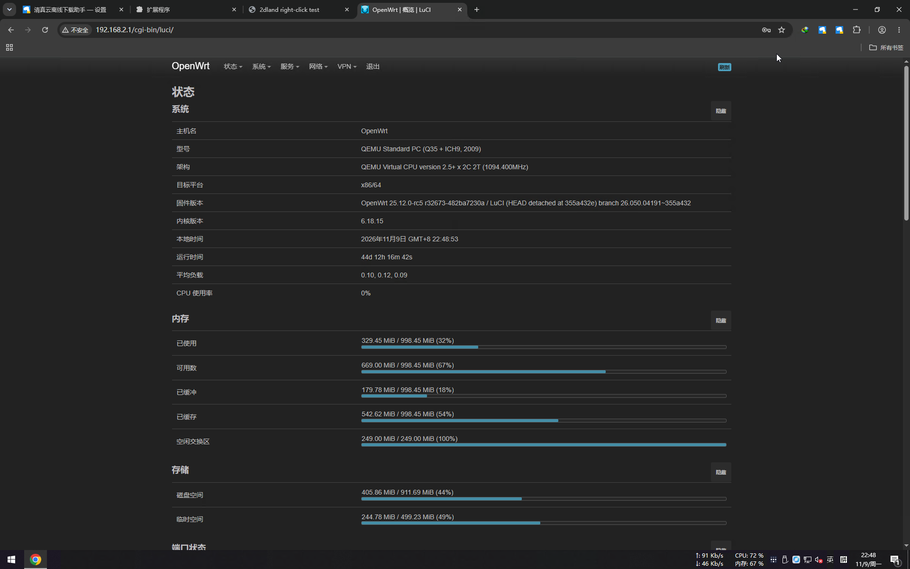
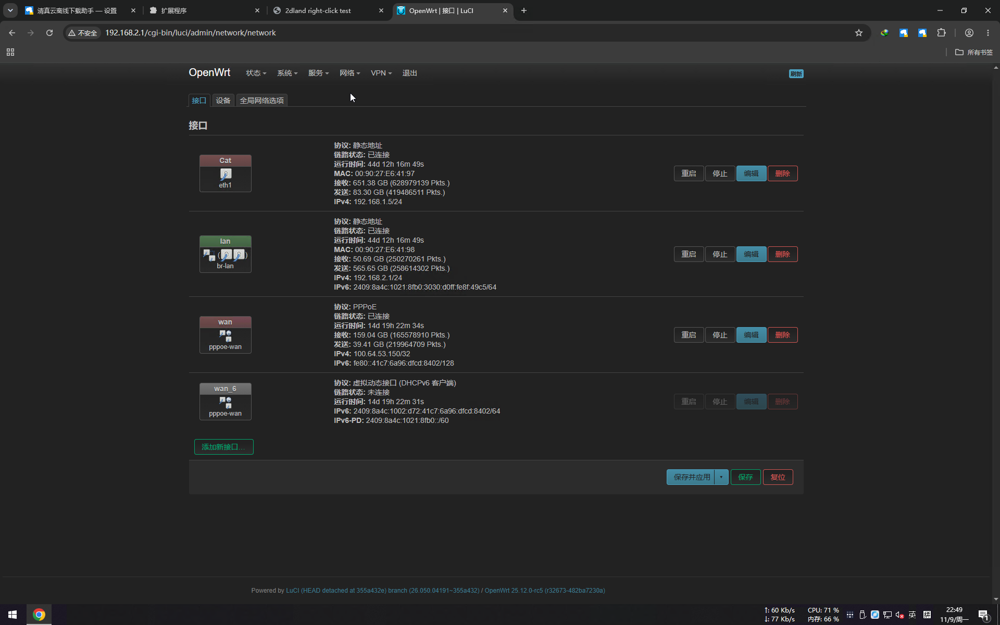
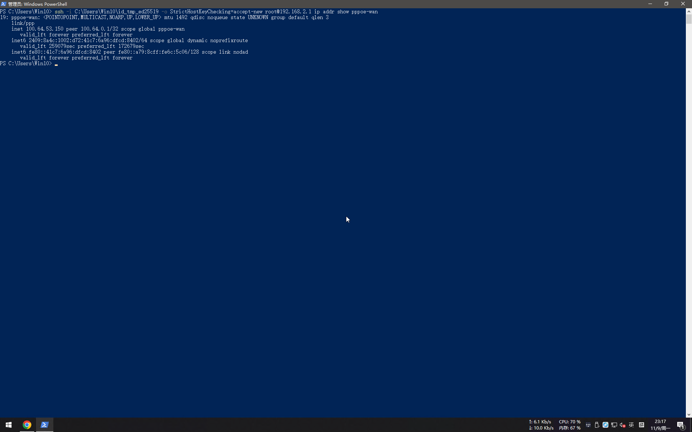
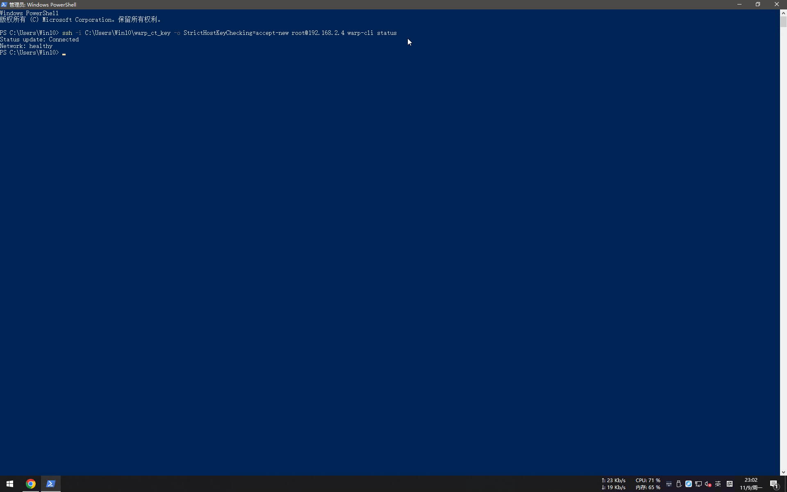

断网时照着做：先分清问题，再恢复。最坏的情况，两步就能回到原来的主路由。

本手册对应家里当前这套设备：N4200 小主机上的 Proxmox VE（简称 PVE）、主路由虚拟机 VM 100、新路由虚拟机 VM 102、旁路由容器 104。地址和编号都按实际配置写，不是通用模板。离线 PDF 版见[家庭网络离线检修手册（PDF）](/your_files/home-network-offline-guide/home-network-offline-guide.pdf)，建议打印一份放在 N4200 小主机旁边。

## 30 秒速查：先看这一框

1. 是不是只有一台设备没网？先看那台设备连的是哪个 Wi-Fi、网关是不是对的。不要动主机。详见「场景 D」。
2. 全家都没网，刚刚切换过新路由？直接回滚：打开 PVE 后台 https://192.168.2.250:8006 ，关 VM 102，开 VM 100。详见「场景 A」。
3. 全家都没网，没动过任何设置？按「场景 B」的顺序查：光猫灯 - VM 100 是否在跑 - 重启 VM 100 - 等 3 分钟再试。
4. 只是收到 104 旁路由丢包告警？多数时候不用处理，更不要为它重启主路由。详见「场景 C」。

记住一句话：外网断了，家里局域网通常还在。PVE 后台在局域网里照样能打开，所以恢复动作不用靠外网，也不用等任何人远程进来。

## 你家网络长什么样

全家的网都从一台 N4200 小主机里出来。主机上跑着 PVE，PVE 里面装着几台虚拟机和容器。真正给全家当主路由的是其中的 VM 100（OpenWrt）。它一停，全家就断网；它正常，家里大多数问题都和它无关。

- 宽带光猫（入户）→ N4200 小主机（PVE 平台）
- VM 100 主路由：192.168.2.1；VM 102 新路由：平时关机备用；CT 104 旁路由：192.168.2.4
- VM 103 Win10：192.168.2.100；VM 101 飞牛：192.168.2.2；PVE 管理口：192.168.2.250
- 手机 / 电视 / 电脑（全家设备）都走 VM 100 上网。

*图：主路由 VM 100 的 LuCI 总览页实拍。OpenWrt 25.12.0-rc5、内核 6.18.15，已连续运行 44 天。*

### 网口是怎么接的，为什么这样接

2 个物理网口直通给了主路由。主机的 2 个物理网口（Intel I211）直接交给 VM 100 用，主路由的网线速度和稳定性不受虚拟网卡影响。以后切换到 VM 102 时，这 2 个网口按原来的顺序移到 VM 102 上。

PVE 管理口在 USB 外接网卡上。当初装 PVE 时先用 USB 网卡当管理口，后来又加了虚拟 VLAN 口。好处是：换主路由、移直通网口时，PVE 本身的管理通道不跟着断，你始终能打开 PVE 后台。

VM 102 平时不开机。它是准备替换 VM 100 的新路由（插件更多）。没切换之前它关着，不会和 VM 100 冲突；只有正式切换时才开机、才接直通网口。

判断影响范围的小窍门：VM 101 飞牛、VM 103 Win10、CT 104 旁路由出问题，一般不会让全家断网。只有 VM 100 和光猫这一段出问题，才会全家一起没网。

## 先分清是哪种断网：5 分钟排查

不要一断网就重启所有东西。先回答下面 3 个问题，顺着走到对应的处理节。整个过程不用拆线、不用改设置。

- 问题 1：只有一台设备没网吗？换一台手机或电脑试试同一个网页 → 去「场景 D」。
- 问题 2：刚刚切换过新路由吗？或者刚刚改过 PVE 里的虚拟机开关 → 去「场景 A」。
- 问题 3：浏览器能打开 192.168.2.1 吗？这是主路由 VM 100 的管理页。能打开 → 去「场景 B」；打不开：主路由可能没在跑 → 先去「进 PVE 后台」看 VM 100 状态，再按「场景 B」处理。

排查时顺手确认这 3 件小事：

1. 看手机连的 Wi-Fi 名字对不对。家里有过实证：手机自己换了一个 Wi-Fi，切出了原来的上网路径，YouTube 打不开，其实网络本身没坏。
2. 看光猫的灯。光信号灯（常标 LOS）红灯闪烁，多半是入户线路或运营商问题，等或报修，本手册后面的重启帮不上忙。
3. 给恢复留时间。主路由重启后，拨号、发地址都需要时间。每次重启后至少等 3 分钟再判断好没好，不要连着反复重启。

## 最重要的技能：进 PVE 后台

后面所有恢复动作都在 PVE 后台里完成。关键在于：PVE 后台走局域网，不走外网。哪怕全家上不了互联网，只要你的手机或电脑还连着家里 Wi-Fi、还能拿到 192.168.2 开头的地址，就能打开它。

浏览器地址栏：https://192.168.2.250:8006

左侧列表按编号找机器，点中一台后看右上角的状态和按钮：

- **100 主路由 VM 100**：状态 running＝正在运行，stopped＝已关机
- **101 飞牛 VM 101**：启动（Start）：把选中的虚拟机开机
- **102 新路由 VM 102**：关机（Shutdown）：正常关机，要等它完全停下
- **103 Win10 VM 103**：停止（Stop）：强制停下，只在关机没反应时用
- **104 旁路由 CT 104**：同上

1. 手机或电脑连上家里 Wi-Fi。确认不是连着邻居网络或手机热点。
2. 打开浏览器，输入 https://192.168.2.250:8006 并回车。
3. 浏览器可能提示证书不安全。点「高级」或「继续前往」，这是你自己家里的设备，正常现象。
4. 用你平时登录 PVE 的账号密码登录。本手册不印密码，密码请单独保管，不要写在这本手册上。
5. 在左侧列表里按编号找机器：100 是老主路由，102 是新路由，104 是旁路由。认编号，不要只认名字。

如果 PVE 后台也打不开：先确认你的设备 IP 是 192.168.2 开头（在 Wi-Fi 详情里看）。如果拿到的不是这个网段，说明主路由的发地址功能已经停了，这时改用网线直连：电脑用网线接到主机或交换机上，并把电脑 IP 手动设为 192.168.2.99、掩码 255.255.255.0，再打开上面的 PVE 地址。还不行，就直接看主机本身：显示器和键盘接上 N4200，确认 PVE 是否还活着。

（PVE 虚拟机列表实拍图待补：PVE 登录开了二次验证，截图时被挡住，拿到图后补上。）

## 场景 A：切换新路由后起不来，一键回滚

这是最需要这本手册的情况。切换就是把 2 个直通网口从 VM 100 移到 VM 102、再开 VM 102。新路由如果拨不上号或配错，全家会断网，远程协助也进不来（远程通道本身也要走主路由）。这时不要慌，VM 100 一直原样保留着，回滚只有两个动作。

1. **关掉新路由 VM 102。**进 PVE 后台，在左侧点中 102，点右上角「关机（Shutdown）」。等 30 秒，看状态变成 stopped（已停止）。如果关机没反应，再用「停止（Stop）」强制停下。必须等它完全停下，才能做下一步——两台路由不能同时抢同一组直通网口。
2. **打开老路由 VM 100。**在左侧点中 100，点「启动（Start）」。然后等 3 分钟：它要重新接管网口、重新拨号、重新给全家设备发地址，这段时间没网是正常的。
3. **验证恢复。**用手机打开任意网页，再试着打开主路由页 192.168.2.1。两个都能开，就是回滚成功。手机如果还连着旧状态，把 Wi-Fi 关掉再打开一次，让它重新拿地址。

回滚成功的标志：VM 100 状态是 running，VM 102 状态是 stopped，手机能上网。做到这一步就停手，不要接着去改 VM 102 的设置。先恢复生活，原因等网络通了再慢慢查。

**回滚口诀：关 102，等停透，开 100，等 3 分钟。**

回滚时最容易犯的 3 个错：

- 102 还没停透就开 100。两台同时开着会抢网口和同一个局域网地址，结果是谁都不好用。顺序永远是：先确认 102 已停止，再开 100。
- 等不及，刚开 100 就反复重启。拨号需要时间，反复重启只会让它一直从头再来。开一次，等满 3 分钟再判断。
- 顺手去删 VM 或改硬件配置。回滚只需要开关机。删除、改网口、改磁盘都不属于回滚动作，一律不要碰（见「红线」）。

切换前最后提醒自己一句：正式切换一定要挑人在家、时间宽裕的时候做。切换的那 10 到 15 分钟里断网是计划内的，不要在临出门或家里正有人开会、考试时切换。

## 场景 B：主路由还在，就是上不了网

没动过设置、突然全家没网，多半出在这一段链路的某一环：光猫 - VM 100 拨号 - 运营商。按下面的顺序逐项处理，一次只做一步，做完等 3 分钟再看效果。

1. **看光猫。**光信号灯红灯闪：是线路或运营商问题，重启光猫一次，等 5 分钟；还红就打运营商报修电话，后面几步先不用做。灯正常，继续下一步。
2. **确认 VM 100 在跑。**进 PVE 后台看 100 的状态。如果是 stopped，点「启动」，等 3 分钟再试上网。如果是 running，继续下一步。
3. **重启 VM 100 一次。**在 PVE 里对 100 点「关机」，等它完全停止后再「启动」。或者打开主路由页 192.168.2.1，在里面选重启。两种方式选一种就行，不要两种连着做。
4. **查拨号状态。**打开 192.168.2.1 登录主路由，在网络接口页面看宽带连接（PPPoE）有没有拿到地址。长时间拿不到，多半是运营商侧或宽带账号侧的问题，不要反复修改路由器里的宽带密码——VM 100 的备份里配置是完整的，乱改只会添乱。

*图：主路由的网络接口页实拍。lan 是 192.168.2.1/24，wan（PPPoE）已连接，拿到地址 100.64.53.150。查拨号就看这一页。*

*图：命令行核对 PPPoE 地址实拍。pppoe-wan 拿到 100.64.53.150，说明拨号正常。*

5. **最后才考虑重启整台主机。**只有 PVE 后台里虚拟机全无反应时，才在 PVE 里对主机执行重启。绝对不要直接拔 N4200 的电源——虚拟机和飞牛里的文件都怕突然断电。主机重启后所有虚拟机要等几分钟才陆续恢复，先等 5 分钟再判断。

一个有用的对照：如果主路由页 192.168.2.1 能打开、家里设备之间也能互相访问，只是打不开外面的网站，说明局域网是好的，坏的是外网这一段。按上面第 1、4 步查光猫和拨号即可，不要去动 PVE 里的虚拟机开关。

## 场景 D：只有某台设备没网

别人都能上网、只有一台不行，问题就在这台设备自己身上，和主路由、PVE 都没关系。

1. 看它连的 Wi-Fi 名字是不是家里的那个，有没有自动连到别的网络。
2. 关掉它的 Wi-Fi 再打开，让它重新拿地址；还不行就「忘记此网络」后重新输密码连接。
3. 看它拿到的地址：应该是 192.168.2 开头，网关应该是 192.168.2.1。如果这台设备是特意走旁路由的，网关才会是 192.168.2.4；普通设备网关写成 192.168.2.4 而 104 又出问题时，就会表现为只有它没网——把它的网关改回自动获取即可。
4. 重启这台设备本身。做到这一步基本都能好，不需要动任何主机设置。

## 场景 C：旁路由 104 和 WARP 丢包告警

你会经常收到 104 旁路由的健康告警，又经常看到它自己恢复。这不等于家里网络坏了，先把原理说清，省得每次都紧张。

### 104 是干什么的，坏了影响谁

104 是一个 LXC 容器（编号 104，地址 192.168.2.4），里面跑着 Cloudflare WARP 隧道，给特意把网关设成 192.168.2.4 的设备走一条特殊出口。普通设备网关是 192.168.2.1，根本不经过 104。所以 104 出问题，不会让全家断网，最多是那几台走旁路由的设备访问某些网站变慢或打不开，把那台设备的网关改回 192.168.2.1 就能先恢复普通上网。

*图：旁路由 104 上查 WARP 状态实拍。warp-cli status 显示 Connected、Network healthy，说明隧道本身是通的。*

### 为什么告警老是反复横跳

- 检查方法本身很敏感。健康检查每次只发 10 个测试包，丢 2 个就是 20%，正好踩到告警线。所以它会在「告警、恢复、告警」之间来回跳，数字看着吓人，不代表隧道断了。
- 104 连的那台海外服务器下行本身有丢包。已经实测过：它连的洛杉矶服务器回程持续丢包约一成多。你手机上的 CF One 连的是另一台干净的服务器，所以手机从没出过这个问题——不是容器不稳定，是两边连的服务器不一样。
- 主机 CPU 被抢。N4200 一共就那么多算力，Win10 虚拟机忙的时候能占掉大半，隧道就抢不到 CPU，丢包跟着变高。不用 Win10 的时候把它关掉，104 的丢包会明显好转。

### 收到告警时怎么做

1. 先试一下正常上网。如果网页、视频都正常，什么都不用做，等下一轮检查，它大概率自己恢复。
2. 如果走旁路由的设备确实打不开网站，先把那台设备的网关临时改回 192.168.2.1 恢复上网，104 的事之后再说。
3. 想处理 104 时，进 PVE 后台看 104 是不是 running。是 running 就先等 10 分钟观察，不要急着重启主路由——重启 VM 100 对 104 的丢包没有任何帮助。

不要做的事：不要因为 104 的告警去重启 VM 100、去改主路由设置、或者去拔主机电源。那是拿全家网络去赌一个旁路小问题，得不偿失。

## 红线：这些事不要做

- 不要删除任何虚拟机或容器。尤其是 VM 100，它是全家网络的命根子，也是回滚的退路，任何时候都只关机、不删除。
- 不要同时开着 VM 100 和 VM 102 当主路由。两台都拿着 192.168.2.1 会直接冲突。切换和回滚都遵循同一条：先关一台，确认停透，再开另一台。
- 不要改直通网口的顺序和归属，除非正在按切换方案操作。2 张 Intel I211 直通网口的顺序是固定的，平时在 PVE 里看到硬件配置不要顺手调整。
- 不要直接拔 N4200 电源，不要长按电源键强关。要关整机，先关虚拟机，再在 PVE 里关机。
- 不要乱改主路由里的宽带账号密码。VM 100 的配置备份已经完整导出并保存好了（包含宽带、防火墙、DHCP 和插件配置）。真需要恢复配置时，用备份恢复，不要凭记忆手填。
- 看到不认识的欢迎向导或初始化页面，先停手。不要一路点「继续」。有些插件的配置丢了会弹出向导，盲点继续可能把原来的配置覆盖掉。拍个照，等网络恢复后再处理。
- 不要把这本手册和密码放在一起。手册里只有地址和步骤，没有密码；密码单独保管。

## 最后一页：地址速查卡

- **PVE 后台（恢复的总入口）**：https://192.168.2.250:8006
- **主路由管理页**：192.168.2.1（VM 100）
- **老主路由（回滚目标）**：VM 100 - 只关机，不删除
- **新路由（切换目标）**：VM 102 - 平时关机备用
- **旁路由 WARP**：CT 104 - 192.168.2.4
- **飞牛 NAS**：VM 101 - 192.168.2.2
- **Win10 测试机**：VM 103 - 192.168.2.100

**回滚口诀：关 102，等停透，开 100，等 3 分钟。**

求助时先说清这 3 件事：全家没网还是只有一台、刚刚有没有切换或改过开关、光猫的灯是不是红的。说清这 3 件，对方就能直接判断卡在哪一段。

建议：把地址速查卡单独打印，贴在 N4200 小主机旁边的墙上。断网时最需要的就是这一页，其他页慢慢看。
