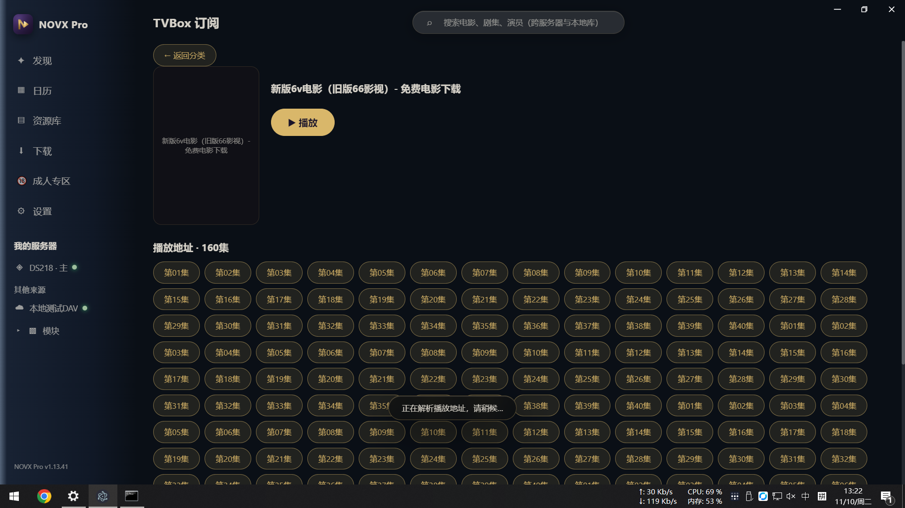
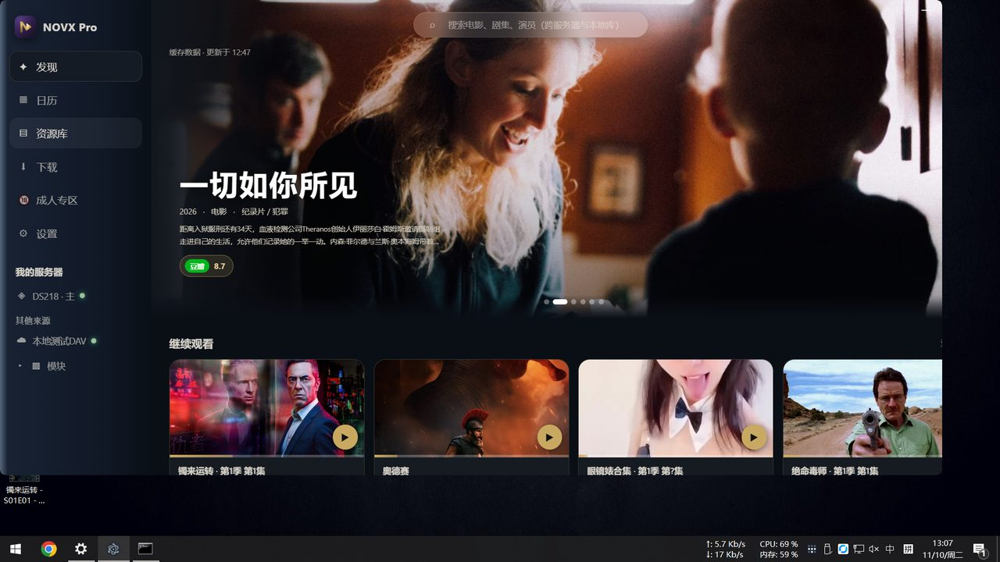
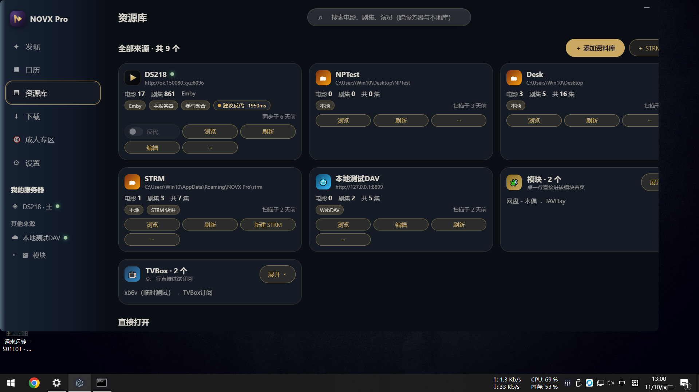

## NOVX Pro 1.0.110-test 已交付

- **NOVX Pro 1.0.110-test**：草稿 Release 439942966（tag v1.0.110-test，draft true）。内容：F11 R1+R2+R5——圆角调度器串行（createCornerScheduler）＋退全屏 150ms 后 force 刷新圆角＋单测；含 1.0.109 全部内容（xb6v 全屏键盘：空格/方向键/F 经 NP-EVT 回传）。文件 NOVX.Pro.v1.0.110-test-win-unpacked.zip，272,152,237 字节，SHA256 `329d5782f9ee836a4df12f8732dc43db0f34747fa77668e54e75cc4487d15ffa`。asar 39,565,796 字节，SHA256 `dbb339b9d24f3ad3d5771d01dd2a21924614b3aabc4461266ef6e463ae1378cf`。
- **下载直链（测试版草稿，用户 2026-11-10 14:03 明确要求破例放进博客）**：https://github.com/aliporcins/nova-player/releases/download/untagged-c60e5080e583e94bdacb/NOVX.Pro.v1.0.110-test-win-unpacked.zip

## F11：第一次按进全屏仍错乱（用户真机反馈，待修）

- 1.0.110 上第一次按 F11 进全屏，窗口错乱且不恢复：内容整体往左上偏、右边被截断、窗口底部没贴到屏幕底（露出桌面壁纸）、右边竖着别的窗口。再按一次 F11 退出来，能恢复正常。
- 1.0.110 的 R1+R2 只修了退全屏路径，进全屏方向仍有问题。VM 测试正在查主窗日志（wincorner 行）定因；1.0.111 已立项修进全屏（拦截 F11，先同步清圆角区域再切全屏）。

## 2dland Worker：两处改动已上线

- **/tasks 返回加字段**（2026-11-10 12:26）：每项加 code、message、bytes_processed、bytes_total。
- **失败判定改成按进度判**（2026-11-10 12:44）：classifyTask——done＝progress≥100 或 status 5；failed 仅当服务端返回明确失败 code/message，或 progress 0 且 size 0 卡住超 10 分钟；其余未完成一律 downloading。谷雨任务（The Silent Storm S01，2160p）已从 failed 改回 downloading：服务端未返回失败原因，任务从未开始下载（progress 0、size 0），最可能是磁力链无可用 peer。

## 2dland 插件 v1.1.0：代码审查完成

- 2026-11-10 13:44 完成。查出 4 个真实问题，均已修掉：校验密钥硬编码在源码里还复制两份→单份 config.js；content script 常驻所有页面→按需注入；popup.js 用 innerHTML 拼服务端数据→DOM API；Worker 向任意源开放 CORS→已删响应头（仅改本地，未部署）。
- 版本仍为 1.1.0，未打包、未部署。

## 2dland 任务状态同步问题（用户反馈，待修）

- 2dland 网页上任务“异类.6v电影”已下载完成 1.6 GB，NOVX 播放器下载页里同一条还显示“下载中 0%”。已进 1.0.111 修：播放器显示层问题，Worker 不动。

## 1.0.111-test 正在构建

- 在建内容：F11 进全屏修法、2dland 状态显示修法、NSIS exe 安装包、去掉下载页“后台任务 (v136)”里的版本号、下载页预览截图、下载板块布局优化。

## 没进博客的东西

- （无）1.0.110-test 草稿直链原按惯例不进博客与图书馆，用户 2026-11-10 14:03 明确要求破例放进，已补在上文 1.0.110-test 一节。
