今天 15 款付费 App 限时免费，原价加起来约 45 美元；另外还有 8 个终身内购可用兑换码 0 元领，原价加起来约 148 美元。都是今天刚确认的，限免随时可能结束，看到喜欢的就领。

## 今日极力推荐

1. **Anima Camera** — 评分 5.0，原价 $4.99，Anima 将 48MP 分辨率与闪光灯相结合，创造出疯狂的效果！
2. **Off Day** — 评分 5.0，原价 $3.99，「休息日」是一个开源项目
3. **AnyScale - Tunings & Scales** — 评分 4.8，原价 $3.99，Any Scale 是一款综合性的吉他音阶和​​调音应用程序，适合任何人……

## 付费应用限时免费（15 款）

点链接进 App Store 点“获取”就行。领的时候只点“获取”，不要买任何内购。

### 摄影与录像（2 款）

#### 1. Anima Camera

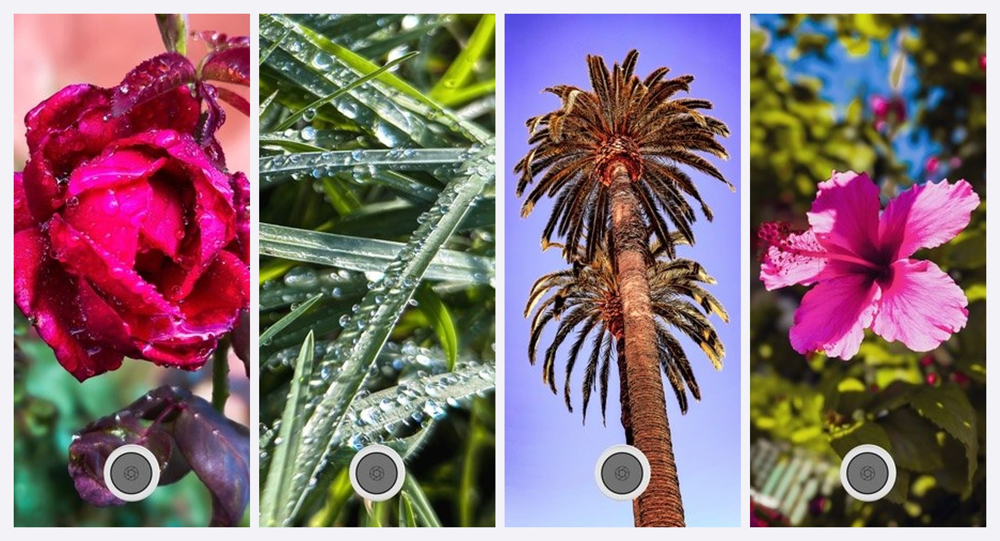

- **原价**：$4.99，现在免费
- **评分**：★5.0 (1)
- **支持设备**：iPhone / iPad / iPod touch
- **最低系统**：iOS 26.0
- **干什么的**：Anima 将 48MP 分辨率与闪光灯相结合，创造出疯狂的效果！
- **领取**：[在 App Store 打开](https://apps.apple.com/us/app/id6751657083)

!carousel

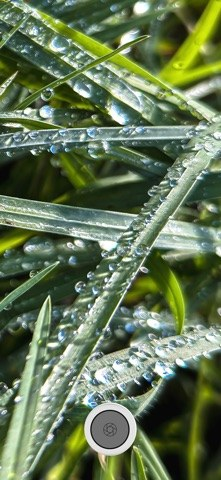

#### 2. Merge Videos - Compilation

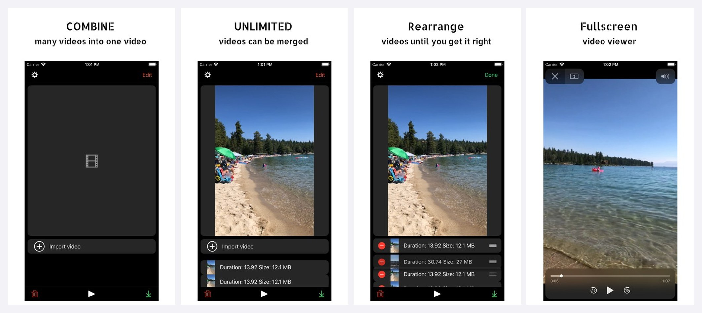

- **原价**：$2.99，现在免费
- **评分**：★4.1 (1,728)
- **支持设备**：iPhone / iPad / iPod touch
- **最低系统**：iOS 17.0
- **干什么的**：这个应用程序非常适合创建故事，特别是如果您已经录制了……
- **领取**：[在 App Store 打开](https://apps.apple.com/us/app/id1278169874)

!carousel
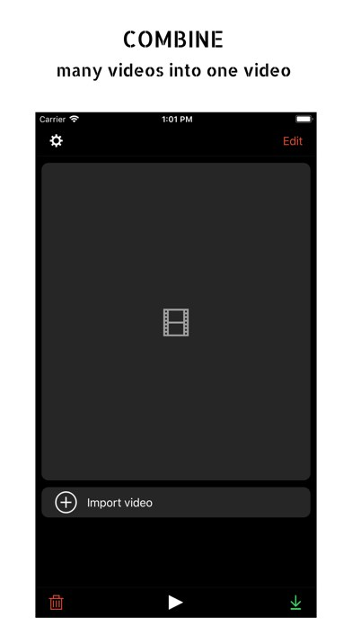
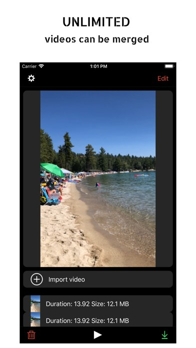

### 生活（1 款）

#### 1. Off Day

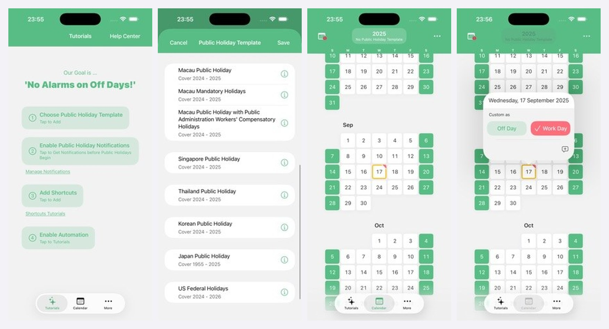

- **原价**：$3.99，现在免费
- **评分**：★5.0 (34)
- **支持设备**：iPhone / iPad / iPod touch
- **最低系统**：iOS 16.0
- **干什么的**：「休息日」是一个开源项目
- **领取**：[在 App Store 打开](https://apps.apple.com/us/app/id6501973975)

!carousel
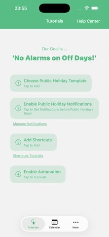
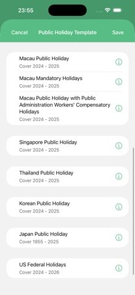

### 音乐（1 款）

#### 1. AnyScale - Tunings & Scales

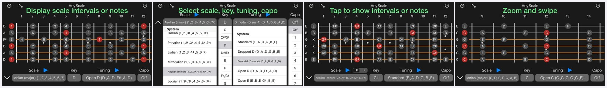

- **原价**：$3.99，现在免费
- **评分**：★4.8 (24)
- **支持设备**：iPhone / iPad / iPod touch
- **最低系统**：iOS 13.0
- **干什么的**：Any Scale 是一款综合性的吉他音阶和​​调音应用程序，适合任何人……
- **领取**：[在 App Store 打开](https://apps.apple.com/us/app/id1513089417)

!carousel
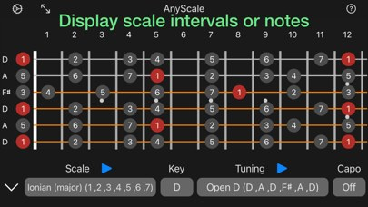
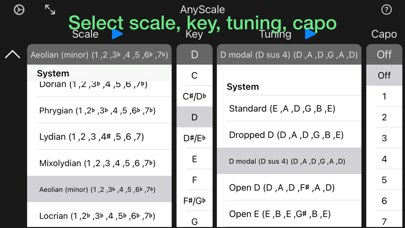

### 效率工具（3 款）

#### 1. Check It Again

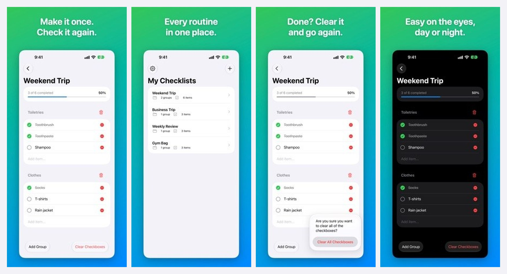

- **原价**：$2.99，现在免费
- **评分**：★5.0 (8)
- **支持设备**：iPhone / iPad / iPod touch / Mac
- **最低系统**：iOS 17.6
- **干什么的**：Check It Again 是一款极其简单的清单 App，专为那些你一遍又一遍要做的事而设计
- **领取**：[在 App Store 打开](https://apps.apple.com/us/app/id6760605393)

!carousel
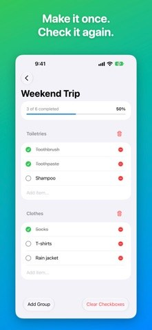
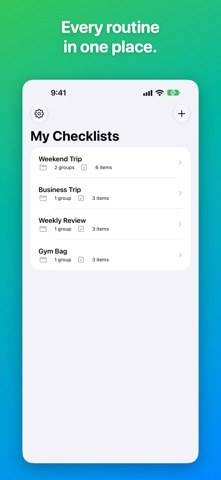

#### 2. Pros n Cons

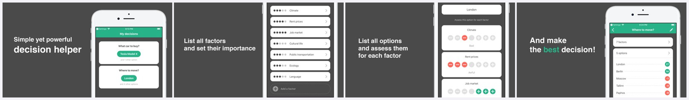

- **原价**：$2.99，现在免费
- **评分**：★4.1 (36)
- **支持设备**：iPhone / iPad / iPod touch
- **最低系统**：iOS 13
- **干什么的**：优点和缺点 - 简单但功能强大的决策助手。
- **领取**：[在 App Store 打开](https://apps.apple.com/us/app/id668357845)

!carousel

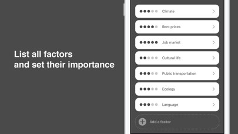

#### 3. Seedling Daily Planner

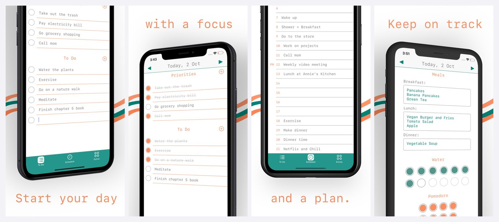

- **原价**：$1.99，现在免费
- **评分**：★4.4 (76)
- **支持设备**：iPhone / iPad / iPod touch
- **最低系统**：iOS 13.0
- **干什么的**：早上你能做的最好的事情之一就是以……开始新的一天。
- **领取**：[在 App Store 打开](https://apps.apple.com/us/app/id1516093618)

!carousel
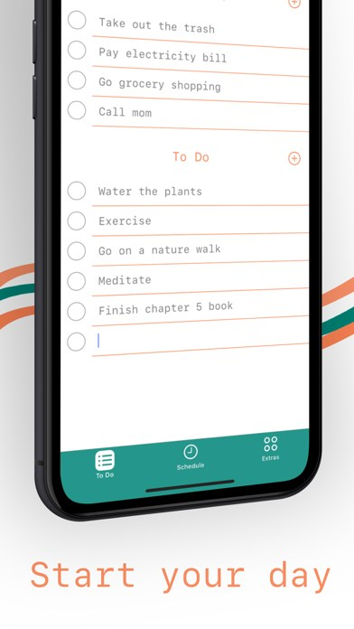
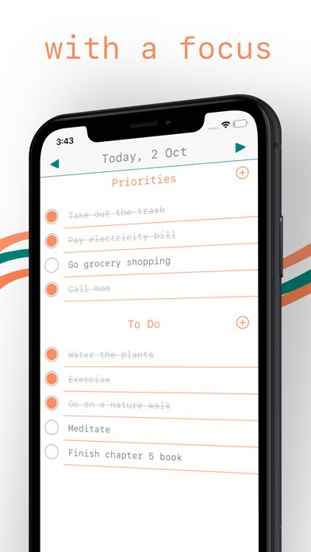

### 健康健美（1 款）

#### 1. WorkoutSpot

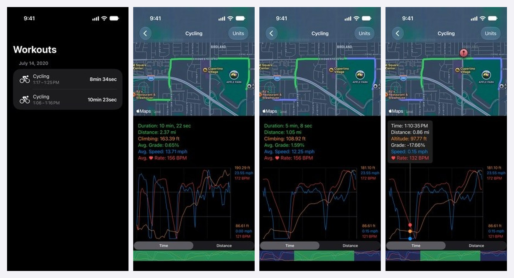

- **原价**：$2.99，现在免费
- **评分**：★5.0 (4)
- **支持设备**：iPhone / iPad / iPod touch
- **最低系统**：iOS 16.0
- **干什么的**：WorkoutSpot 允许您分析锻炼的任何点或部分......
- **领取**：[在 App Store 打开](https://apps.apple.com/us/app/id1529681363)

!carousel

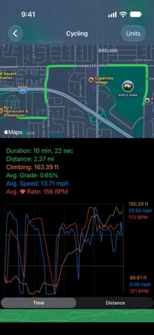

### 财务（1 款）

#### 1. Compound Interest Calculation+

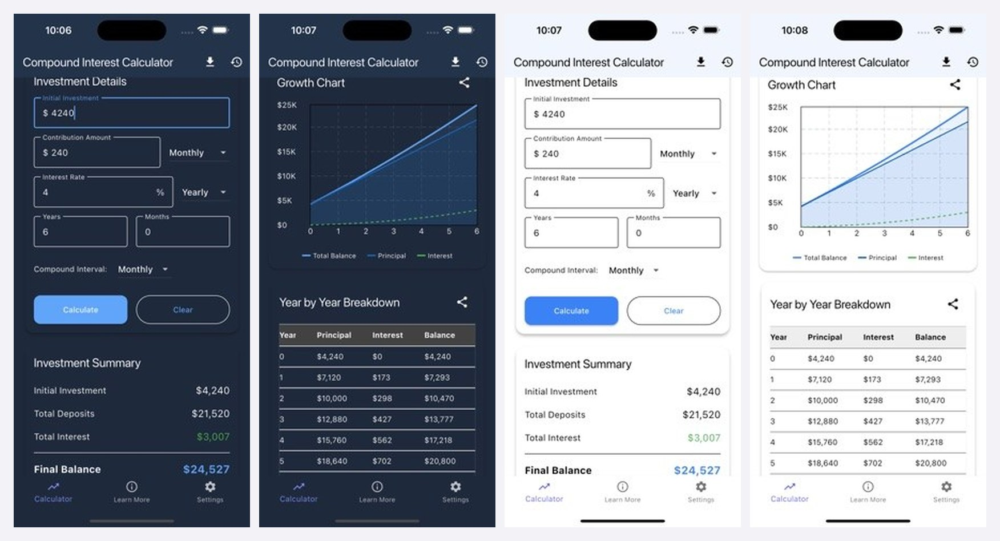

- **原价**：$2.99，现在免费
- **评分**：★5.0 (4)
- **支持设备**：iPhone / iPad / iPod touch
- **最低系统**：iOS 12.0
- **干什么的**：探索我们最先进的化合物 I 的复合力量……
- **领取**：[在 App Store 打开](https://apps.apple.com/us/app/id6743874787)

!carousel
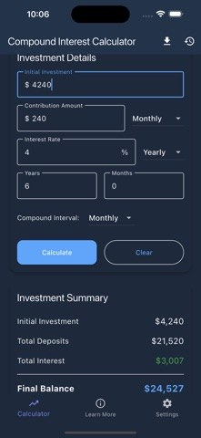
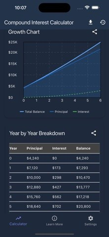

### 教育（1 款）

#### 1. Baba Piano - Music & Spelling

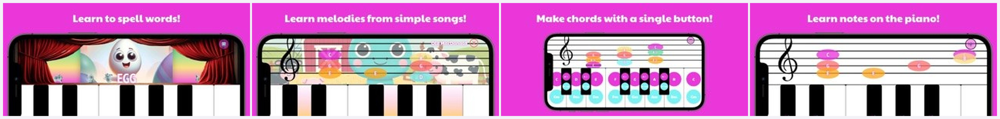

- **原价**：$2.99，现在免费
- **评分**：★5.0 (3)
- **支持设备**：iPhone / iPad / iPod touch
- **最低系统**：iOS 15.0
- **干什么的**：欢迎来到巴巴的钢琴，这是一种神奇的学习和娱乐乐器……
- **领取**：[在 App Store 打开](https://apps.apple.com/us/app/id6504294358)

!carousel

### 开发者工具（1 款）

#### 1. Arduino Bluetooth Pro

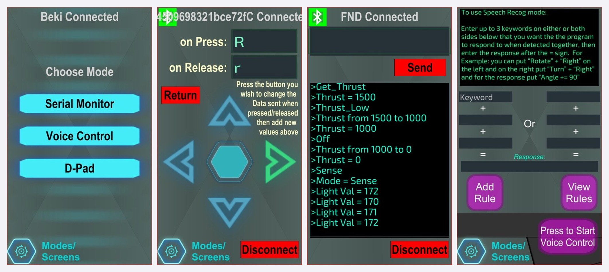

- **原价**：$2.99，现在免费
- **评分**：★4.7 (34)
- **支持设备**：iPhone / iPad / iPod touch
- **最低系统**：iOS 12.0
- **干什么的**：用于 Arduino Projects Connect 的高端、可定制的蓝牙控制...
- **领取**：[在 App Store 打开](https://apps.apple.com/us/app/id1111181830)

!carousel
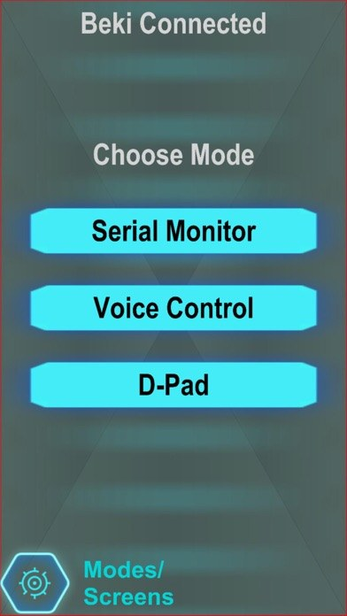
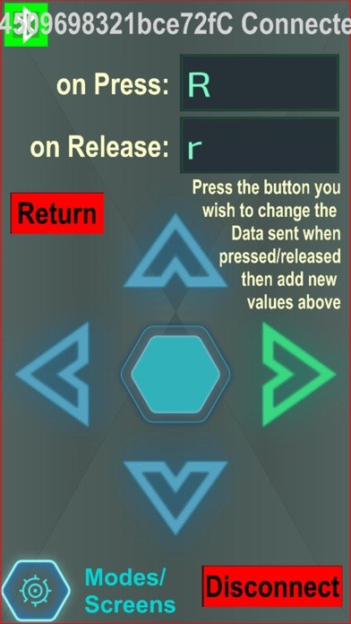

### 参考（1 款）

#### 1. Offline AI Bird Identifier

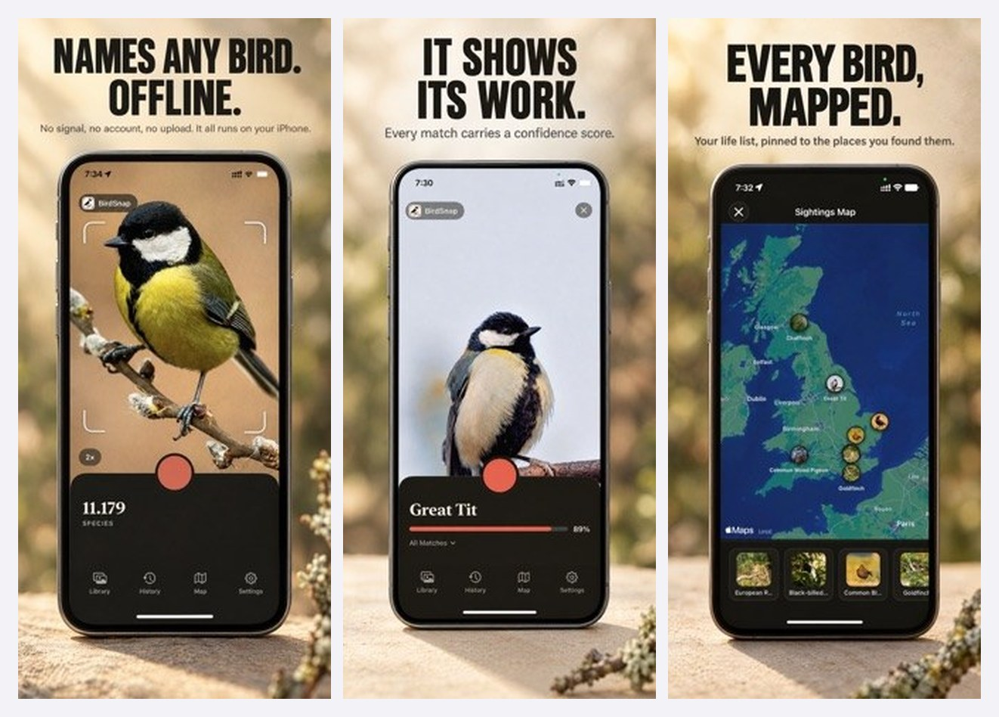

- **原价**：$2.99，现在免费
- **评分**：★3.0 (6)
- **支持设备**：iPhone / iPad / iPod touch
- **最低系统**：iOS 17.5
- **干什么的**：在没有互联网连接的情况下，从照片中识别 11,179 种鸟类……
- **领取**：[在 App Store 打开](https://apps.apple.com/us/app/id6572327360)

!carousel
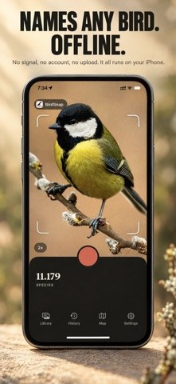
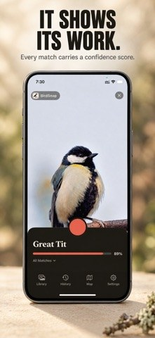

### Book（1 款）

#### 1. Poog The Polar Bear

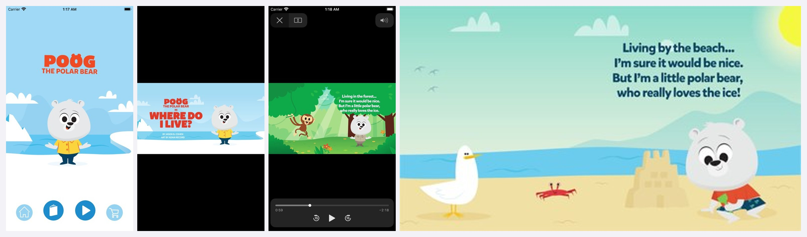

- **原价**：$1.99，现在免费
- **评分**：★5.0 (2)
- **支持设备**：iPhone / iPad / iPod touch
- **最低系统**：iOS 17.6
- **干什么的**：普格是一只友好而好奇的小北极熊，渴望探索……
- **领取**：[在 App Store 打开](https://apps.apple.com/us/app/id1538322670)

!carousel
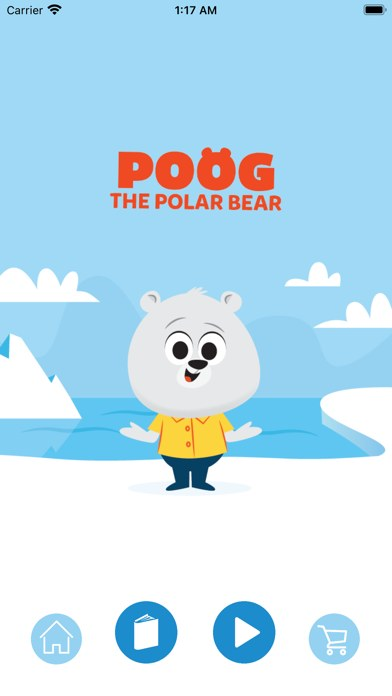

### 工具（1 款）

#### 1. GoFTP Server

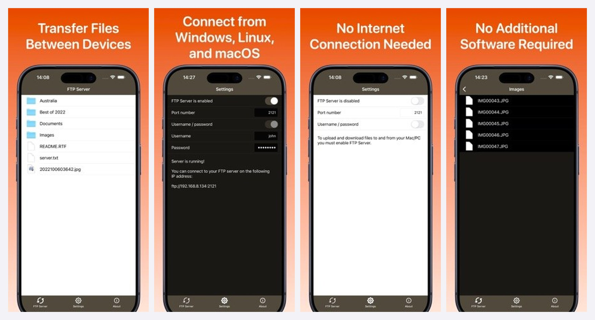

- **原价**：$1.99，现在免费
- **评分**：★4.8 (68)
- **支持设备**：iPhone / iPad / iPod touch
- **最低系统**：iOS 12.0
- **干什么的**：GoFTP 服务器可让您在移动设备之间无缝共享文件...
- **领取**：[在 App Store 打开](https://apps.apple.com/us/app/id1610864726)

!carousel
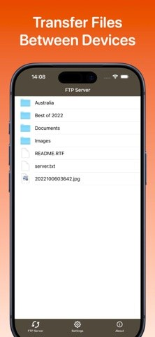
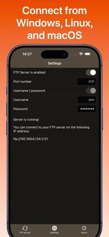

### 社交（1 款）

#### 1. Code Drawer

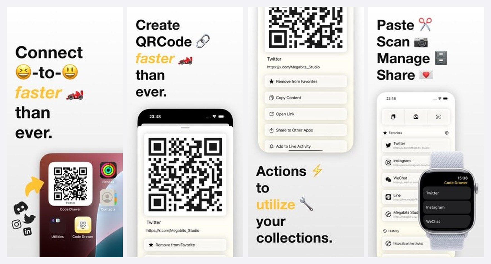

- **原价**：$1.99，现在免费
- **评分**：★4.2 (24)
- **支持设备**：iPhone / iPad / iPod touch / Mac / Apple Watch
- **最低系统**：iOS 18.0
- **干什么的**：Code Drawer 是一款一体化的二维码工具包。
- **领取**：[在 App Store 打开](https://apps.apple.com/us/app/id1438149621)

!carousel

## 终身内购 0 元兑换（8 个）

这几个不是商店里直接降价到 0 元，而是开发者发的公开兑换码：点帖子里的兑换链接直接进 App Store 兑。每个兑换码一个 Apple 账号只能用一次，都是终身解锁、不是订阅，不会续费。

**怎么领**：先装上对应的免费 App → 点该款下面的兑换链接 → 自动跳到 App Store 兑换页，确认就行。不用绑卡，没有试用期。没有兑换链接的款，暂时只能先装 App，等开发者放出公开码。

### 游戏（1 个）

#### 1. Ringo: Water Ring Toss

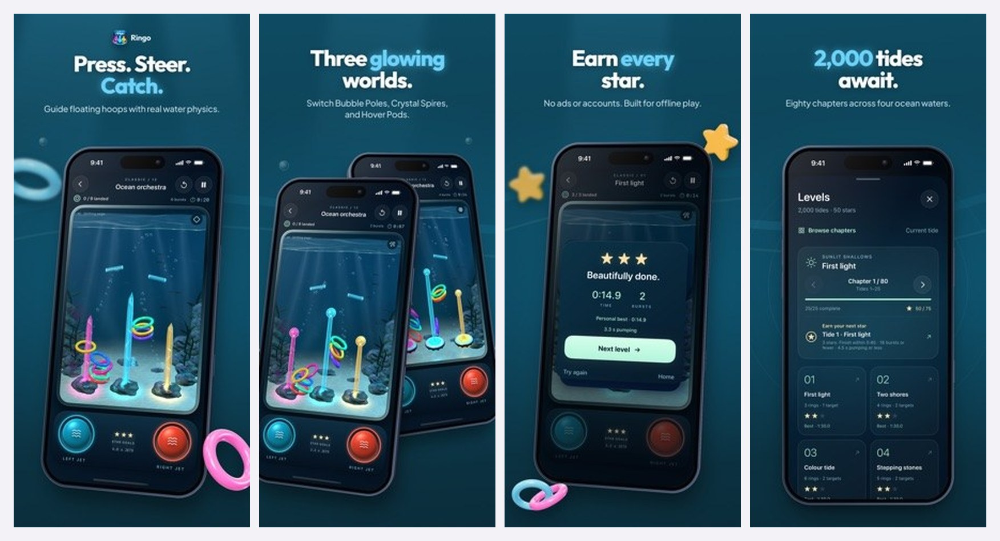

- **内购**：Ringo Pro
- **原价**：$2.99，兑换码 0 元领
- **评分**：暂无评分
- **支持设备**：iPhone / iPad / iPod touch
- **干什么的**：一个小水玩具。
- **最低系统**：iOS 17.0
- **兑换链接**：[点这里兑换](https://apps.apple.com/redeem?ctx=offercodes&id=6822308678&code=FRIEND5)
- **App 链接**：[在 App Store 打开](https://apps.apple.com/us/app/id6822308678)
!carousel

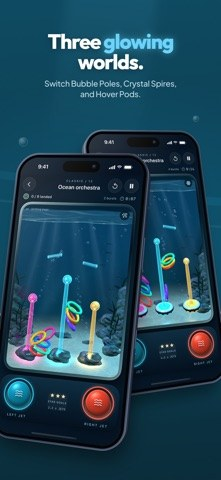

### 教育（1 个）

#### 1. Ni Hao Bolo

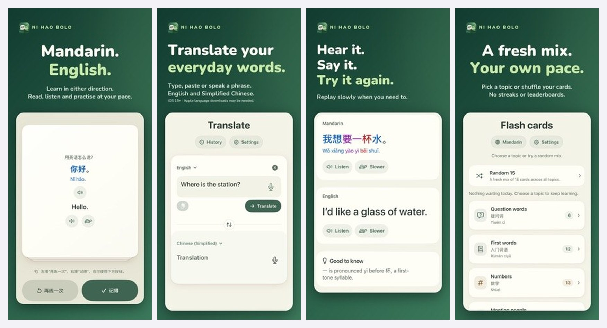

- **内购**：Ni Hao Bolo Pro
- **原价**：$9.99，兑换码 0 元领
- **评分**：暂无评分
- **支持设备**：iPhone / iPad / iPod touch
- **干什么的**：从英语中学习有用的普通话，或者用普通话练习英语……
- **最低系统**：iOS 17.0
- **兑换链接**：[点这里兑换](https://apps.apple.com/redeem?ctx=offercodes&id=6827587342&code=FRIEND5)
- **App 链接**：[在 App Store 打开](https://apps.apple.com/us/app/id6827587342)
!carousel

### 健康健美（1 个）

#### 1. Petals: Period & Cycle Tracker

- **内购**：Lifetime Plus Family
- **原价**：$49.99，兑换码 0 元领
- **评分**：★4.9 (7)
- **支持设备**：iPhone / iPad / iPod touch
- **干什么的**：您的周期，详细记录下来。
- **最低系统**：iOS 18.6
- **兑换链接**：[点这里兑换](https://apps.apple.com/redeem?ctx=offercodes&id=6751436384&code=GETFREEPETALS)
- **App 链接**：[在 App Store 打开](https://apps.apple.com/us/app/id6751436384)
!carousel

### 效率工具（1 个）

#### 1. Floaty: Lock Screen Essentials

- **内购**：Floaty Pro Lifetime
- **原价**：$49.99，兑换码 0 元领
- **评分**：★5.0 (5)
- **支持设备**：iPhone / iPad / iPod touch
- **干什么的**：此刻所需，尽在浮现
- **最低系统**：iOS 17.0
- **兑换链接**：[点这里兑换](https://apps.apple.com/redeem?ctx=offercodes&id=6825604929&code=GGFPL2K15)
- **App 链接**：[在 App Store 打开](https://apps.apple.com/us/app/id6825604929)
!carousel

### 工具（1 个）

#### 1. FamilyDay - Days for Family

- **内购**：FamilyDay Lifetime
- **原价**：$6.99，兑换码 0 元领
- **评分**：暂无评分
- **支持设备**：iPhone / iPad / iPod touch
- **干什么的**：把重要的日子留给家人
- **最低系统**：iOS 17.0
- **兑换链接**：[点这里兑换](https://apps.apple.com/redeem?ctx=offercodes&id=6825604711&code=FAMILYDAY500REDNOTE)
- **App 链接**：[在 App Store 打开](https://apps.apple.com/us/app/id6825604711)
!carousel

### 财务（1 个）

#### 1. Lumori: Bills & Subscriptions

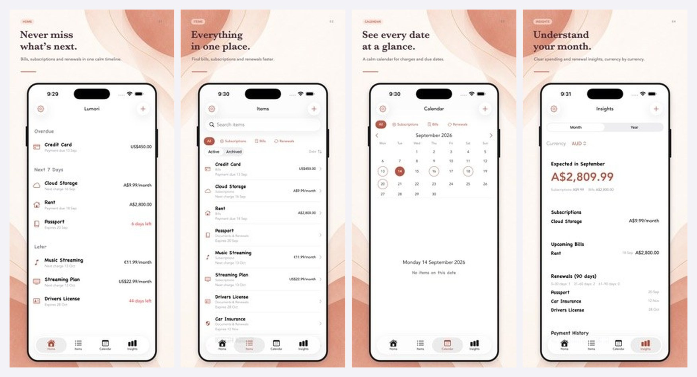

- **内购**：Lumori Pro Lifetime
- **原价**：$12.99，兑换码 0 元领
- **评分**：★5.0 (4)
- **支持设备**：iPhone / iPad / iPod touch
- **干什么的**：提前知道，接下来要处理什么
- **最低系统**：iOS 17.0
- **兑换链接**：[点这里兑换](https://apps.apple.com/redeem?ctx=offercodes&id=6797824934&code=LUMORI)
- **App 链接**：[在 App Store 打开](https://apps.apple.com/us/app/id6797824934)
!carousel

### 社交（1 个）

#### 1. Seesaw: A Place for Two

- **内购**：Six conversations
- **原价**：$9.99，兑换码 0 元领
- **评分**：★5.0 (5)
- **支持设备**：iPhone / iPad / iPod touch
- **干什么的**：你身边最亲近的人一直在改变，但没有什么能告诉你如何改变。
- **最低系统**：iOS 15.1
- **兑换链接**：[点这里兑换](https://apps.apple.com/redeem?ctx=offercodes&id=6755359501&code=DATENIGHT)
- **App 链接**：[在 App Store 打开](https://apps.apple.com/us/app/id6755359501)
!carousel

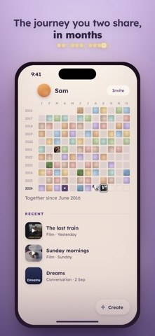

### 音乐（1 个）

#### 1. Offline Music Player Pro

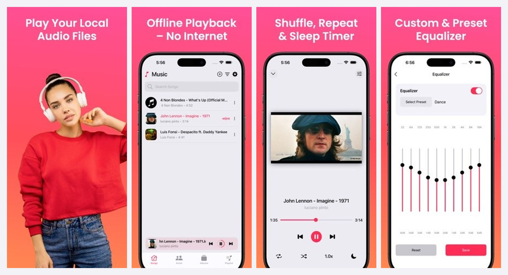

- **内购**：Lifetime Pro
- **原价**：$4.99，兑换码 0 元领
- **评分**：★4.4 (30)
- **支持设备**：iPhone / iPad / iPod touch
- **干什么的**：随时随地享受您的音乐。
- **最低系统**：iOS 15.0
- **兑换链接**：[点这里兑换](https://apps.apple.com/redeem?ctx=offercodes&id=6749329943&code=BKHBFH)
- **App 链接**：[在 App Store 打开](https://apps.apple.com/us/app/id6749329943)
!carousel

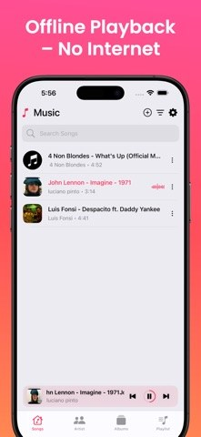

---

限免结束时间苹果不公布，一般 1–3 天，尽快领。
