今天 15 款付费 App 限时免费，原价加起来约 35 美元；另外还有 8 个终身内购可用兑换码 0 元领，原价加起来约 170 美元。都是今天刚确认的，限免随时可能结束，看到喜欢的就领。

## 今日极力推荐

1. **Super Investor: SEC Filings** — 评分 4.0，原价 $9.99，Key benefits of reading SEC filings: * Investor Confidence: SEC filing…
2. **Escanear Codigos QR** — 评分 5.0，原价 $4.99，Experience the fastest and most stylish scanning utility on the App St…
3. **PQ Calc** — 评分 5.0，原价 $4.99，PQ Calc converts between light levels and video code values on the PQ…

## 付费应用限时免费（15 款）

点链接进 App Store 点“获取”就行。领的时候只点“获取”，不要买任何内购。

### 1. Super Investor: SEC Filings

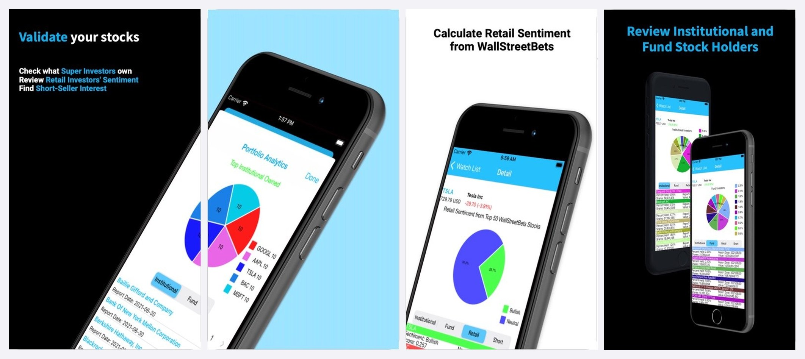

- **原价**：$9.99，现在免费
- **评分**：★4.0 (12)
- **支持设备**：iPhone / iPad / iPod touch
- **最低系统**：iOS 26.0
- **干什么的**：Key benefits of reading SEC filings: * Investor Confidence: SEC filing…
- **领取**：[在 App Store 打开](https://apps.apple.com/us/app/id1441737952)

!carousel

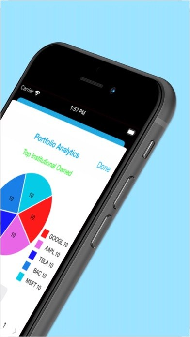

### 2. Escanear Codigos QR

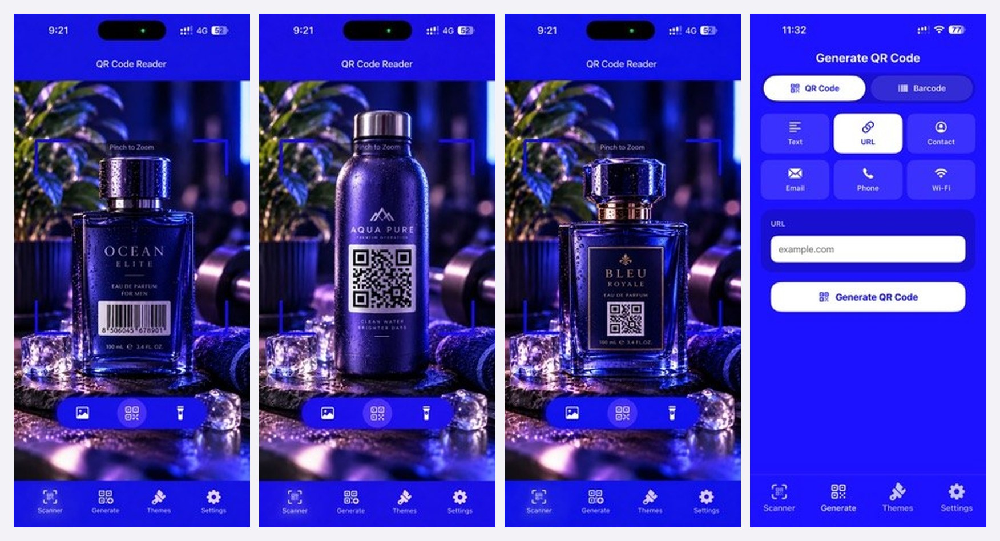

- **原价**：$4.99，现在免费
- **评分**：★5.0 (21)
- **支持设备**：iPhone / iPad / iPod touch
- **最低系统**：iOS 17.6
- **干什么的**：Experience the fastest and most stylish scanning utility on the App St…
- **领取**：[在 App Store 打开](https://apps.apple.com/us/app/id6755494105)

!carousel

### 3. PQ Calc

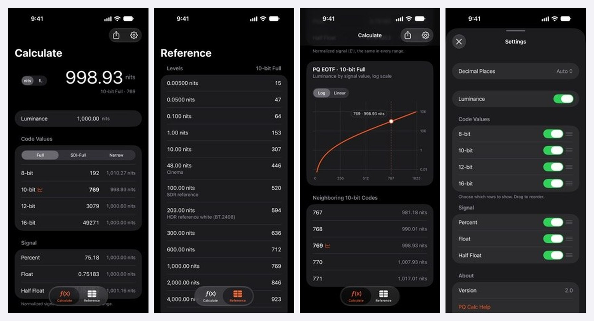

- **原价**：$4.99，现在免费
- **评分**：★5.0 (2)
- **支持设备**：iPhone / iPad / iPod touch / Mac
- **最低系统**：iOS 27.0
- **干什么的**：PQ Calc converts between light levels and video code values on the PQ…
- **领取**：[在 App Store 打开](https://apps.apple.com/us/app/id1541419476)

!carousel
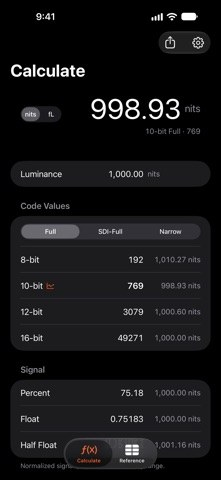
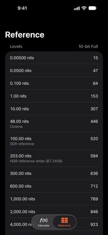

### 4. Fotospot Road Trip Community

- **原价**：$4.99，现在免费
- **评分**：★4.8 (4,055)
- **支持设备**：iPhone / iPad / iPod touch
- **最低系统**：iOS 16.6
- **干什么的**：Fotospot is your ultimate road trip companion! Discover over 14,000 ha…
- **领取**：[在 App Store 打开](https://apps.apple.com/us/app/id1200952700)

!carousel

### 5. Magic 8 Ball: Talking Oracle

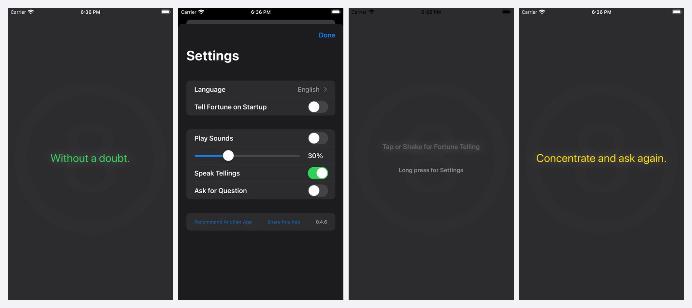

- **原价**：$4.99，现在免费
- **评分**：★4.6 (10)
- **支持设备**：iPhone / iPad / iPod touch / Apple Watch
- **最低系统**：iOS 17.0
- **干什么的**：大声说出你的问题
- **领取**：[在 App Store 打开](https://apps.apple.com/us/app/id1512596471)

!carousel
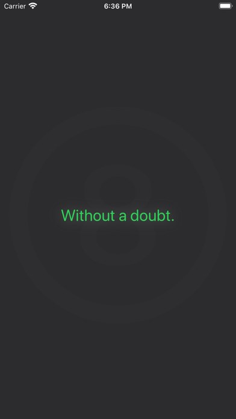
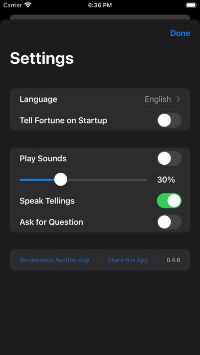

### 6. HippityPip: Phone Number Song

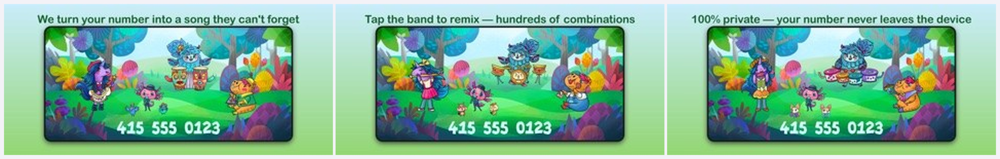

- **原价**：$4.99，现在免费
- **评分**：★4.3 (29)
- **支持设备**：iPhone / iPad / iPod touch
- **最低系统**：iOS 15.0
- **干什么的**：HippityPip does one thing, and does it really well: it teaches your ch…
- **领取**：[在 App Store 打开](https://apps.apple.com/us/app/id1374602205)

!carousel
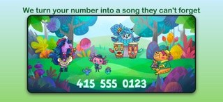

### 7. totododo

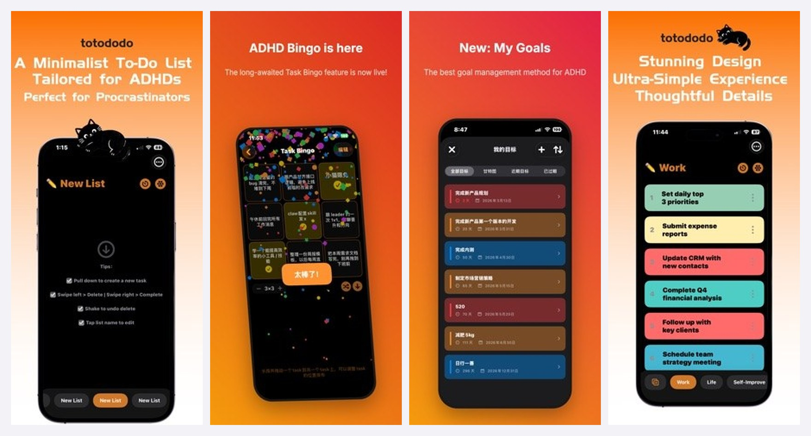

- **原价**：付费应用，现在免费
- **评分**：★5.0 (2)
- **支持设备**：iPhone / iPad / iPod touch
- **最低系统**：iOS 17.6
- **干什么的**：你好，很高兴你看到了totododo! 它是我专门为ADHD人群设计和开发的一款量身定制的极简Todo- list APP（当然，普通人也完…
- **领取**：[在 App Store 打开](https://apps.apple.com/us/app/id6756238255)

!carousel
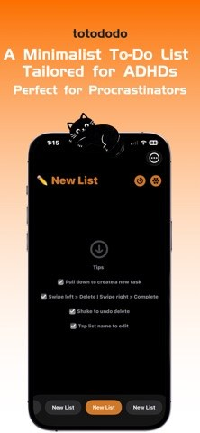

### 8. NoteAhead

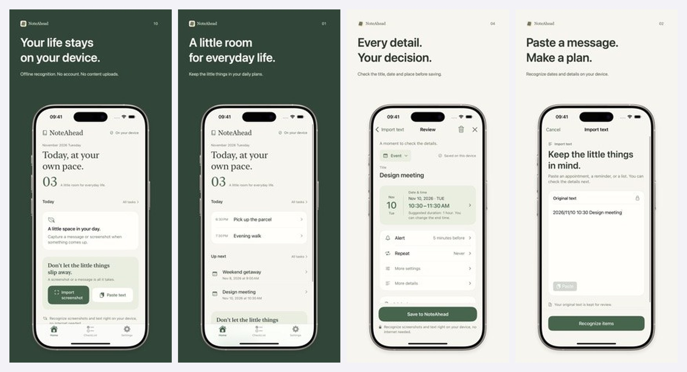

- **原价**：付费应用，现在免费
- **评分**：★5.0 (1)
- **支持设备**：iPhone / iPad / iPod touch
- **最低系统**：iOS 18.0
- **干什么的**：快捷备忘录，让琐碎有着落，让生活更从容
- **领取**：[在 App Store 打开](https://apps.apple.com/us/app/id6820391051)

!carousel
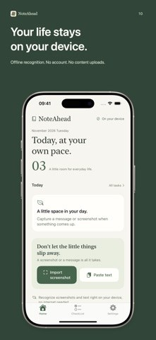
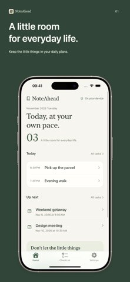

### 9. RECALL

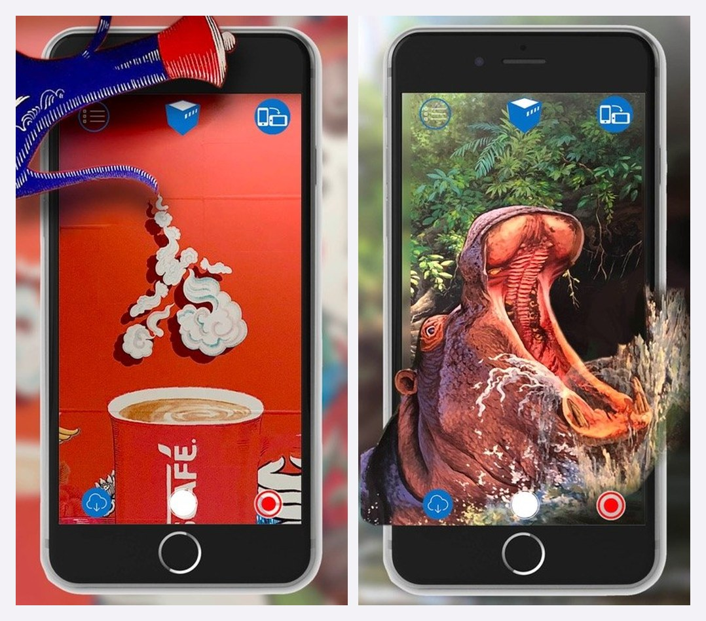

- **原价**：付费应用，现在免费
- **评分**：★5.0 (1)
- **支持设备**：iPhone / iPad / iPod touch
- **最低系统**：iOS 15.0
- **干什么的**：Recall is AR Code (Augmented Reality) service in Cloud service provide…
- **领取**：[在 App Store 打开](https://apps.apple.com/us/app/id1231598152)

!carousel
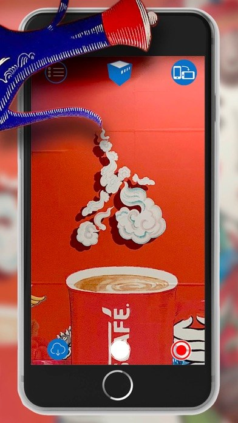
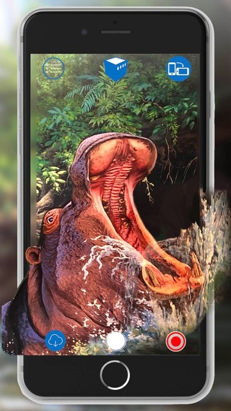

### 10. Village Hub

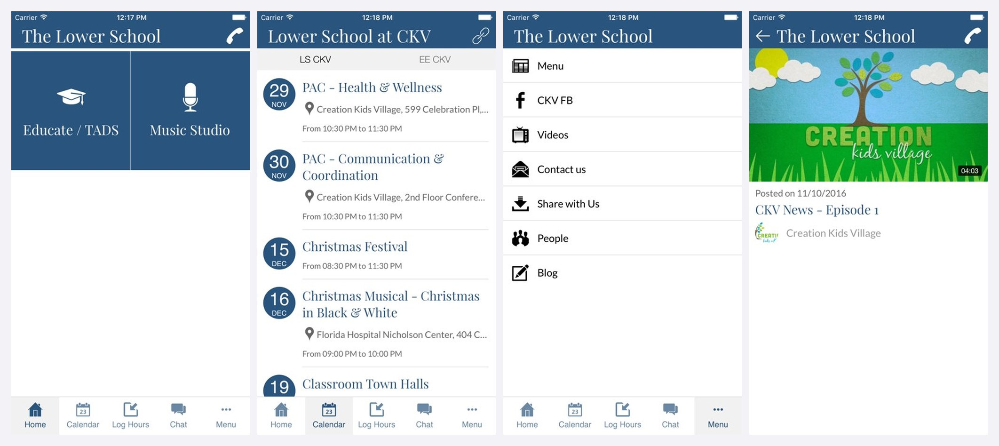

- **原价**：付费应用，现在免费
- **评分**：★5.0 (1)
- **支持设备**：iPhone / iPad / iPod touch
- **最低系统**：iOS 15.0
- **干什么的**：Village Hub is the official app for families and staff of Creation Vil…
- **领取**：[在 App Store 打开](https://apps.apple.com/us/app/id1317758267)

!carousel
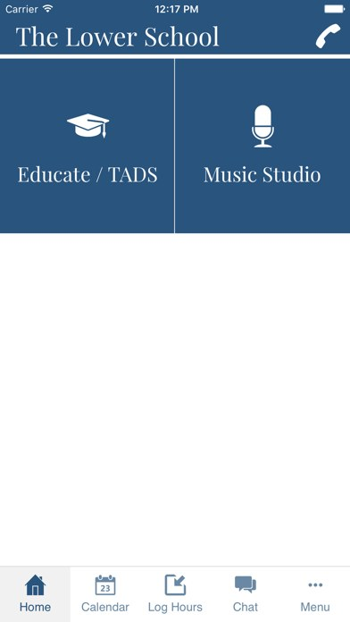
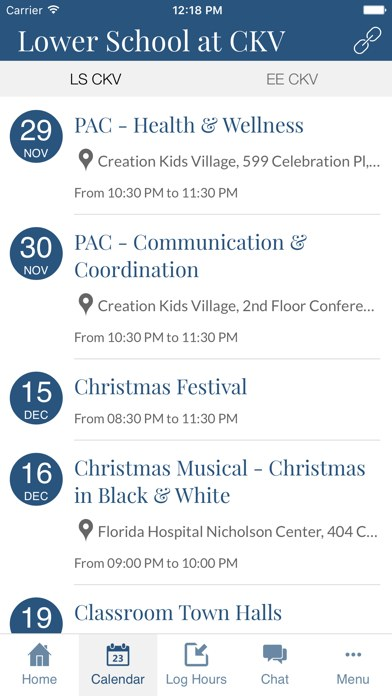

### 11. SketchClub: Draw & Paint

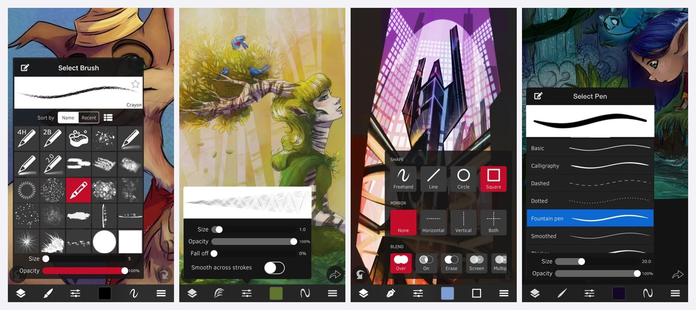

- **原价**：付费应用，现在免费
- **评分**：★4.8 (2,623)
- **支持设备**：iPhone / iPad / iPod touch
- **最低系统**：iOS 15.0
- **干什么的**：SketchClub 不仅为你提供出色的工具，用来素描、绘画、涂鸦、上色和编辑照片，还能激励你持续创作
- **领取**：[在 App Store 打开](https://apps.apple.com/us/app/id404414176)

!carousel
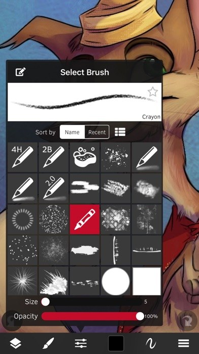

### 12. Video Joiner & Trimmer Pro

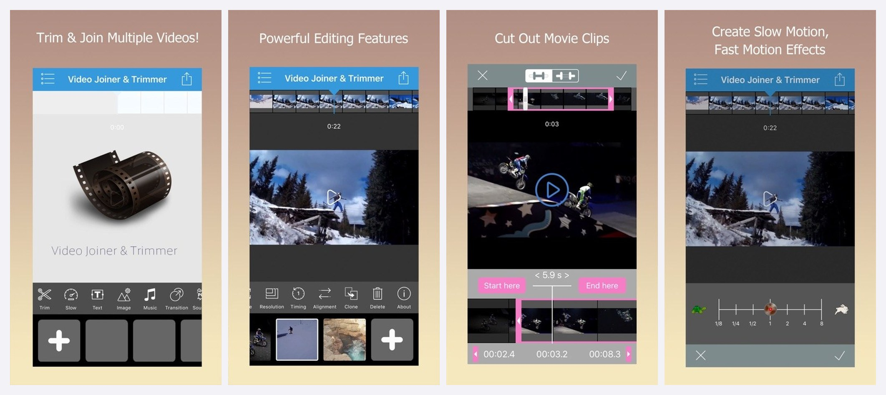

- **原价**：付费应用，现在免费
- **评分**：★4.7 (491)
- **支持设备**：iPhone / iPad / iPod touch
- **最低系统**：iOS 13.0
- **干什么的**：视频剪切合并专家用于轻松合并多个视频片段，帮助你快速地制作震撼效果的短视频并分享给家人朋友
- **领取**：[在 App Store 打开](https://apps.apple.com/us/app/id1076258090)

!carousel

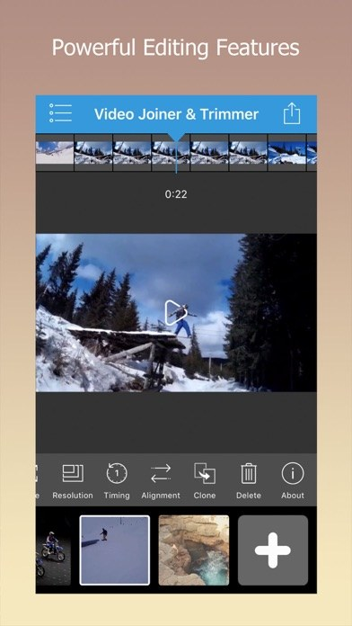

### 13. OneLLM: OpenCode & DS Harness

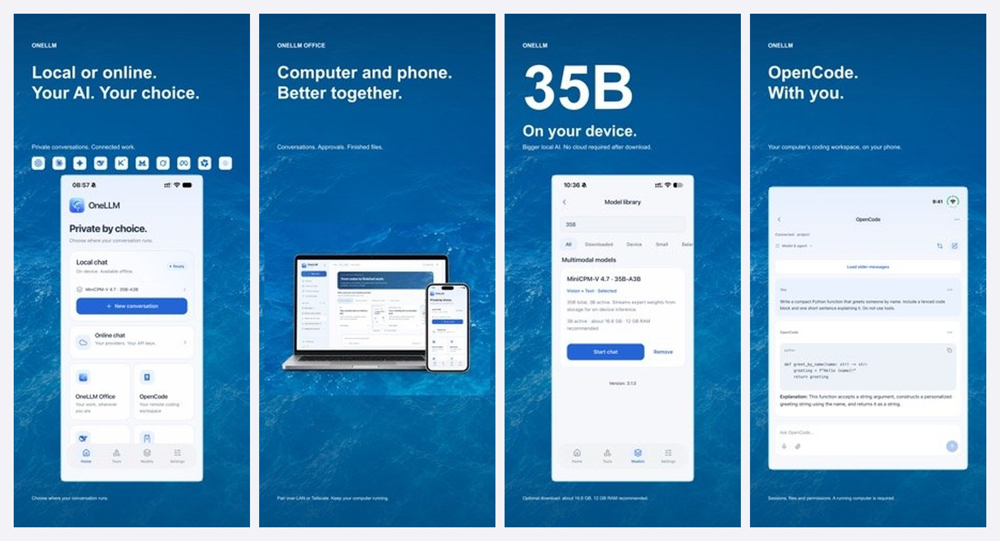

- **原价**：付费应用，现在免费
- **评分**：★4.6 (28)
- **支持设备**：iPhone / iPad / iPod touch
- **最低系统**：iOS 16.4
- **干什么的**：Local AI. Online models. Your computer, within reach. OneLLM brings ev…
- **领取**：[在 App Store 打开](https://apps.apple.com/us/app/id6737907910)

!carousel

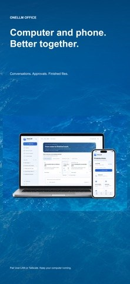

### 14. Close

- **原价**：付费应用，现在免费
- **评分**：★4.3 (35)
- **支持设备**：iPhone / iPad / iPod touch
- **最低系统**：iOS 15.0
- **干什么的**：With the Close app you'll visit events carefree! All your tickets, inf…
- **领取**：[在 App Store 打开](https://apps.apple.com/us/app/id1317343329)

!carousel

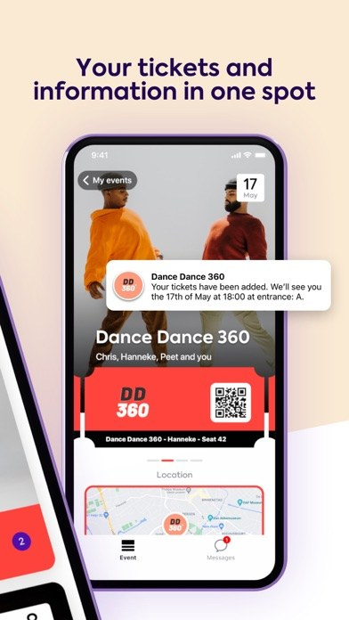

### 15. Photo Eraser for iPhone

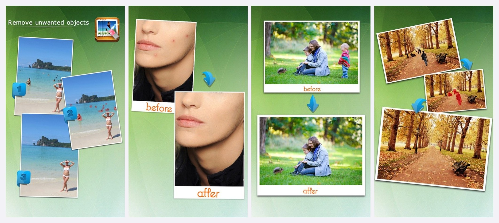

- **原价**：付费应用，现在免费
- **评分**：★3.7 (274)
- **支持设备**：iPhone / iPad / iPod touch
- **最低系统**：iOS 8.0
- **干什么的**：Photo Eraser易于删除图像中不需要的对象如删除水印，日期戳，额外的文字，建筑等等并保持原有的重要视觉效果不发生改变
- **领取**：[在 App Store 打开](https://apps.apple.com/us/app/id646256209)

!carousel

## 终身内购 0 元兑换（8 个）

这几个不是商店里直接降价到 0 元，而是开发者发的公开兑换码：点帖子里的兑换链接直接进 App Store 兑。每个兑换码一个 Apple 账号只能用一次，都是终身解锁、不是订阅，不会续费。

**怎么领**：先装上对应的免费 App → 点该款下面的兑换链接 → 自动跳到 App Store 兑换页，确认就行。不用绑卡，没有试用期。没有兑换链接的款，暂时只能先装 App，等开发者放出公开码。

### 1. Petals: Period & Cycle Tracker

- **内购**：Lifetime Plus Family
- **原价**：$49.99，兑换码 0 元领
- **评分**：★4.9 (7)
- **支持设备**：iPhone / iPad / iPod touch
- **干什么的**：Your cycle, logged deeply with details. Owned completely. Petals is a…
- **解锁内容**：解锁Lifetime Plus Family终身版。
- **最低系统**：iOS 18.6
- **兑换链接**：[点这里兑换](https://apps.apple.com/redeem?ctx=offercodes&id=6751436384&code=GETFREEPETALS)
- **App 链接**：[在 App Store 打开](https://apps.apple.com/us/app/id6751436384)
!carousel

### 2. Floaty: Lock Screen Essentials

- **内购**：Floaty Pro Lifetime
- **原价**：$49.99，兑换码 0 元领
- **评分**：★5.0 (5)
- **支持设备**：iPhone / iPad / iPod touch
- **干什么的**：此刻所需，尽在浮现
- **解锁内容**：解锁Floaty Pro Lifetime终身版。
- **最低系统**：iOS 17.0
- **兑换链接**：[点这里兑换](https://apps.apple.com/redeem?ctx=offercodes&id=6825604929&code=GGFPL2K15)
- **App 链接**：[在 App Store 打开](https://apps.apple.com/us/app/id6825604929)
!carousel
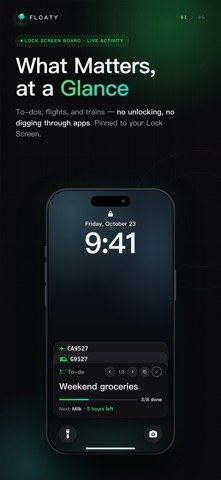

### 3. FamilyDay - Days for Family

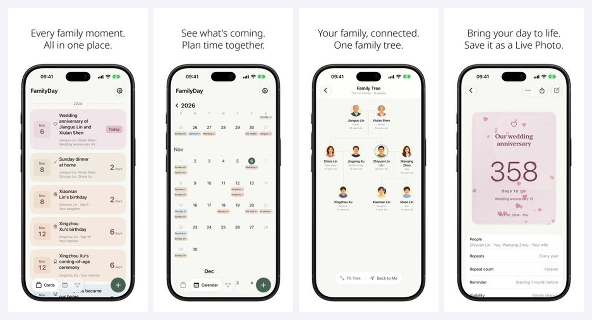

- **内购**：FamilyDay Lifetime
- **原价**：$6.99，兑换码 0 元领
- **评分**：暂无评分
- **支持设备**：iPhone / iPad / iPod touch
- **干什么的**：把重要的日子留给家人
- **解锁内容**：解锁FamilyDay Lifetime终身版。
- **最低系统**：iOS 17.0
- **兑换链接**：[点这里兑换](https://apps.apple.com/redeem?ctx=offercodes&id=6825604711&code=FAMILYDAY500REDNOTE)
- **App 链接**：[在 App Store 打开](https://apps.apple.com/us/app/id6825604711)
!carousel

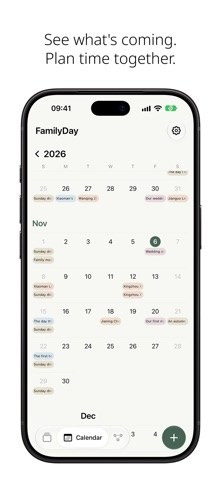

### 4. Lumori: Bills & Subscriptions

- **内购**：Lumori Pro Lifetime
- **原价**：$12.99，兑换码 0 元领
- **评分**：★5.0 (4)
- **支持设备**：iPhone / iPad / iPod touch
- **干什么的**：提前知道，接下来要处理什么
- **解锁内容**：解锁Lumori Pro Lifetime终身版。
- **最低系统**：iOS 17.0
- **兑换链接**：[点这里兑换](https://apps.apple.com/redeem?ctx=offercodes&id=6797824934&code=LUMORI)
- **App 链接**：[在 App Store 打开](https://apps.apple.com/us/app/id6797824934)
!carousel

### 5. Seesaw: A Place for Two

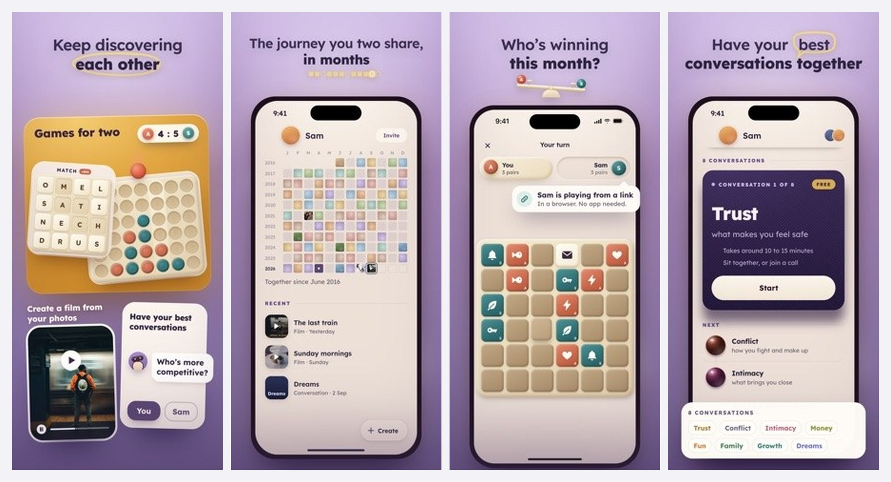

- **内购**：Six conversations
- **原价**：$9.99，兑换码 0 元领
- **评分**：★5.0 (5)
- **支持设备**：iPhone / iPad / iPod touch
- **干什么的**：The people closest to you keep changing, and nothing tells you how. Se…
- **解锁内容**：解锁Six conversations终身版。
- **最低系统**：iOS 15.1
- **兑换链接**：[点这里兑换](https://apps.apple.com/redeem?ctx=offercodes&id=6755359501&code=DATENIGHT)
- **App 链接**：[在 App Store 打开](https://apps.apple.com/us/app/id6755359501)
!carousel

### 6. Offline Music Player Pro

- **内购**：Lifetime Pro
- **原价**：$4.99，兑换码 0 元领
- **评分**：★4.4 (30)
- **支持设备**：iPhone / iPad / iPod touch
- **干什么的**：Enjoy your music – anywhere, anytime. Offline Music Player Pro is a si…
- **解锁内容**：解锁Lifetime Pro终身版。
- **最低系统**：iOS 15.0
- **兑换链接**：[点这里兑换](https://apps.apple.com/redeem?ctx=offercodes&id=6749329943&code=BKHBFH)
- **App 链接**：[在 App Store 打开](https://apps.apple.com/us/app/id6749329943)
!carousel

### 7. Couples Questions - Dovee

- **内购**：Dovee Pro
- **原价**：$29.99，兑换码 0 元领
- **评分**：暂无评分
- **支持设备**：iPhone / iPad / iPod touch
- **干什么的**：Every great relationship starts with meaningful conversations. Dovee i…
- **解锁内容**：解锁Dovee Pro终身版。
- **最低系统**：iOS 15.0
- **兑换链接**：[点这里兑换](https://apps.apple.com/redeem?ctx=offercodes&id=6770237393&code=VBNMNBNM)
- **App 链接**：[在 App Store 打开](https://apps.apple.com/us/app/id6770237393)
!carousel

### 8. Glance: Health Dashboard

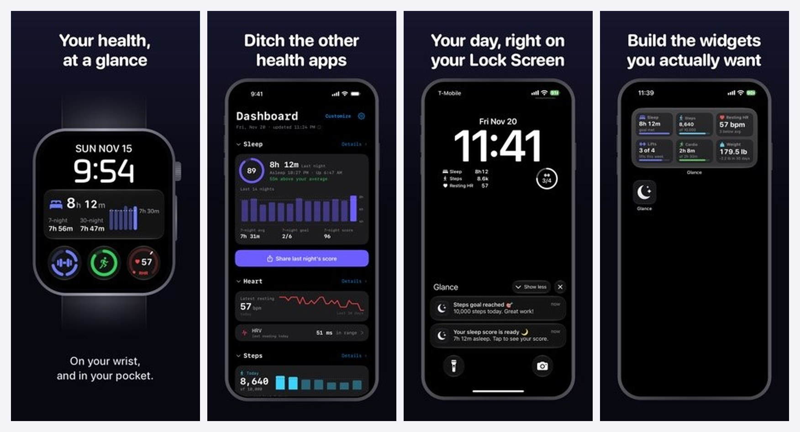

- **内购**：Unlock Glance
- **原价**：$4.99，兑换码 0 元领
- **评分**：★5.0 (4)
- **支持设备**：iPhone / iPad / iPod touch / Apple Watch
- **干什么的**：Glance puts the health numbers you actually check in one place: how yo…
- **解锁内容**：解锁Unlock Glance终身版。
- **最低系统**：iOS 17.0
- **兑换链接**：[点这里兑换](https://apps.apple.com/redeem?ctx=offercodes&id=6832784436&code=GLANCEREDDIT26)
- **App 链接**：[在 App Store 打开](https://apps.apple.com/us/app/id6832784436)
!carousel
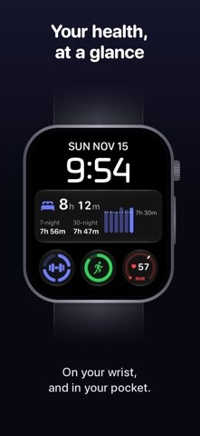
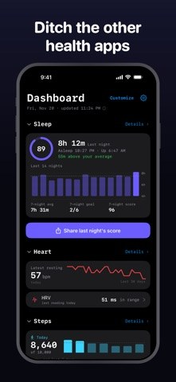

---

限免结束时间苹果不公布，一般 1–3 天，尽快领。
