今天 13 款付费 App 限时免费，原价加起来快 50 美元；另外还有 8 个终身内购可用兑换码 0 元领，原价加起来 330 美元。都是今天刚确认的，限免随时可能结束，看到喜欢的就领。

## 今日极力推荐

1. **Mouse·Keyboard** — 评分 4.7，4 款里评分最高，把 iPhone/iPad 变成 Mac 或 PC 的触控板＋全键盘。
2. **BlackCam** — 黑白摄影相机，实时滤镜＋手动控制，出片很有味道。
3. **Cut for Stories** — 一键剪出适合发 Stories 的竖屏视频，带字幕和转场。

## 付费应用限时免费（4 款）

点链接进 App Store 点“获取”就行。领的时候只点“获取”，不要买任何内购。

### 1. Mouse · Keyboard

- **原价**：$4.99，现在免费
- **评分**：★4.7 (2,515)
- **支持设备**：iPad / iPhone / iPod touch
- **最低系统**：iOS 17.0
- **干什么的**：把 iPhone/iPad 变成 Mac 或 PC 的触控板＋全键盘，演讲、沙发上网都好用。
- **领取**：[在 App Store 打开](https://apps.apple.com/us/app/id1515294700)

!carousel

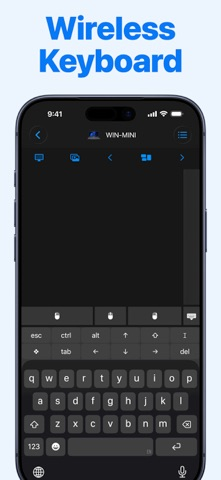

### 2. Calc4Key

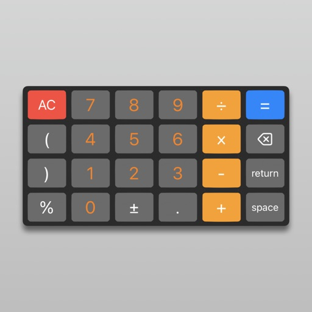

- **原价**：$0.99，现在免费
- **评分**：★4.6 (832)
- **支持设备**：iPad / iPhone / iPod touch
- **最低系统**：iOS 16.0
- **干什么的**：键盘里嵌计算器，任何 App 里都能直接算，不用切换。
- **领取**：[在 App Store 打开](https://apps.apple.com/us/app/id1585531759)

!carousel
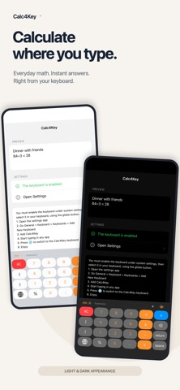
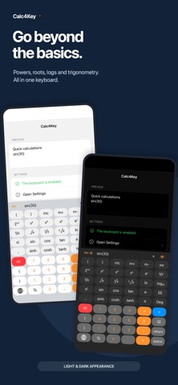

### 3. Cut for Stories

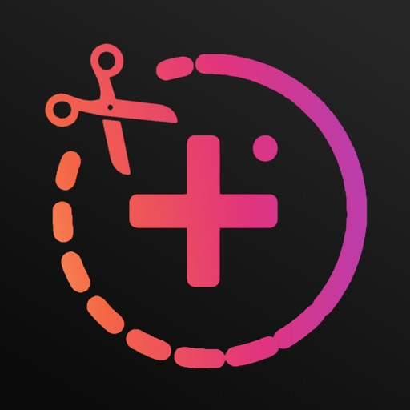

- **原价**：$2.99，现在免费
- **评分**：★4.6 (372)
- **支持设备**：iPad / iPhone / iPod touch
- **最低系统**：iOS 12.0
- **干什么的**：Ins 故事模板，带修图、渐变、取色、自定义字体。
- **领取**：[在 App Store 打开](https://apps.apple.com/us/app/id1190312896)

!carousel
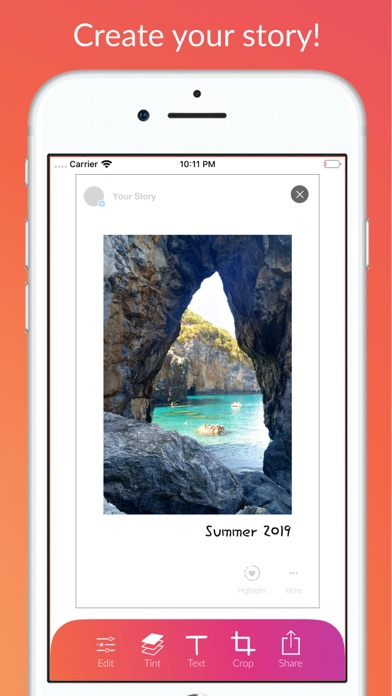
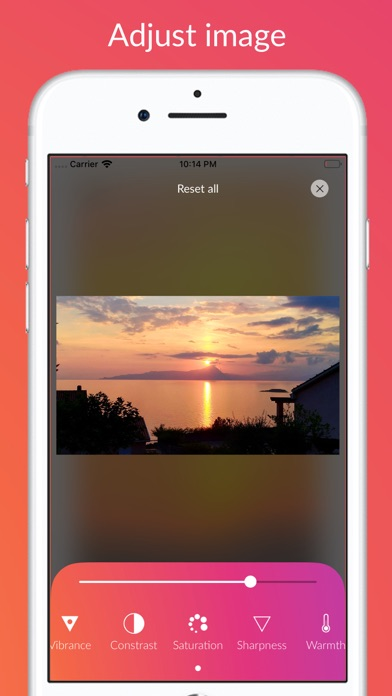

### 4. BlackCam - Black&White Camera

- **原价**：$1.99，现在免费
- **评分**：★4.6 (575)
- **支持设备**：iPad / iPhone / iPod touch
- **最低系统**：iOS 17.6
- **干什么的**：专业黑白相机，实时滤镜、胶片颗粒、暗角。
- **领取**：[在 App Store 打开](https://apps.apple.com/us/app/id943901190)

!carousel
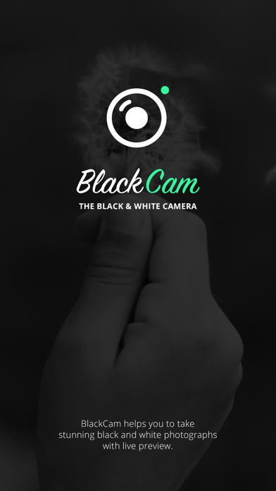

## 终身内购 0 元兑换（8 个）

这 8 个不是商店里直接降价到 0 元，而是开发者在 AppHunt 上发的兑换码：用兑换码可以在 App Store 里 0 元兑换对应的终身内购。每个兑换码一个 Apple 账号只能用一次，都是终身解锁、不是订阅，不会续费。

**怎么领**：先装上对应的免费 App → 打开 AppHunt 的优惠页（apphunt.app/promos）→ 注册一个免费 AppHunt 账号查看兑换码 → 点 Redeem，会自动跳到 App Store 并填好兑换码，确认就行。不用绑卡，没有试用期。兑换码要在 2027 年 3 月 1 日前用掉。

### 1. 70mm: MKV Video & Media Player

- **内购**：70mm Pro 终身版
- **原价**：$14.99，兑换码 0 元领
- **解锁内容**：解锁无限电视播放、跨设备播放进度同步、字幕翻译、无限网络服务器。
- **剩余兑换码**：14,310 / 15,000（今天刚查的）
- **最低系统**：iOS 26.0
- **App 链接**：[在 App Store 打开](https://apps.apple.com/us/app/id6813558062)
!carousel
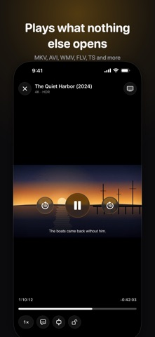
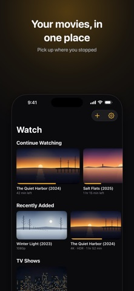

### 2. Acord: 吉他调音器、节拍器

- **内购**：Acord Premium 终身版
- **原价**：$29.99，兑换码 0 元领
- **解锁内容**：解锁全部乐器和调音、频闪模式、任意基准音、变速训练、练习计时、更多节拍器音色。
- **剩余兑换码**：14,492 / 15,000（今天刚查的）
- **最低系统**：iOS 17.0
- **App 链接**：[在 App Store 打开](https://apps.apple.com/us/app/id6817105087)
!carousel
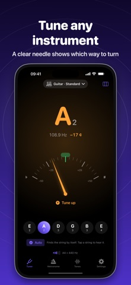
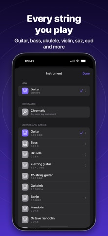

### 3. Nod: 睡眠白噪音

- **内购**：Nod Premium 终身版
- **原价**：$49.99，兑换码 0 元领
- **解锁内容**：解锁其余 34 个声音、最多 8 个声音混音、10 个混音预设、全部起床音、间隔铃。
- **剩余兑换码**：14,493 / 15,000（今天刚查的）
- **最低系统**：iOS 18.0
- **App 链接**：[在 App Store 打开](https://apps.apple.com/us/app/id6818187290)
!carousel
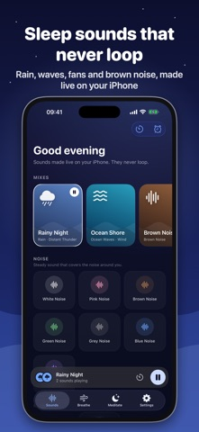
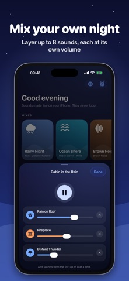

### 4. Klavi: 钢琴课

- **内购**：Klavi Pro 终身版
- **原价**：$89.99，兑换码 0 元领
- **解锁内容**：解锁全部课程、各级别全部曲目、无限训练回合。
- **剩余兑换码**：6,810 / 8,500（今天刚查的）
- **最低系统**：iOS 17.0
- **App 链接**：[在 App Store 打开](https://apps.apple.com/us/app/id6822897220)
!carousel
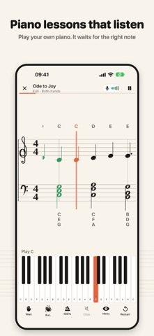
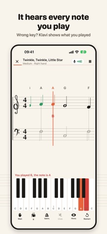

### 5. Habolo: 习惯追踪

- **内购**：Habolo Pro（一次性，无订阅）
- **原价**：$14.99，兑换码 0 元领
- **解锁内容**：解锁 90 天强度图表、12 个月地图和 Pro 视图。
- **剩余兑换码**：7,960 / 10,000（今天刚查的）
- **最低系统**：iOS 26.0
- **App 链接**：[在 App Store 打开](https://apps.apple.com/us/app/id6837220047)
!carousel
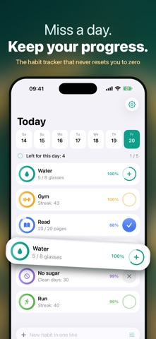
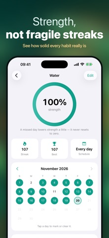

### 6. Noppi: 积木扫描计数

- **内购**：Noppi Pro 终身版
- **原价**：$39.99，兑换码 0 元领
- **解锁内容**：解锁全部 42 个搭建创意和积木清单导出（乐高式积木扫描）。
- **剩余兑换码**：13,856 / 15,000（今天刚查的）
- **最低系统**：iOS 17.0
- **App 链接**：[在 App Store 打开](https://apps.apple.com/us/app/id6821694403)
!carousel
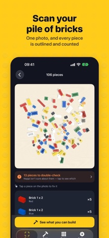

### 7. 8hrs: 工时追踪

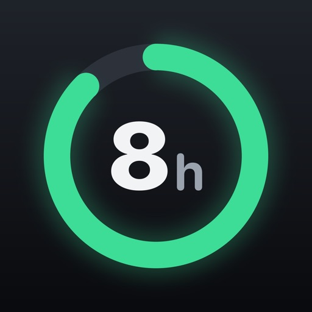

- **内购**：8hrs Pro 终身版
- **原价**：$49.99，兑换码 0 元领
- **解锁内容**：解锁加班和薪资估算、PDF 工时表、年度报表、客户筛选、标签报表。
- **剩余兑换码**：14,638 / 15,000（今天刚查的）
- **最低系统**：iOS 26.0
- **App 链接**：[在 App Store 打开](https://apps.apple.com/us/app/id6812893582)
!carousel
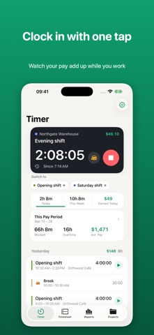
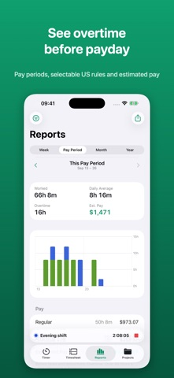

### 8. PlantKey: 植物识别

- **内购**：PlantKey Pro 终身版
- **原价**：$39.99，兑换码 0 元领
- **解锁内容**：解锁无限花园和日记、植物医生、测光表。
- **剩余兑换码**：8,654 / 10,000（今天刚查的）
- **最低系统**：iOS 17.0
- **App 链接**：[在 App Store 打开](https://apps.apple.com/us/app/id6833565635)

---

限免结束时间苹果不公布，一般 1–3 天，尽快领。
!carousel
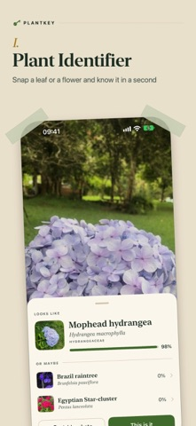
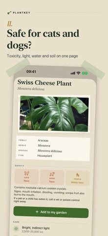
