今天 15 款付费 App 限时免费，原价加起来约 13 美元；另外还有 8 个终身内购可用兑换码 0 元领，原价加起来约 148 美元。都是今天刚确认的，限免随时可能结束，看到喜欢的就领。

## 今日极力推荐

1. **Status Styler** — 评分 5.0，原价 $1.99，50% OFF!!
2. **Horizon: Calendar Highlights** — 评分 5.0，原价 $0.99，你的 Apple 日历，按重要程度整理
3. **Diana's Animals Stickers** — 评分 5.0，原价 $0.99，Diana's Animals Stickers: The friendliest stickers you'll ever meet.

## 付费应用限时免费（15 款）

点链接进 App Store 点“获取”就行。领的时候只点“获取”，不要买任何内购。

### 社交（1 款）

#### 1. Status Styler

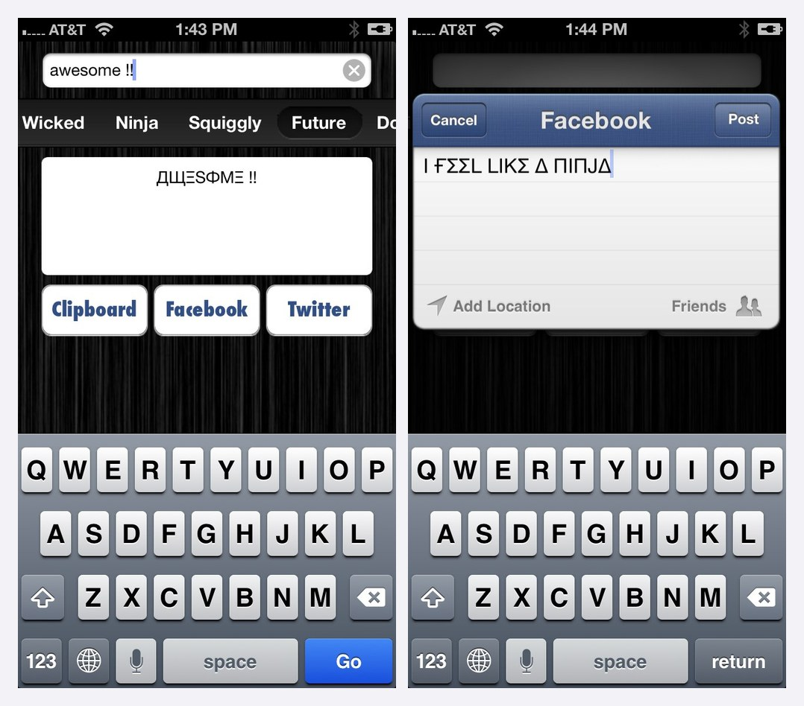

- **原价**：$1.99，现在免费
- **设备**：iPhone / iPad / Apple Watch
- **最低系统**：iOS 6.1
- **评分**：★5.0 (1)
- **大小**：2.0 MB
- **干什么的**：50% OFF!!
- **领取**：[在 App Store 打开](https://apps.apple.com/us/app/id481000392)

!carousel
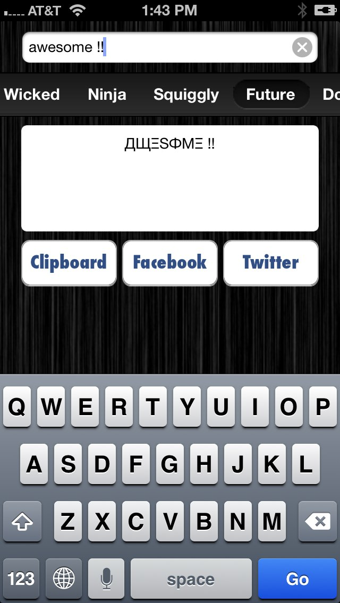
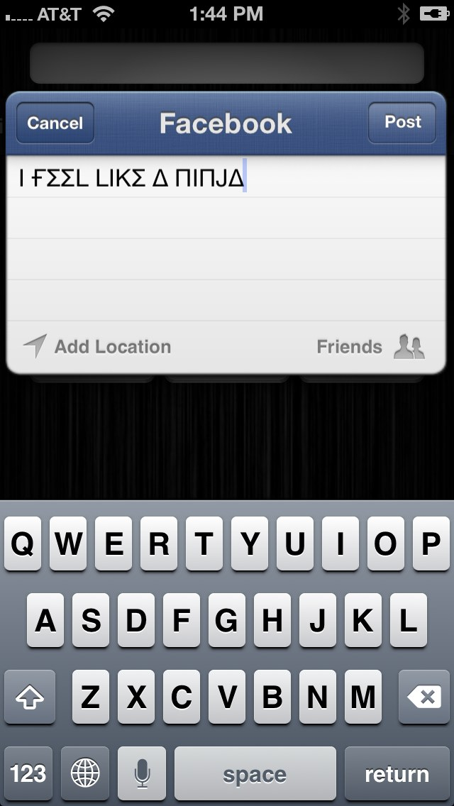

### 效率工具（4 款）

#### 1. Horizon: Calendar Highlights

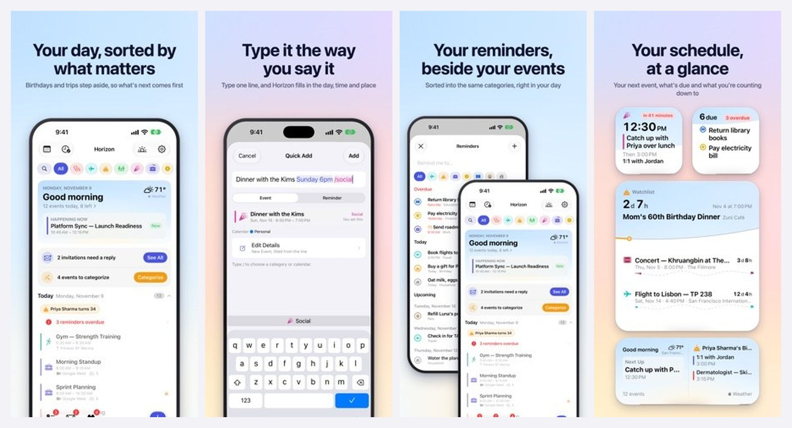

- **原价**：$0.99，现在免费
- **设备**：iPhone / iPad / Apple Watch
- **最低系统**：iOS 18.6
- **评分**：★5.0 (11)
- **大小**：38.3 MB
- **干什么的**：你的 Apple 日历，按重要程度整理
- **领取**：[在 App Store 打开](https://apps.apple.com/us/app/id6761135453)

!carousel
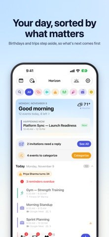
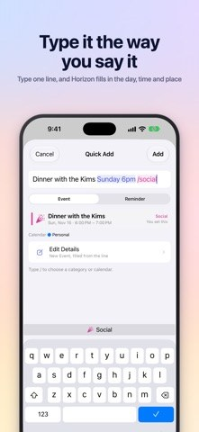

#### 2. SimpleToDo - Todo & Calendar

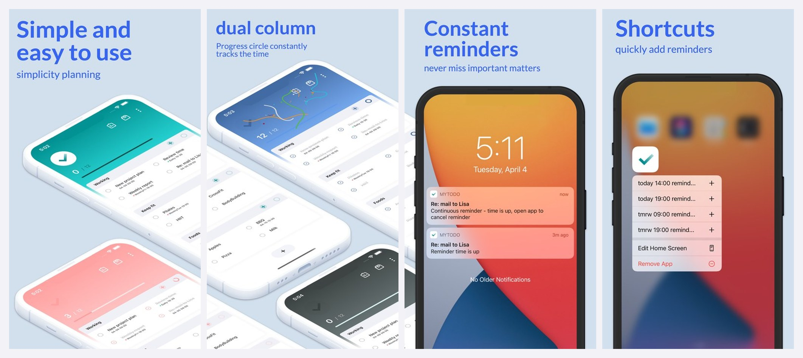

- **原价**：$0.99，现在免费
- **设备**：iPhone / iPad / Apple Watch
- **最低系统**：iOS 17.0
- **评分**：★5.0 (23)
- **大小**：48.1 MB
- **干什么的**：「我的待办」，一款简洁高效的待办清单(Todo)、日程管理(GTD)应用
- **领取**：[在 App Store 打开](https://apps.apple.com/us/app/id1294530516)

!carousel
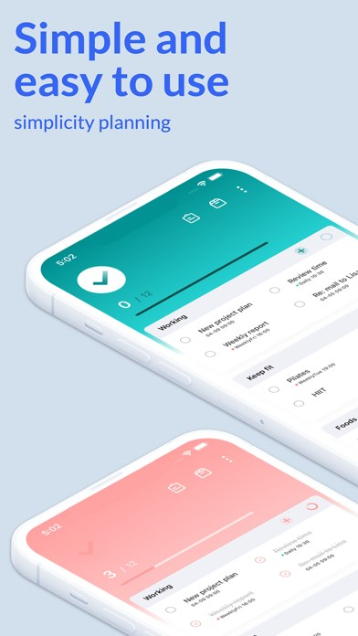
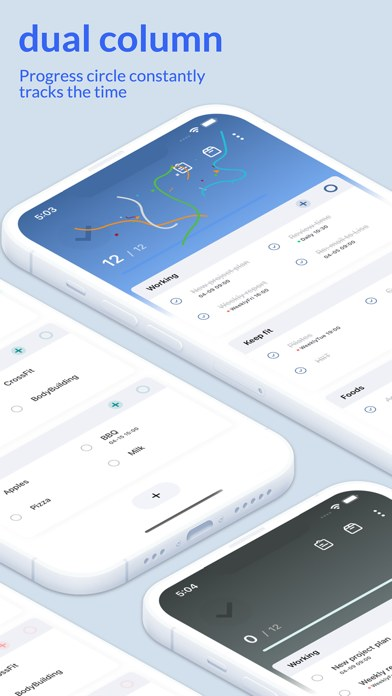

#### 3. Tracker Buttons Pro

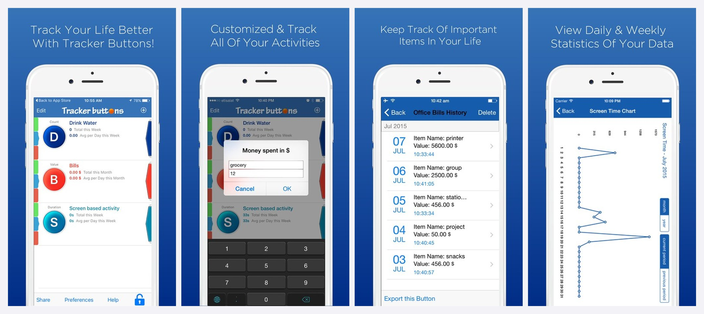

- **原价**：$0.99，现在免费
- **设备**：iPhone / iPad / Apple Watch
- **最低系统**：iOS 10.0
- **评分**：★4.6 (14)
- **大小**：36.0 MB
- **干什么的**：Track Your Life Better With Tracker Buttons!
- **领取**：[在 App Store 打开](https://apps.apple.com/us/app/id993411102)

!carousel
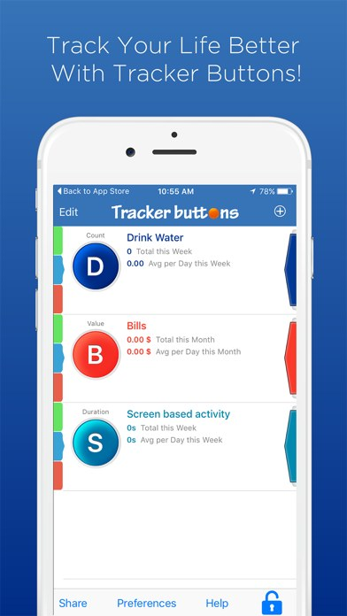
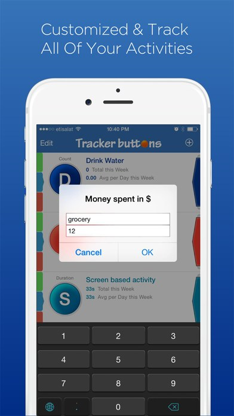

#### 4. Colorblind Helper & Simulator

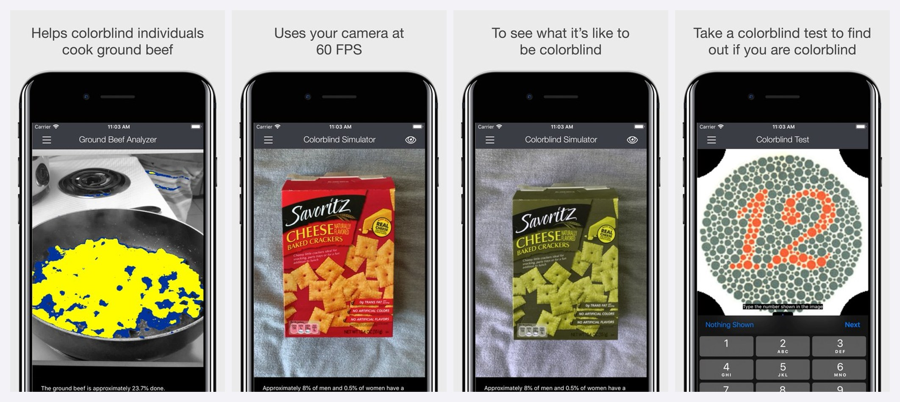

- **原价**：$0.99，现在免费
- **设备**：iPhone / iPad
- **最低系统**：iOS 18.6
- **评分**：★4.5 (10)
- **大小**：2.9 MB
- **干什么的**：For those who are colorblind, help yourself differentiate between raw…
- **领取**：[在 App Store 打开](https://apps.apple.com/us/app/id1455153058)

!carousel
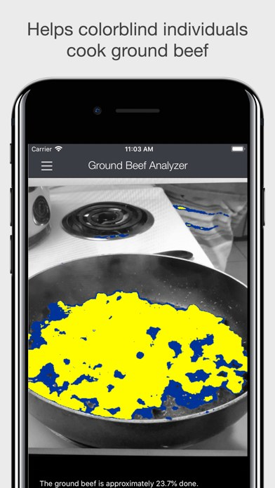
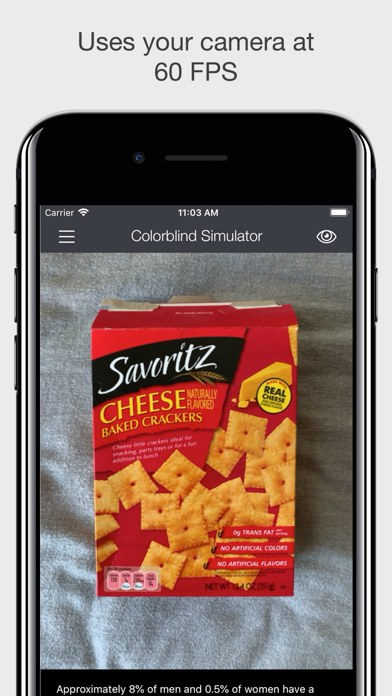

### Stickers（1 款）

#### 1. Diana's Animals Stickers

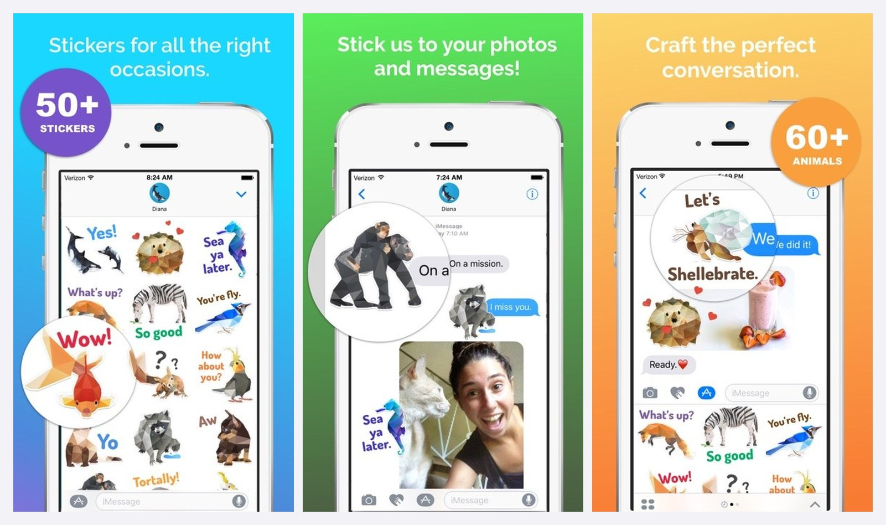

- **原价**：$0.99，现在免费
- **设备**：iPhone / iPad
- **最低系统**：iOS 15.0
- **评分**：★5.0 (10)
- **大小**：8.3 MB
- **干什么的**：Diana's Animals Stickers: The friendliest stickers you'll ever meet.
- **领取**：[在 App Store 打开](https://apps.apple.com/us/app/id1170837414)

!carousel
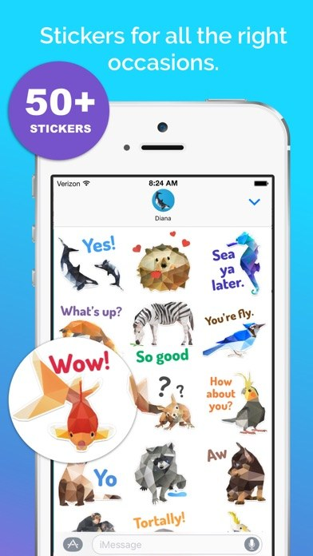
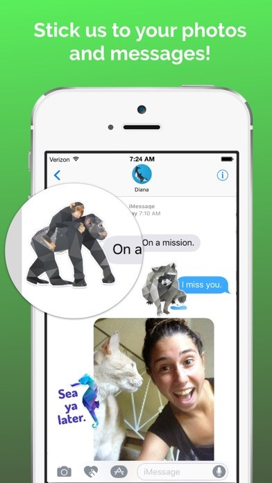

### 教育（1 款）

#### 1. Numerology

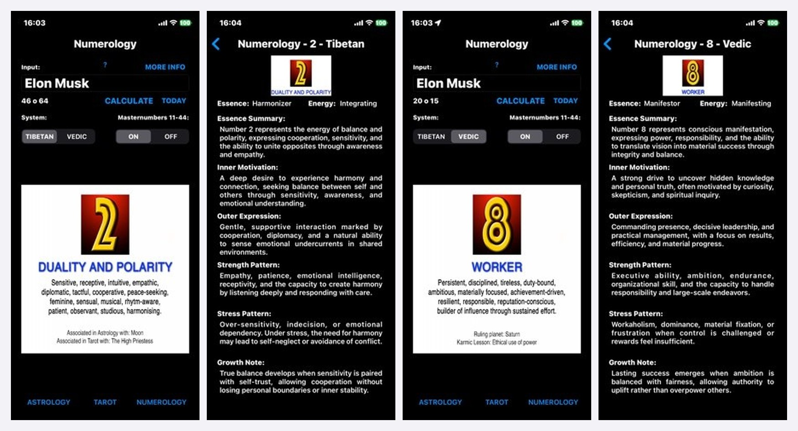

- **原价**：$0.99，现在免费
- **设备**：iPhone / iPad / Mac
- **最低系统**：iOS 14.0
- **评分**：★4.7 (11)
- **大小**：61.2 MB
- **干什么的**：Numerology is a refined and intuitive tool designed to explore the ene…
- **领取**：[在 App Store 打开](https://apps.apple.com/us/app/id1195301998)

!carousel
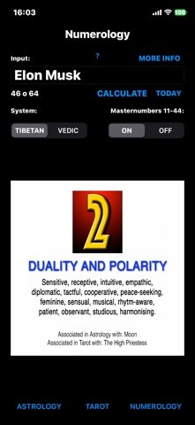
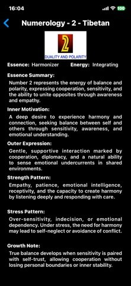

### 新闻（1 款）

#### 1. Blue for Twitter

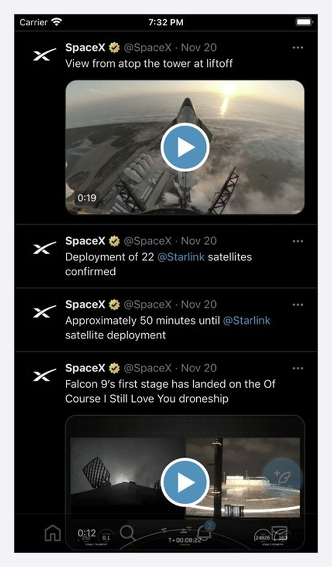

- **原价**：$0.99，现在免费
- **设备**：iPhone / iPad
- **最低系统**：iOS 15.0
- **评分**：★4.7 (80)
- **大小**：11.8 MB
- **干什么的**：Enjoy a healthier & more mindful Twitter/X experience: • No ads • No c…
- **领取**：[在 App Store 打开](https://apps.apple.com/us/app/id6472628197)

!carousel

### 音乐（2 款）

#### 1. Christmas Radio UK

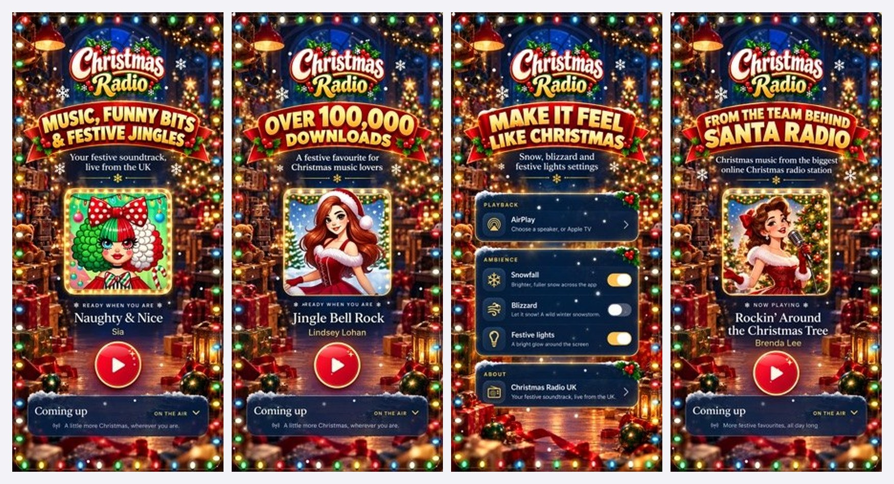

- **原价**：$0.99，现在免费
- **设备**：iPhone / iPad / Apple TV
- **最低系统**：iOS 17.0
- **评分**：★4.5 (886)
- **大小**：36.1 MB
- **干什么的**：CHRISTMAS RADIO UK – CHRISTMAS MUSIC ALL YEAR ROUND!
- **领取**：[在 App Store 打开](https://apps.apple.com/us/app/id1157967613)

!carousel

#### 2. Tapewind: Cassette Player

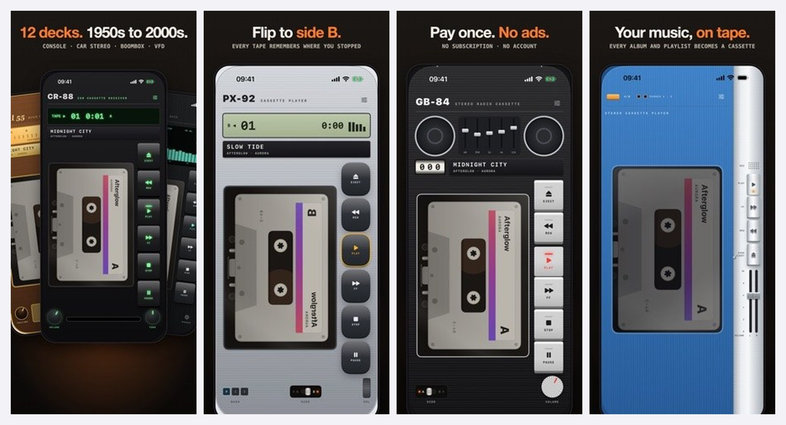

- **原价**：付费应用，现在免费
- **设备**：iPhone / iPad
- **最低系统**：iOS 17.0
- **评分**：★4.0 (1)
- **大小**：3.9 MB
- **干什么的**：Play your music on a real-feeling cassette deck.
- **领取**：[在 App Store 打开](https://apps.apple.com/us/app/id6819736826)

!carousel

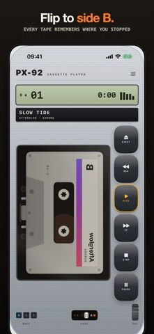

### 摄影与录像（3 款）

#### 1. Dual cameras

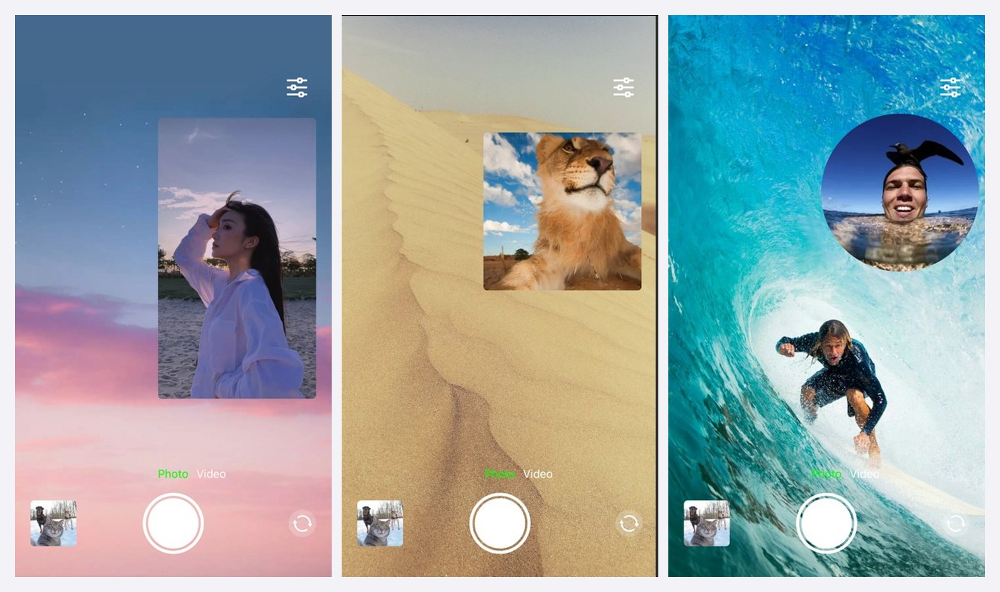

- **原价**：$0.99，现在免费
- **设备**：iPhone / iPad
- **最低系统**：iOS 17.6
- **评分**：★4.4 (227)
- **大小**：10.0 MB
- **干什么的**：Use both front and rear cameras to record and take pictures.
- **领取**：[在 App Store 打开](https://apps.apple.com/us/app/id6444750403)

!carousel

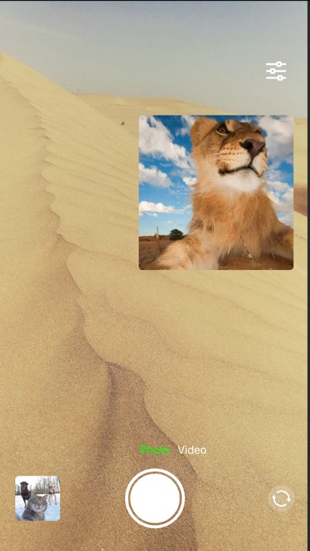

#### 2. Instant Video Background Music

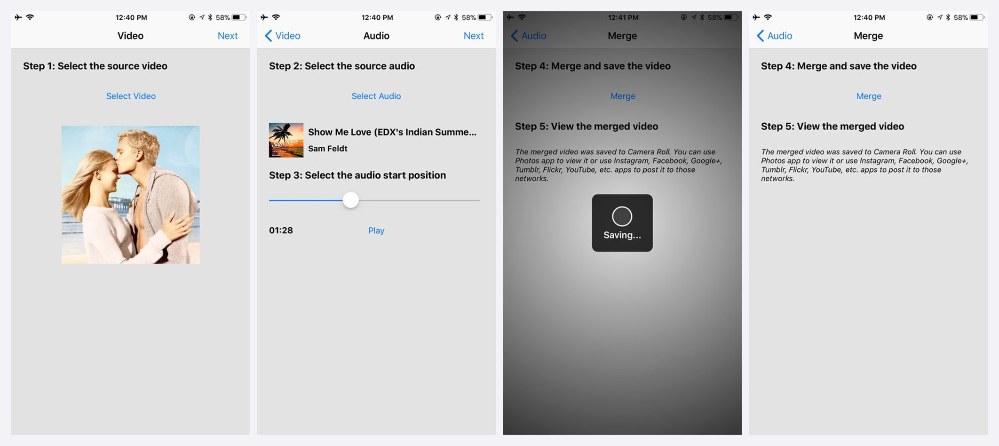

- **原价**：$0.99，现在免费
- **设备**：iPhone / iPad
- **最低系统**：iOS 17.0
- **评分**：★3.8 (39)
- **大小**：5.1 MB
- **干什么的**：Give your videos the soundtrack they deserve.
- **领取**：[在 App Store 打开](https://apps.apple.com/us/app/id681042189)

!carousel

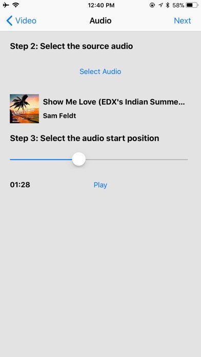

#### 3. Spatial Pro - AI Spatial | 3D

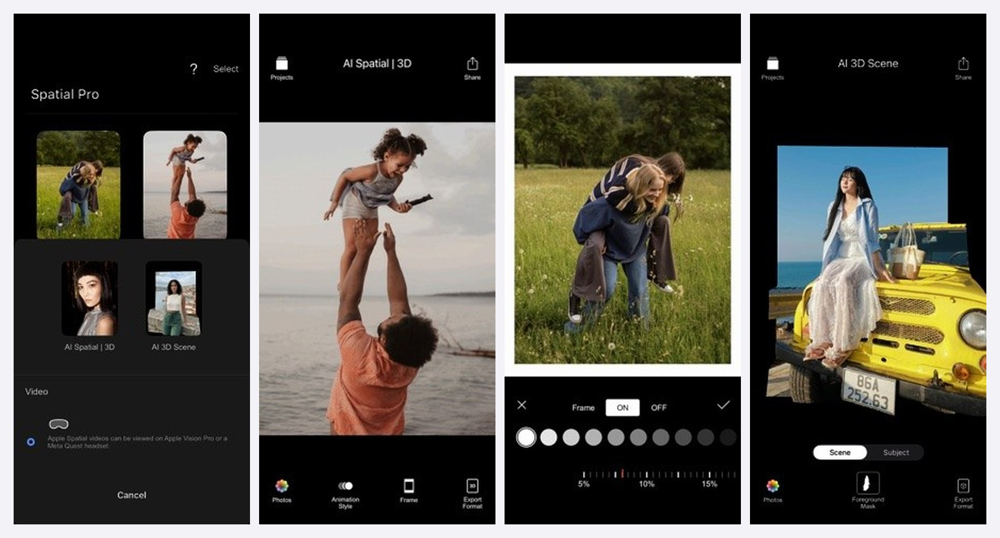

- **原价**：付费应用，现在免费
- **设备**：iPhone / iPad
- **最低系统**：iOS 18.0
- **评分**：★4.9 (19)
- **大小**：1.4 GB
- **干什么的**：***考虑到用户隐私，所有的处理均在设备上完成
- **领取**：[在 App Store 打开](https://apps.apple.com/us/app/id6761425441)

!carousel
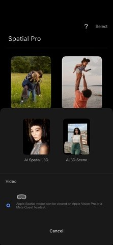
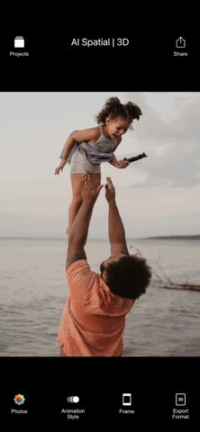

### 开发者工具（1 款）

#### 1. Mockup Screenshot

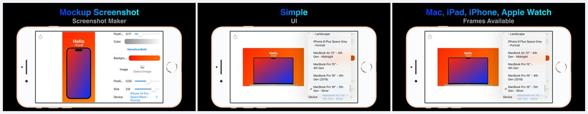

- **原价**：$0.99，现在免费
- **设备**：iPhone / iPad / Mac
- **最低系统**：iOS 15.0
- **评分**：★3.9 (9)
- **大小**：98.9 MB
- **干什么的**：This app lets you make images for the app store Features: - You can ru…
- **领取**：[在 App Store 打开](https://apps.apple.com/us/app/id6443696943)

!carousel
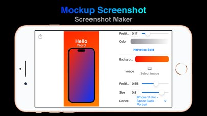
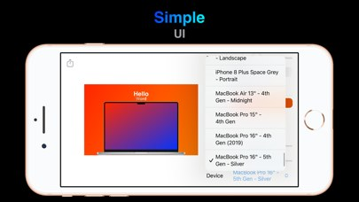

### 工具（1 款）

#### 1. AlbumBee - Photo Cleanup

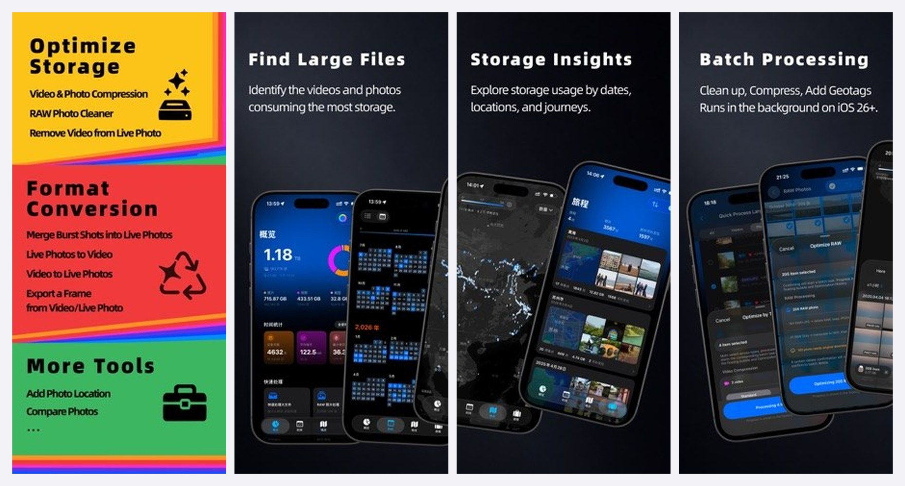

- **原价**：付费应用，现在免费
- **设备**：iPhone / iPad
- **最低系统**：iOS 17.0
- **评分**：★3.0 (4)
- **大小**：21.7 MB
- **干什么的**：整理相册很辛苦,让小蜜蜂来帮你
- **领取**：[在 App Store 打开](https://apps.apple.com/us/app/id6774040750)

!carousel

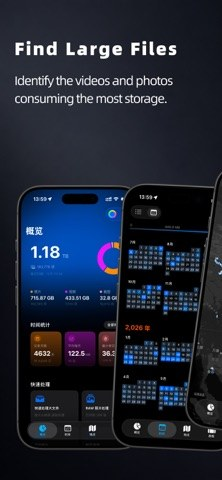

## 终身内购 0 元兑换（8 个）

这几个不是商店里直接降价到 0 元，而是开发者发的公开兑换码：点帖子里的兑换链接直接进 App Store 兑。每个兑换码一个 Apple 账号只能用一次，都是终身解锁、不是订阅，不会续费。

**怎么领**：先装上对应的免费 App → 点该款下面的兑换链接 → 自动跳到 App Store 兑换页，确认就行。不用绑卡，没有试用期。没有兑换链接的款，暂时只能先装 App，等开发者放出公开码。

### 健康健美（2 个）

#### 1. Good Terms: Mindful App Limits

- **内购**：Good Terms Plus Lifetime
- **原价**：$24.99，兑换码 0 元领
- **设备**：iPhone / iPad
- **最低系统**：iOS 26.0
- **评分**：暂无评分
- **大小**：3.9 MB
- **干什么的**：Most screen time tools count minutes.
- **兑换链接**：[点这里兑换](https://apps.apple.com/redeem?ctx=offercodes&id=6834076393&code=MIKELOVESPUPPIES)
- **App 链接**：[在 App Store 打开](https://apps.apple.com/us/app/id6834076393)
!carousel

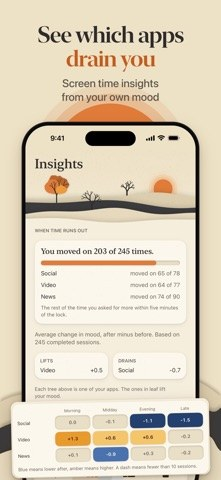

#### 2. Petals: Period & Cycle Tracker

- **内购**：Lifetime Plus Family
- **原价**：$49.99，兑换码 0 元领
- **设备**：iPhone / iPad
- **最低系统**：iOS 18.6
- **评分**：★4.9 (7)
- **大小**：14.8 MB
- **干什么的**：Your cycle, logged deeply with details.
- **兑换链接**：[点这里兑换](https://apps.apple.com/redeem?ctx=offercodes&id=6751436384&code=GETFREEPETALS)
- **App 链接**：[在 App Store 打开](https://apps.apple.com/us/app/id6751436384)
!carousel

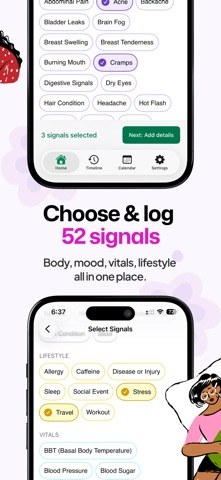

### 游戏（1 个）

#### 1. Ringo: Water Ring Toss

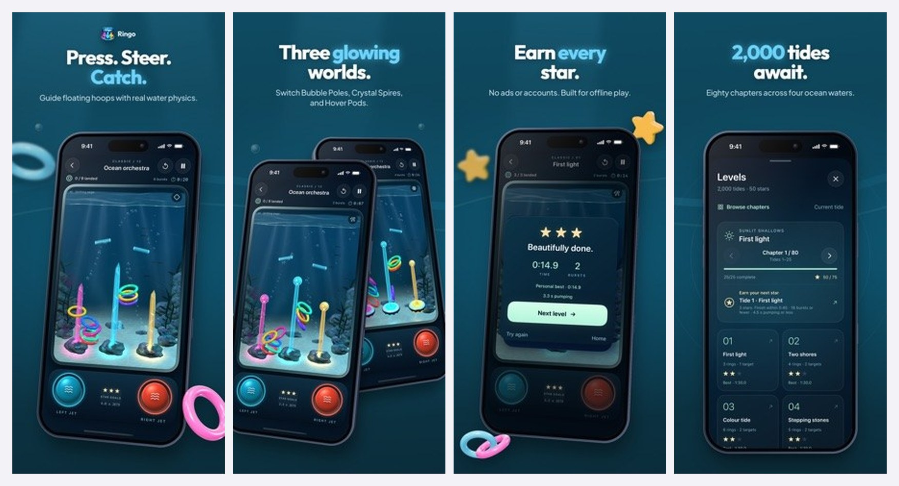

- **内购**：Ringo Pro
- **原价**：$2.99，兑换码 0 元领
- **设备**：iPhone / iPad
- **最低系统**：iOS 17.0
- **评分**：暂无评分
- **大小**：9.9 MB
- **干什么的**：A little water toy.
- **兑换链接**：[点这里兑换](https://apps.apple.com/redeem?ctx=offercodes&id=6822308678&code=FRIEND5)
- **App 链接**：[在 App Store 打开](https://apps.apple.com/us/app/id6822308678)
!carousel

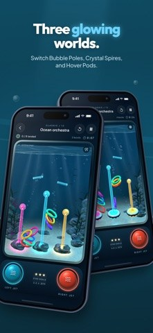

### 教育（1 个）

#### 1. Ni Hao Bolo

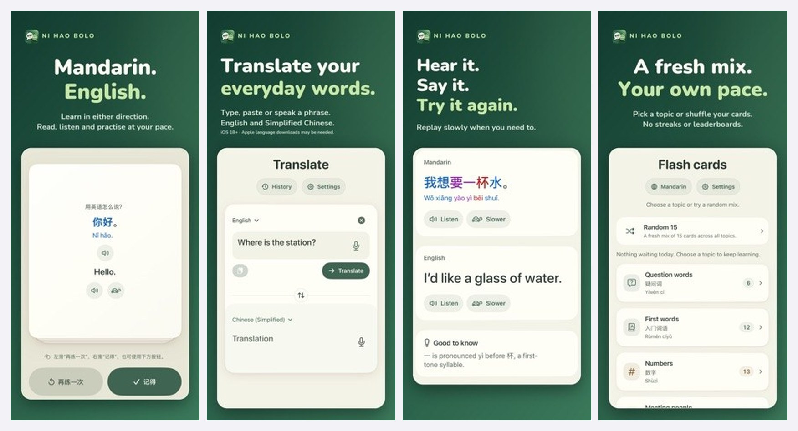

- **内购**：Ni Hao Bolo Pro
- **原价**：$9.99，兑换码 0 元领
- **设备**：iPhone / iPad
- **最低系统**：iOS 17.0
- **评分**：暂无评分
- **大小**：5.9 MB
- **干什么的**：Learn useful Mandarin from English, or practise English with Mandarin…
- **兑换链接**：[点这里兑换](https://apps.apple.com/redeem?ctx=offercodes&id=6827587342&code=FRIEND5)
- **App 链接**：[在 App Store 打开](https://apps.apple.com/us/app/id6827587342)
!carousel

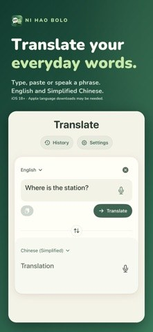

### 效率工具（2 个）

#### 1. Floaty: Lock Screen Essentials

- **内购**：Floaty Pro
- **原价**：$29.99，兑换码 0 元领
- **设备**：iPhone / iPad
- **最低系统**：iOS 17.0
- **评分**：★5.0 (5)
- **大小**：26.6 MB
- **干什么的**：此刻所需，尽在浮现
- **兑换链接**：[点这里兑换](https://apps.apple.com/redeem?ctx=offercodes&id=6825604929&code=GGFPL2K15)
- **App 链接**：[在 App Store 打开](https://apps.apple.com/us/app/id6825604929)
!carousel
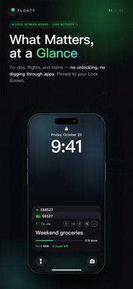

#### 2. Nota AI:Meeting Recorder Agent

- **内购**：LifeTime
- **原价**：$9.99，兑换码 0 元领
- **设备**：iPhone / iPad / Mac / Apple Watch
- **最低系统**：iOS 26.0
- **评分**：★5.0 (15)
- **大小**：89.1 MB
- **干什么的**：Turn conversations into clear notes with Nota.
- **兑换链接**：[点这里兑换](https://apps.apple.com/redeem?ctx=offercodes&id=6781580778&code=NOTAAIRECORDEAGENT)
- **App 链接**：[在 App Store 打开](https://apps.apple.com/us/app/id6781580778)
!carousel

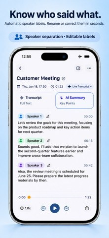

### 工具（1 个）

#### 1. FamilyDay - Days for Family

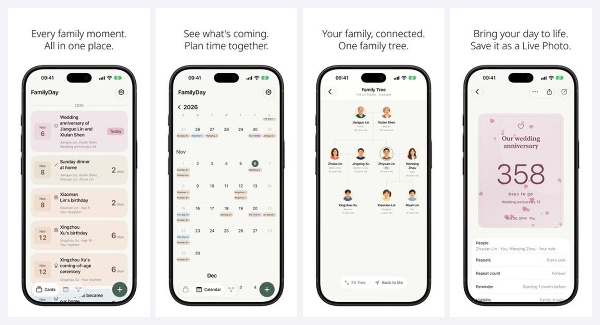

- **内购**：FamilyDay Lifetime
- **原价**：$6.99，兑换码 0 元领
- **设备**：iPhone / iPad
- **最低系统**：iOS 17.0
- **评分**：暂无评分
- **大小**：15.9 MB
- **干什么的**：把重要的日子留给家人
- **兑换链接**：[点这里兑换](https://apps.apple.com/redeem?ctx=offercodes&id=6825604711&code=FAMILYDAY500REDNOTE)
- **App 链接**：[在 App Store 打开](https://apps.apple.com/us/app/id6825604711)
!carousel
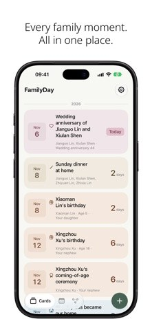
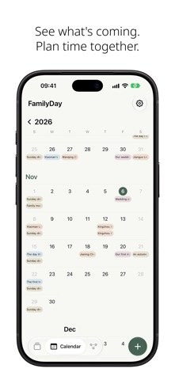

### 生活（1 个）

#### 1. Dayfetti: Countdown & Memories

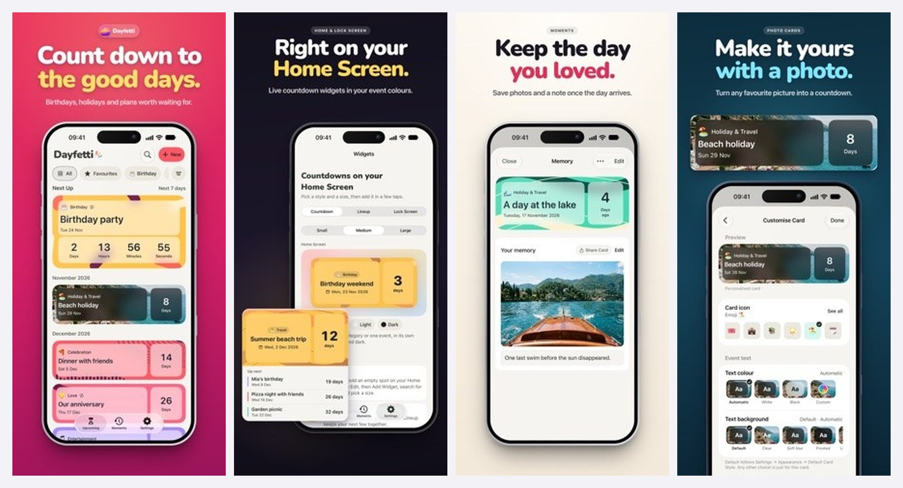

- **内购**：Dayfetti Pro · Lifetime
- **原价**：$12.99，兑换码 0 元领
- **设备**：iPhone / iPad
- **最低系统**：iOS 18.0
- **评分**：★5.0 (2)
- **大小**：14.1 MB
- **干什么的**：Count down to birthdays, trips, anniversaries and the days you look fo…
- **兑换链接**：[点这里兑换](https://apps.apple.com/redeem?ctx=offercodes&id=6831184506&code=FRIEND5)
- **App 链接**：[在 App Store 打开](https://apps.apple.com/us/app/id6831184506)
!carousel

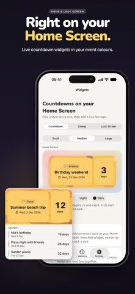

---

限免结束时间苹果不公布，一般 1–3 天，尽快领。
