今天 7 款付费 App 限时免费；另有 8 个终身内购可用兑换码 0 元领，原价加起来约 161 美元。都是今天刚确认的，限免随时可能结束，看到喜欢的就领。

## 今日极力推荐

1. **growDay  -Health Habit Agent** — 评分 5.0，原价 付费应用，Healthcare 是一款 Apple Intelligence 驱动的个人健康伴侣，帮助你全面管理身心健康
2. **JotBee** — 评分 5.0，原价 付费应用，JotBee — 随手记录，酿造生活
3. **XYZMoney-玲珑记账** — 评分 3.0，原价 付费应用，玲珑记账是一款智能化的个人财务管理工具

## 付费应用限时免费（7 款）

点链接进 App Store 点“获取”就行。领的时候只点“获取”，不要买任何内购。

### 健康健美（1 款）

#### 1. growDay  -Health Habit Agent

- **原价**：付费应用，现在免费
- **评分**：★5.0（36）
- **设备**：iPhone / iPad / Apple Watch
- **最低系统**：iOS 18.0
- **大小**：372.1 MB
- **语言**：中文、英文、日文、韩文、法文等 7 种
- **简介**：Healthcare 是一款 Apple Intelligence 驱动的个人健康伴侣，帮助你全面管理身心健康
- **领取**：[在 App Store 打开](https://apps.apple.com/us/app/id6762338774)

!carousel

### 生活（2 款）

#### 1. JotBee

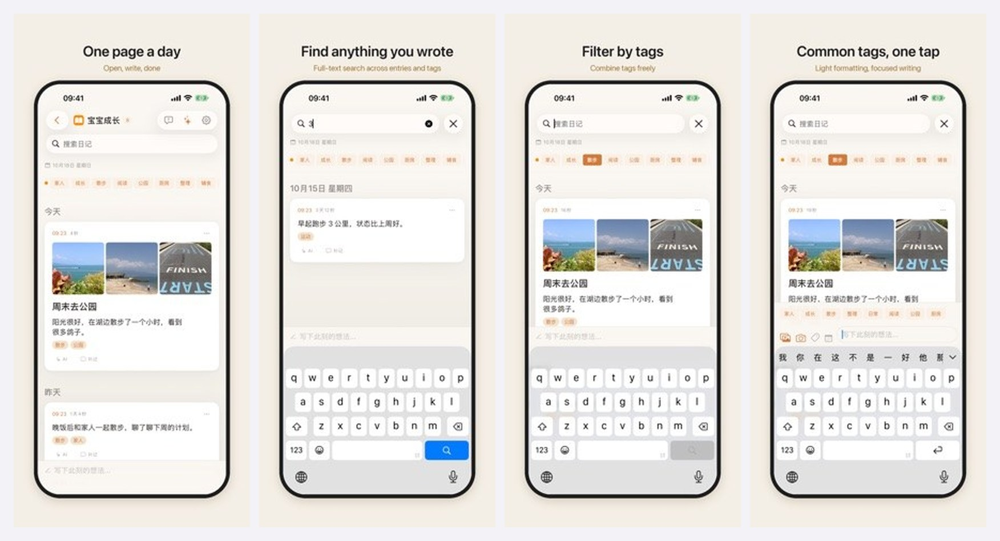

- **原价**：付费应用，现在免费
- **评分**：★5.0（1）
- **设备**：iPhone / iPad / Mac
- **最低系统**：iOS 17.0
- **大小**：4.6 MB
- **语言**：中文、英文、日文、韩文、法文等 8 种
- **简介**：JotBee — 随手记录，酿造生活
- **领取**：[在 App Store 打开](https://apps.apple.com/us/app/id6761894417)

!carousel

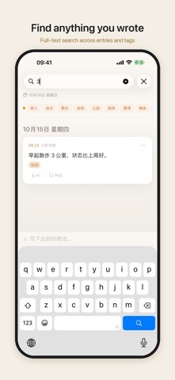

#### 2. Alpaca: Your Ravelry Companion

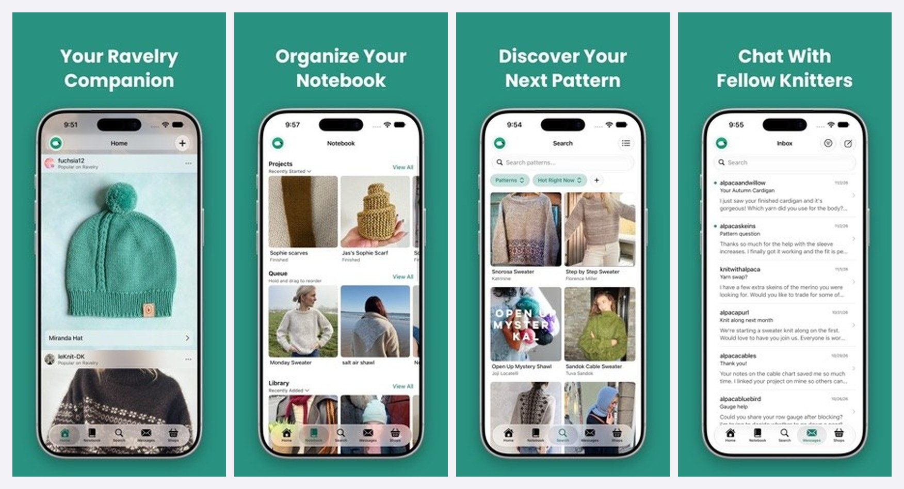

- **原价**：付费应用，现在免费
- **评分**：★4.1（124）
- **设备**：iPhone / iPad
- **最低系统**：iOS 26.1
- **大小**：15.6 MB
- **语言**：仅英文
- **简介**：与 Alpaca 一起，随时随地享受 Ravelry 的精华！
- **领取**：[在 App Store 打开](https://apps.apple.com/us/app/id1242116318)

!carousel

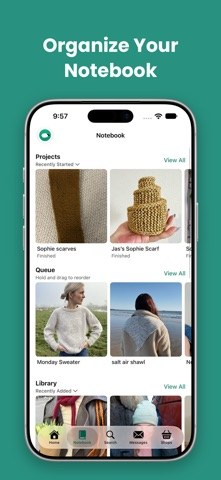

### 效率工具（1 款）

#### 1. Next: To Do List

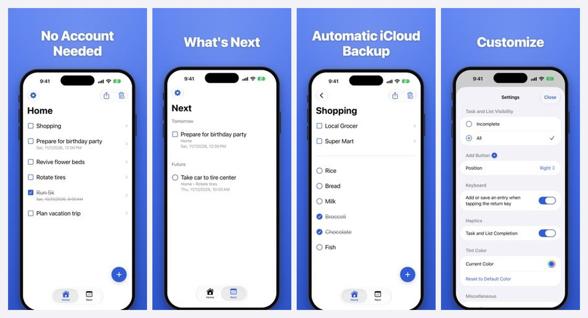

- **原价**：付费应用，现在免费
- **评分**：★5.0（1）
- **设备**：iPhone / iPad
- **最低系统**：iOS 26.6
- **大小**：1.3 MB
- **语言**：仅英文
- **简介**：• 添加任务和列表 • 将列表放入其他列表中 • 重新排序任务和列表 • 完成后核对任务和列表 • 设置截止日期和通知提醒 •
- **领取**：[在 App Store 打开](https://apps.apple.com/us/app/id6810757660)

!carousel
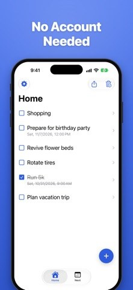
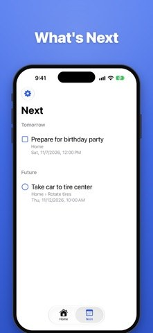

### 游戏（1 款）

#### 1. kickit.

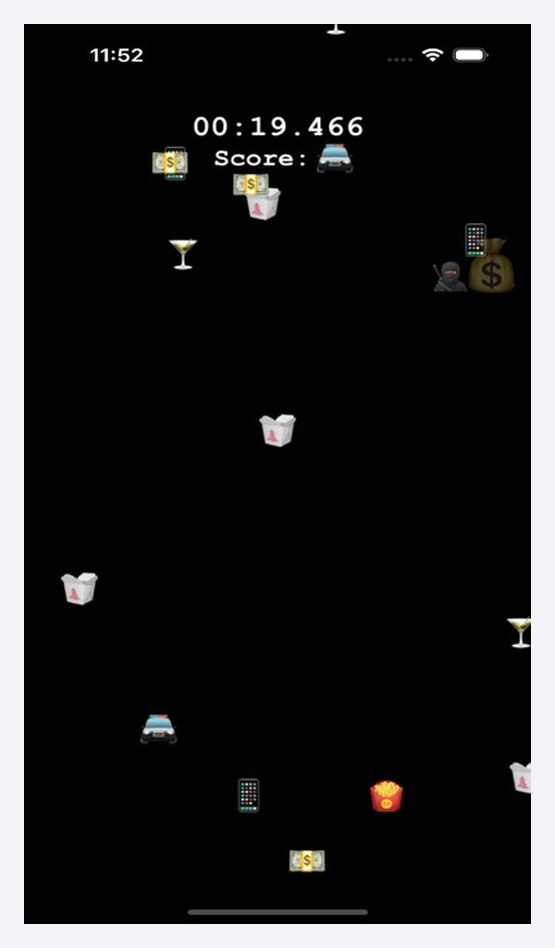

- **原价**：付费应用，现在免费
- **评分**：★4.7（16）
- **设备**：iPhone / iPad
- **最低系统**：iOS 17.2
- **大小**：6.1 MB
- **语言**：仅英文
- **简介**：你的分数取决于你赚钱的能力。
- **领取**：[在 App Store 打开](https://apps.apple.com/us/app/id1254777556)

!carousel

### Book（1 款）

#### 1. Local Audio Books

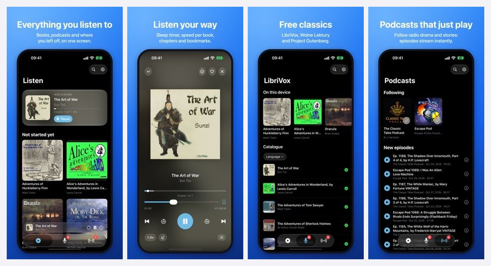

- **原价**：付费应用，现在免费
- **评分**：★4.0（1）
- **设备**：iPhone / iPad
- **最低系统**：iOS 26.0
- **大小**：7.5 MB
- **语言**：英文、法文、德文、西班牙文、葡萄牙文等 8 种
- **简介**：本地有声读物可播放你拥有的有声读物、八种语言的免费经典书籍以及刚刚播放的播客。
- **领取**：[在 App Store 打开](https://apps.apple.com/us/app/id6737989765)

!carousel

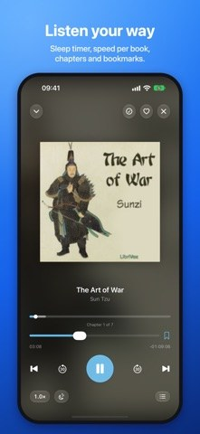

### 工具（1 款）

#### 1. XYZMoney-玲珑记账

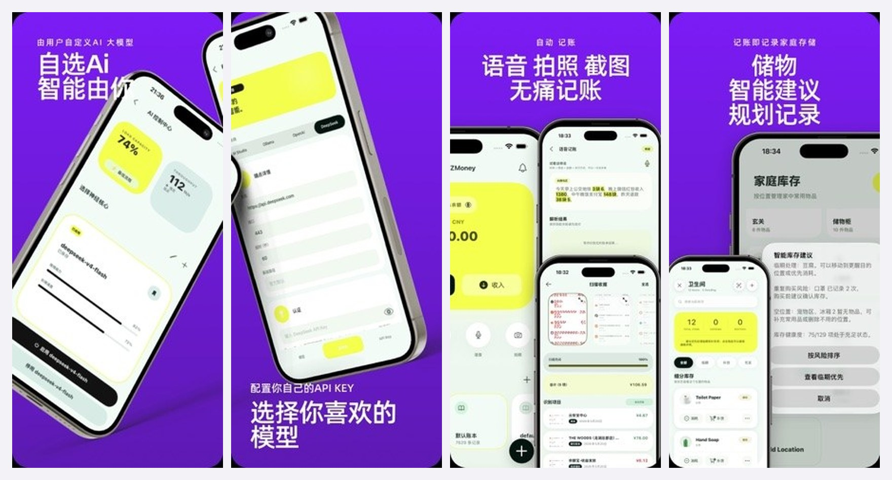

- **原价**：付费应用，现在免费
- **评分**：★3.0（2）
- **设备**：iPhone / iPad
- **最低系统**：iOS 17.0
- **大小**：87.6 MB
- **语言**：中文、英文、日文、韩文、法文等 43 种
- **简介**：玲珑记账是一款智能化的个人财务管理工具
- **领取**：[在 App Store 打开](https://apps.apple.com/us/app/id1519408304)

!carousel

## 终身内购 0 元兑换（8 个）

这几个不是商店里直接降价到 0 元，而是开发者发的公开兑换码：点帖子里的兑换链接直接进 App Store 兑。每个兑换码一个 Apple 账号只能用一次，都是终身解锁、不是订阅，不会续费。

**怎么领**：先装上对应的免费 App → 点该款下面的兑换链接 → 自动跳到 App Store 兑换页，确认就行。不用绑卡，没有试用期。没有兑换链接的款，暂时只能先装 App，等开发者放出公开码。

### 图形设计（1 个）

#### 1. Edit Text In Photo - Forgeit

- **内购**：30 Credits
- **原价**：$19.99，兑换码 0 元领
- **评分**：★4.3（13）
- **设备**：iPhone / iPad
- **最低系统**：iOS 17.0
- **大小**：43.2 MB
- **语言**：中文、英文、日文、韩文、法文等 12 种
- **简介**：六大工具，一个简单的编辑器
- **兑换链接**：[点这里兑换](https://apps.apple.com/redeem?ctx=offercodes&id=6778315973&code=FORGEITBEST)
- **App 链接**：[在 App Store 打开](https://apps.apple.com/us/app/id6778315973)
!carousel

### 健康健美（2 个）

#### 1. Good Terms: Mindful App Limits

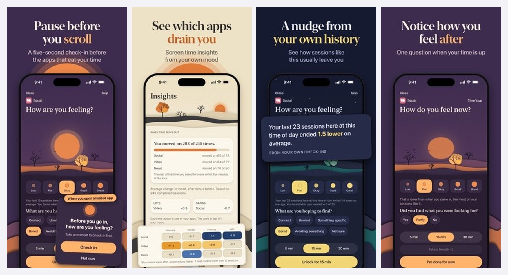

- **内购**：Good Terms Plus Lifetime
- **原价**：$24.99，兑换码 0 元领
- **设备**：iPhone / iPad
- **最低系统**：iOS 26.0
- **大小**：3.9 MB
- **语言**：仅英文
- **简介**：Good terms 会在你选择限制的应用程序之前进行五秒钟的签入。
- **兑换链接**：[点这里兑换](https://apps.apple.com/redeem?ctx=offercodes&id=6834076393&code=MIKELOVESPUPPIES)
- **App 链接**：[在 App Store 打开](https://apps.apple.com/us/app/id6834076393)
!carousel
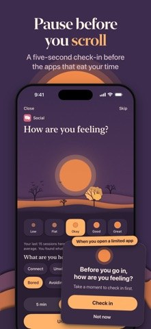

#### 2. Petals: Period & Cycle Tracker

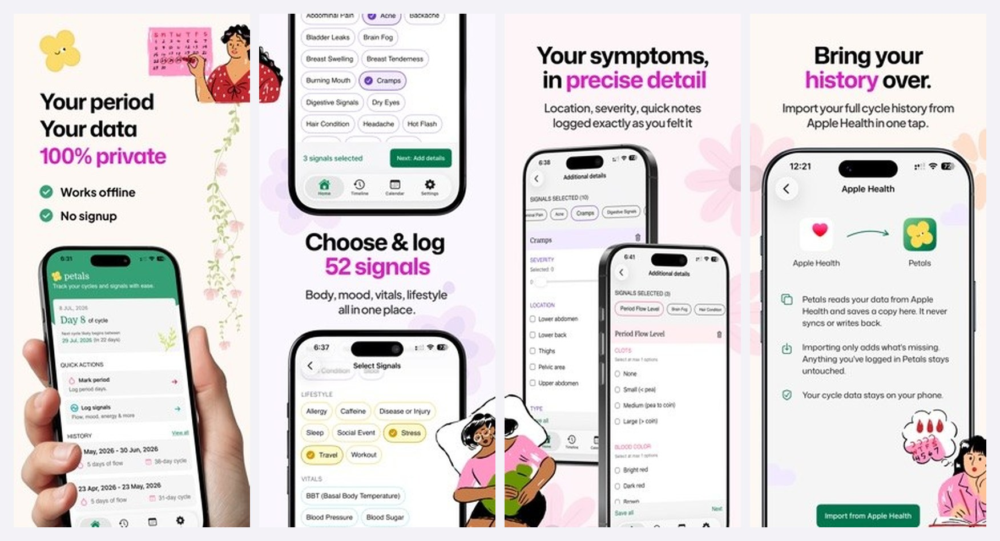

- **内购**：Lifetime Plus Family
- **原价**：$49.99，兑换码 0 元领
- **评分**：★4.9（7）
- **设备**：iPhone / iPad
- **最低系统**：iOS 18.6
- **大小**：14.8 MB
- **语言**：仅英文
- **简介**：你的周期，详细记录下来。
- **兑换链接**：[点这里兑换](https://apps.apple.com/redeem?ctx=offercodes&id=6751436384&code=GETFREEPETALS)
- **App 链接**：[在 App Store 打开](https://apps.apple.com/us/app/id6751436384)
!carousel
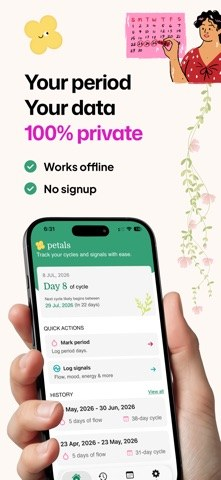

### 游戏（1 个）

#### 1. Ringo: Water Ring Toss

- **内购**：Ringo Pro
- **原价**：$2.99，兑换码 0 元领
- **设备**：iPhone / iPad
- **最低系统**：iOS 17.0
- **大小**：9.9 MB
- **语言**：仅英文
- **简介**：Ringo 将经典的水环玩具带到你的 iPhone 和 iPad 上。
- **兑换链接**：[点这里兑换](https://apps.apple.com/redeem?ctx=offercodes&id=6822308678&code=FRIEND5)
- **App 链接**：[在 App Store 打开](https://apps.apple.com/us/app/id6822308678)
!carousel
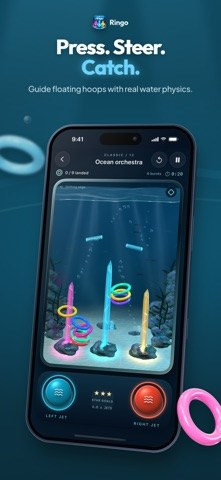

### 教育（1 个）

#### 1. Ni Hao Bolo

- **内购**：Ni Hao Bolo Pro
- **原价**：$9.99，兑换码 0 元领
- **设备**：iPhone / iPad
- **最低系统**：iOS 17.0
- **大小**：5.9 MB
- **语言**：中文、英文
- **简介**：从英语中学习有用的普通话，或在普通话支持下练习英语。
- **兑换链接**：[点这里兑换](https://apps.apple.com/redeem?ctx=offercodes&id=6827587342&code=FRIEND5)
- **App 链接**：[在 App Store 打开](https://apps.apple.com/us/app/id6827587342)
!carousel

### 效率工具（2 个）

#### 1. Floaty: Lock Screen Essentials

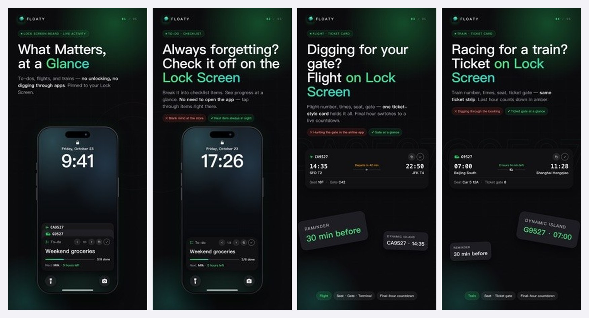

- **内购**：Floaty Pro
- **原价**：$29.99，兑换码 0 元领
- **评分**：★5.0（8）
- **设备**：iPhone / iPad
- **最低系统**：iOS 17.0
- **大小**：26.6 MB
- **语言**：中文、英文
- **简介**：浮现把此刻最需要的信息，显示在你的锁屏上
- **兑换链接**：[点这里兑换](https://apps.apple.com/redeem?ctx=offercodes&id=6825604929&code=GGFPL2K15)
- **App 链接**：[在 App Store 打开](https://apps.apple.com/us/app/id6825604929)
!carousel

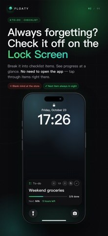

#### 2. Nota AI:Meeting Recorder Agent

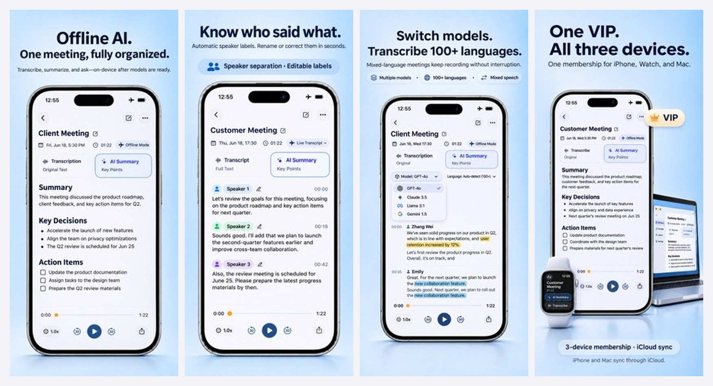

- **内购**：LifeTime
- **原价**：$9.99，兑换码 0 元领
- **评分**：★4.9（16）
- **设备**：iPhone / iPad / Mac / Apple Watch
- **最低系统**：iOS 26.0
- **大小**：89.1 MB
- **语言**：中文、英文、日文、德文、西班牙文
- **简介**：使用 Nota 将对话变成清晰的笔记。
- **兑换链接**：[点这里兑换](https://apps.apple.com/redeem?ctx=offercodes&id=6781580778&code=NOTAAIRECORDEAGENT)
- **App 链接**：[在 App Store 打开](https://apps.apple.com/us/app/id6781580778)
!carousel
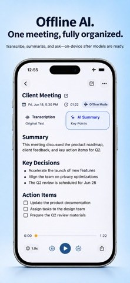

### 生活（1 个）

#### 1. Dayfetti: Countdown & Memories

- **内购**：Dayfetti Pro · Lifetime
- **原价**：$12.99，兑换码 0 元领
- **评分**：★5.0（2）
- **设备**：iPhone / iPad
- **最低系统**：iOS 18.0
- **大小**：14.1 MB
- **语言**：仅英文
- **简介**：将你的下一个约会保留在主屏幕小部件上，当这一天到来时，保存照片和几句话，以便它成为你可以回顾的记忆。
- **兑换链接**：[点这里兑换](https://apps.apple.com/redeem?ctx=offercodes&id=6831184506&code=FRIEND5)
- **App 链接**：[在 App Store 打开](https://apps.apple.com/us/app/id6831184506)
!carousel
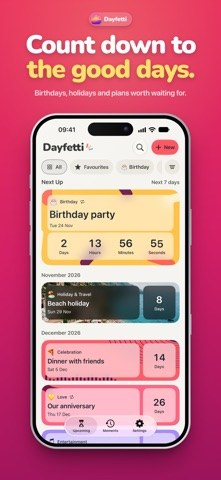

---

限免结束时间苹果不公布，一般 1–3 天，尽快领。
