今天 3 款付费 App 限时免费；另有 8 个终身内购可用兑换码 0 元领，原价加起来约 370 美元。都是今天刚确认的，限免随时可能结束，看到喜欢的就领。

## 今日极力推荐

1. **LandMeter - GPS Area Measure** — 评分 4.6，原价 付费应用，LandMeter 将任何地图变成一个快速的土地、田地和庭院测量工具

## 付费应用限时免费（3 款）

点链接进 App Store 点“获取”就行。领的时候只点“获取”，不要买任何内购。

### 游戏（1 款）

#### 1. Old Monterrey: Pixel Adventure

- **原价**：付费应用，现在免费
- **评分**：★4.7（65）
- **设备**：iPhone / iPad
- **最低系统**：iOS 12.0
- **大小**：60.3 MB
- **语言**：仅英文
- **简介**：Old Monterrey 是一款受墨西哥北部启发的优质 2D 像素平台游戏。
- **领取**：[在 App Store 打开](https://apps.apple.com/us/app/id1658860667)

!carousel

### 导航（1 款）

#### 1. LandMeter - GPS Area Measure

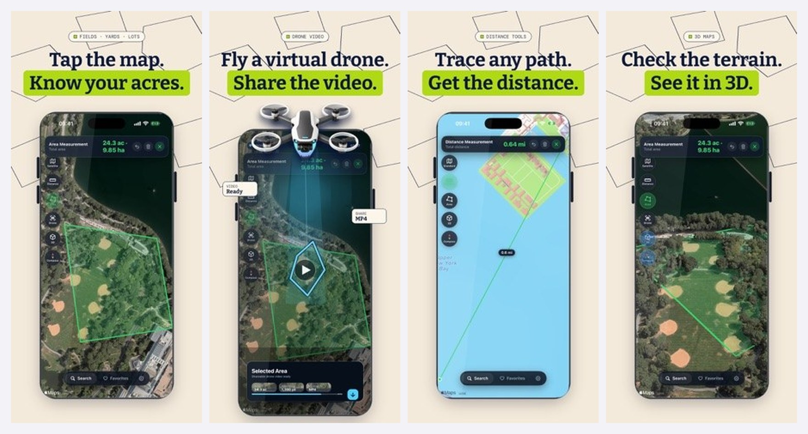

- **原价**：付费应用，现在免费
- **评分**：★4.6（8）
- **设备**：iPhone / iPad
- **最低系统**：iOS 17.0
- **大小**：9.7 MB
- **语言**：中文、英文、日文、韩文、法文等 36 种
- **简介**：LandMeter 将任何地图变成一个快速的土地、田地和庭院测量工具
- **领取**：[在 App Store 打开](https://apps.apple.com/us/app/id6779892226)

!carousel
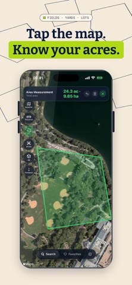

### 摄影与录像（1 款）

#### 1. TripleShot Recorder

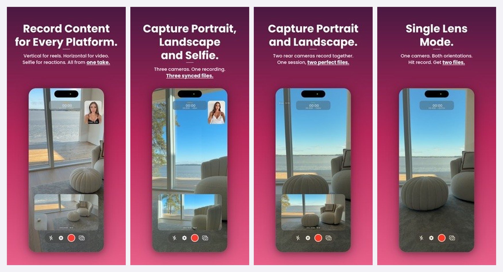

- **原价**：付费应用，现在免费
- **评分**：★4.2（20）
- **设备**：iPhone / iPad
- **最低系统**：iOS 17.6
- **大小**：2.4 MB
- **语言**：仅英文
- **简介**：TripleShot 同时从三个 iPhone 摄像头进行录制，在一次录制中为你提供肖像、风景和自拍镜头。
- **领取**：[在 App Store 打开](https://apps.apple.com/us/app/id6761472164)

!carousel

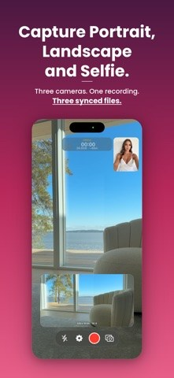

## 终身内购 0 元兑换（8 个）

这几个不是商店里直接降价到 0 元，而是开发者发的公开兑换码：点帖子里的兑换链接直接进 App Store 兑。每个兑换码一个 Apple 账号只能用一次，都是终身解锁、不是订阅，不会续费。

**怎么领**：先装上对应的免费 App → 点该款下面的兑换链接 → 自动跳到 App Store 兑换页，确认就行。不用绑卡，没有试用期。没有兑换链接的款，暂时只能先装 App，等开发者放出公开码。

### 健康健美（2 个）

#### 1. Petals: Period & Cycle Tracker

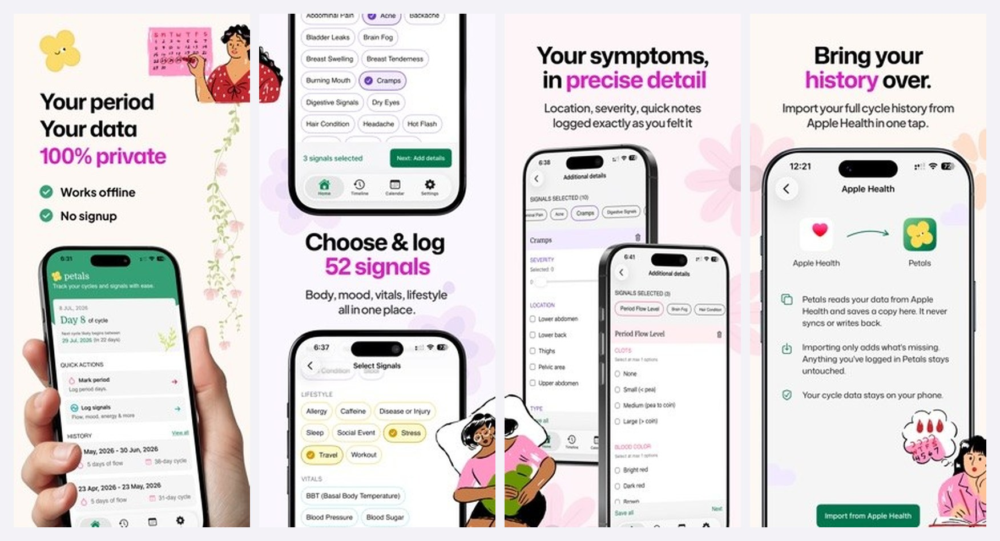

- **内购**：Lifetime Plus Family
- **原价**：$49.99，兑换码 0 元领
- **评分**：★4.9（7）
- **设备**：iPhone / iPad
- **最低系统**：iOS 18.6
- **大小**：14.8 MB
- **语言**：仅英文
- **简介**：你的周期，详细记录下来。
- **兑换链接**：[点这里兑换](https://apps.apple.com/redeem?ctx=offercodes&id=6751436384&code=OOAPPS)
- **App 链接**：[在 App Store 打开](https://apps.apple.com/us/app/id6751436384)
!carousel
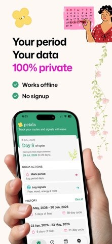
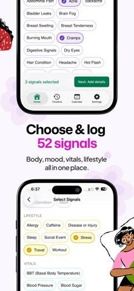

#### 2. Pufflo

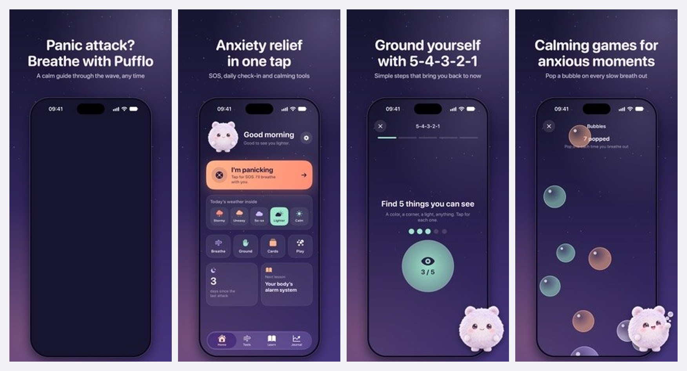

- **内购**：Pufflo Pro Lifetime
- **原价**：$69.99，兑换码 0 元领
- **评分**：★5.0（3）
- **设备**：iPhone / iPad
- **最低系统**：iOS 17.0
- **大小**：13.9 MB
- **语言**：中文、英文、日文、韩文、法文等 43 种
- **简介**：Pufflo是一款帮助应对惊恐发作和焦虑的自助应用
- **App 链接**：[在 App Store 打开](https://apps.apple.com/us/app/id6834941381)
!carousel

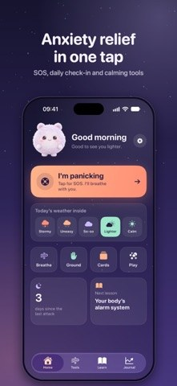

### 摄影与录像（2 个）

#### 1. Edit Text on Photos: Glyphswap

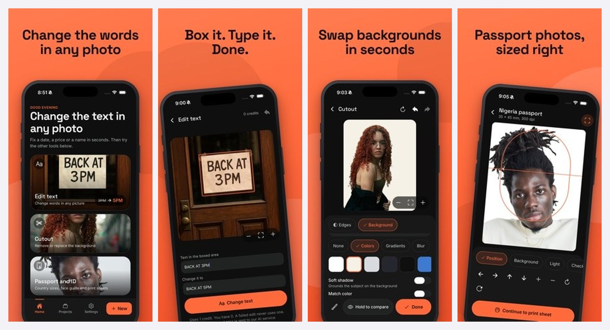

- **内购**：100 Credits
- **原价**：$69.99，兑换码 0 元领
- **评分**：★5.0（1）
- **设备**：iPhone / iPad
- **最低系统**：iOS 16.4
- **大小**：132.9 MB
- **语言**：仅英文
- **简介**：Glyphswap 会更改图片中的文字，同时保持原始外观。
- **兑换链接**：[点这里兑换](https://apps.apple.com/redeem?ctx=offercodes&id=6829087828&code=GLYPHPRO)
- **App 链接**：[在 App Store 打开](https://apps.apple.com/us/app/id6829087828)
!carousel
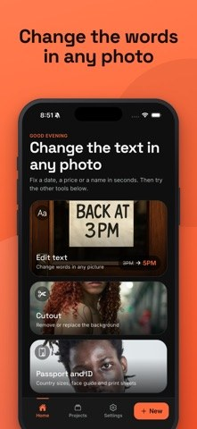
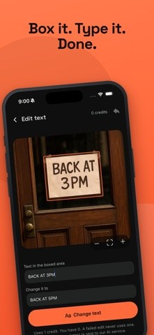

#### 2. No Edits: Daily Video Habit

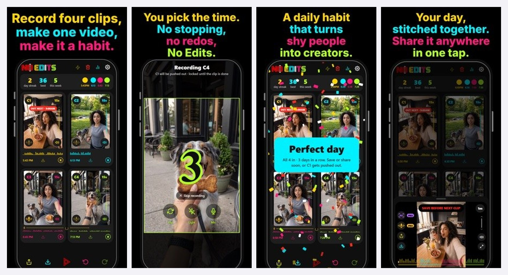

- **内购**：Pro Lifetime
- **原价**：$69.99，兑换码 0 元领
- **设备**：iPhone / iPad
- **最低系统**：iOS 16.4
- **大小**：49.2 MB
- **语言**：仅英文
- **简介**：No Edits 是一款习惯应用程序
- **兑换链接**：[点这里兑换](https://apps.apple.com/redeem?ctx=offercodes&id=6812511258&code=NOEDITS)
- **App 链接**：[在 App Store 打开](https://apps.apple.com/us/app/id6812511258)
!carousel
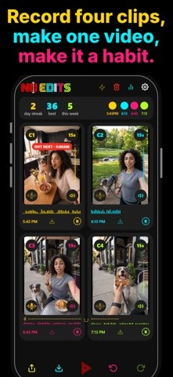
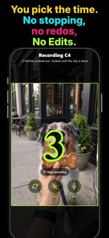

### 工具（2 个）

#### 1. LumaTidy - Sort, Edit & Frame

- **内购**：LumaTidy Pro Lifetime
- **原价**：$9.99，兑换码 0 元领
- **评分**：★5.0（2）
- **设备**：iPhone / iPad
- **最低系统**：iOS 17.0
- **大小**：283.8 MB
- **语言**：中文、英文、日文、韩文、法文等 8 种
- **简介**：让整理照片和视频成为一种乐趣。
- **兑换链接**：[点这里兑换](https://apps.apple.com/redeem?ctx=offercodes&id=6829604506&code=GETFREELT)
- **App 链接**：[在 App Store 打开](https://apps.apple.com/us/app/id6829604506)
!carousel

#### 2. Calculator & Cleaner: SuperC

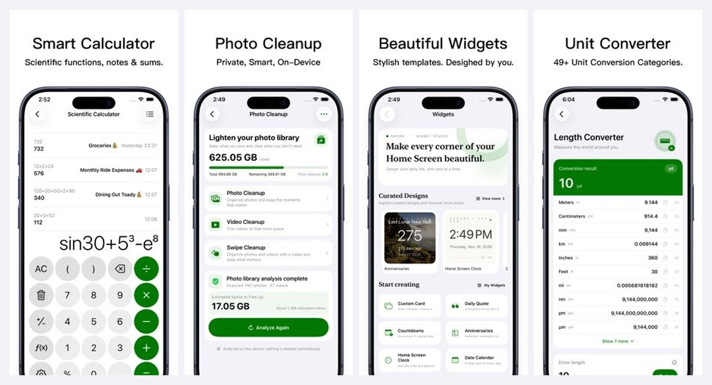

- **内购**：SuperC Lifetime Access
- **原价**：$39.99，兑换码 0 元领
- **评分**：★4.4（8）
- **设备**：iPhone / iPad
- **最低系统**：iOS 16.0
- **大小**：43.0 MB
- **语言**：中文、英文
- **简介**：灵珠计算器 - 多功能百宝箱 让日常所需，触手可及
- **兑换链接**：[点这里兑换](https://apps.apple.com/redeem?ctx=offercodes&id=6737301186&code=SUPERC2026)
- **App 链接**：[在 App Store 打开](https://apps.apple.com/us/app/id6737301186)
!carousel
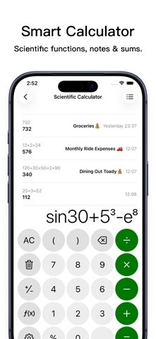
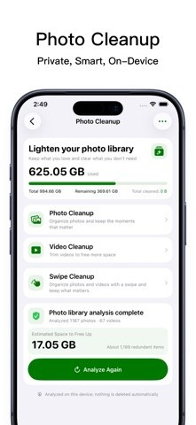

### 图形设计（1 个）

#### 1. Edit Text In Photo - Forgeit

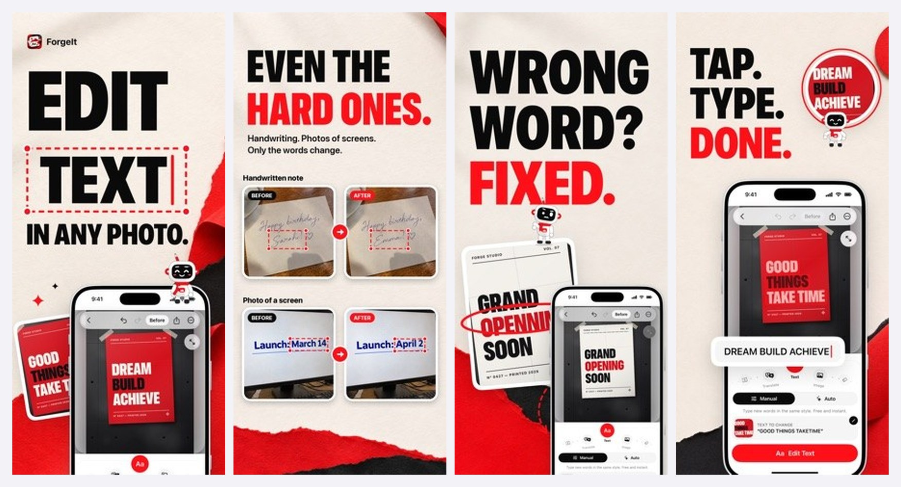

- **内购**：30 Credits
- **原价**：$19.99，兑换码 0 元领
- **评分**：★4.3（13）
- **设备**：iPhone / iPad
- **最低系统**：iOS 17.0
- **大小**：43.2 MB
- **语言**：中文、英文、日文、韩文、法文等 12 种
- **简介**：六大工具，一个简单的编辑器
- **兑换链接**：[点这里兑换](https://apps.apple.com/redeem?ctx=offercodes&id=6778315973&code=FORGEITBEST)
- **App 链接**：[在 App Store 打开](https://apps.apple.com/us/app/id6778315973)
!carousel

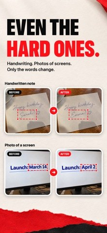

### 音乐（1 个）

#### 1. Guitar Lessons

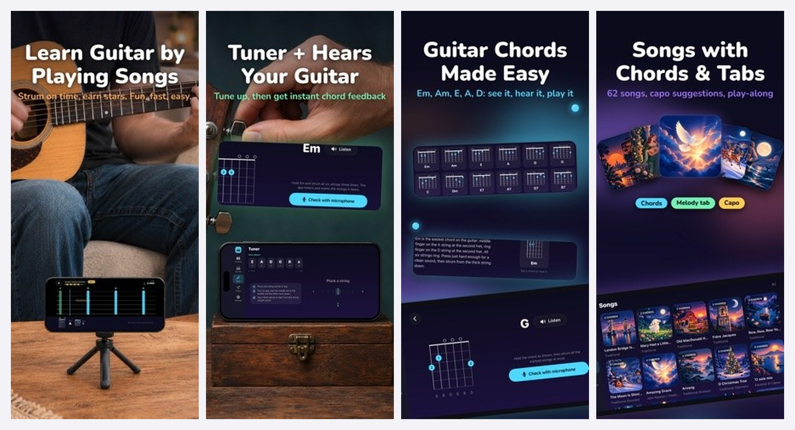

- **内购**：Nota Premium Lifetime
- **原价**：$39.99，兑换码 0 元领
- **评分**：★4.9（9）
- **设备**：iPhone / iPad
- **最低系统**：iOS 26.0
- **大小**：97.8 MB
- **语言**：中文、英文、日文、韩文、法文等 11 种
- **简介**：弹你熟悉的歌曲来学吉他：和弦块滑向判定线，到达时你扫弦即可，每首歌都是一个关卡，有连击、得分和可以赢取的星星
- **App 链接**：[在 App Store 打开](https://apps.apple.com/us/app/id6832286151)
!carousel
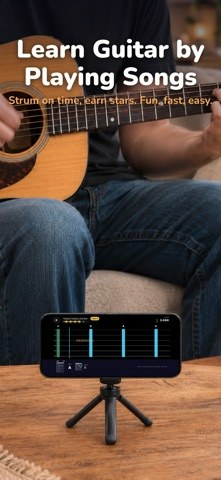

---

限免结束时间苹果不公布，一般 1–3 天，尽快领。
