今天 4 款付费 App 限时免费；另有 8 个终身内购可用兑换码 0 元领，原价加起来约 139 美元。都是今天刚确认的，限免随时可能结束，看到喜欢的就领。

## 今日极力推荐

1. **Merge Voice Memos** — 评分 4.9，原价 付费应用，适合分几次录下的讲座、会议记录、采访、歌曲灵感、试音，以及在“语音备忘录”中被分成好几段的长录音
2. **词光 - 雅思单词·插画背单词** — 评分 4.9，原价 付费应用，—— 记忆曲线替你安排 —— 根据你每次的回答，估算一个词什么时候快忘了，在那之前让你再见它一次

## 付费应用限时免费（4 款）

点链接进 App Store 点“获取”就行。领的时候只点“获取”，不要买任何内购。

### 效率工具（1 款）

#### 1. Merge Voice Memos

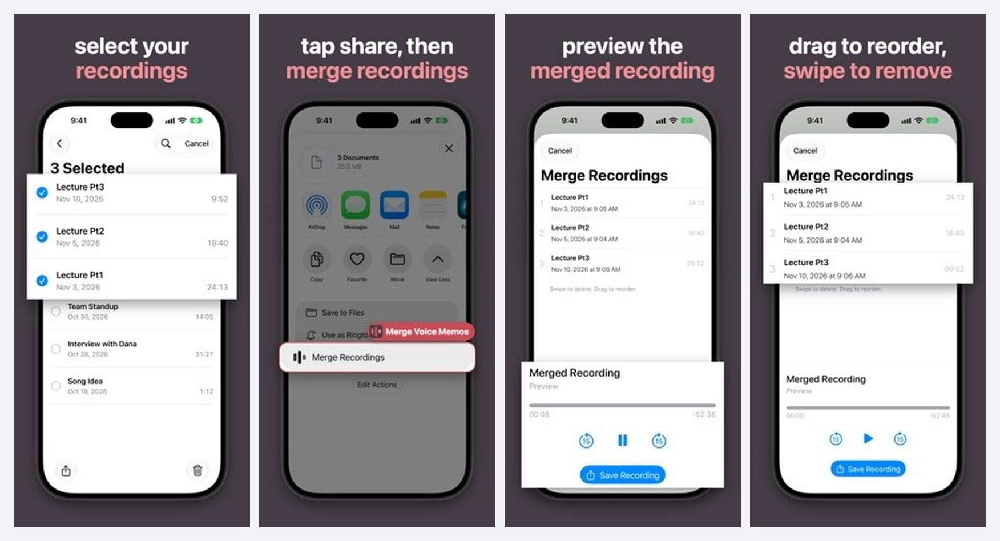

- **原价**：付费应用，现在免费
- **评分**：★4.9（549）
- **设备**：iPhone / iPad
- **最低系统**：iOS 16.0
- **大小**：7.1 MB
- **语言**：中文、英文、日文、韩文、法文等 12 种
- **简介**：适合分几次录下的讲座、会议记录、采访、歌曲灵感、试音，以及在“语音备忘录”中被分成好几段的长录音
- **领取**：[在 App Store 打开](https://apps.apple.com/us/app/id6476123178)

!carousel
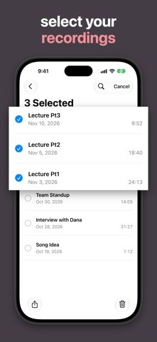
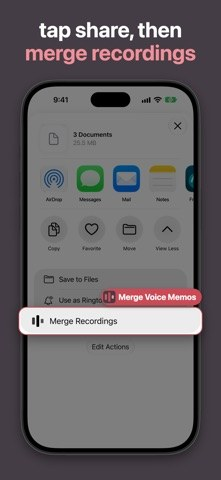

### 教育（1 款）

#### 1. 词光 - 雅思单词·插画背单词

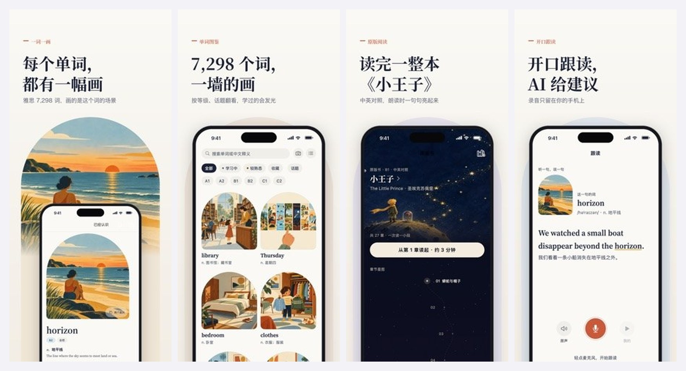

- **原价**：付费应用，现在免费
- **评分**：★4.9（24）
- **设备**：iPhone / iPad
- **最低系统**：iOS 26.0
- **大小**：67.7 MB
- **语言**：中文
- **简介**：—— 记忆曲线替你安排 —— 根据你每次的回答，估算一个词什么时候快忘了，在那之前让你再见它一次
- **领取**：[在 App Store 打开](https://apps.apple.com/us/app/id6827459612)

!carousel
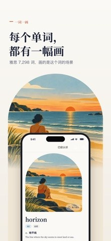
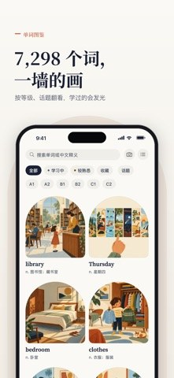

### 图形设计（1 款）

#### 1. Resume Maker: CV Maker

- **原价**：付费应用，现在免费
- **评分**：★4.8（226）
- **设备**：iPhone / iPad
- **最低系统**：iOS 14.0
- **大小**：216.2 MB
- **语言**：仅英文
- **简介**：简历生成器可帮助你在几分钟内创建一份专业且令人印象深刻的简历。
- **领取**：[在 App Store 打开](https://apps.apple.com/us/app/id6468965114)

!carousel

### 医疗（1 款）

#### 1. TPN and Tube Feeding - Nutricalc for RDs

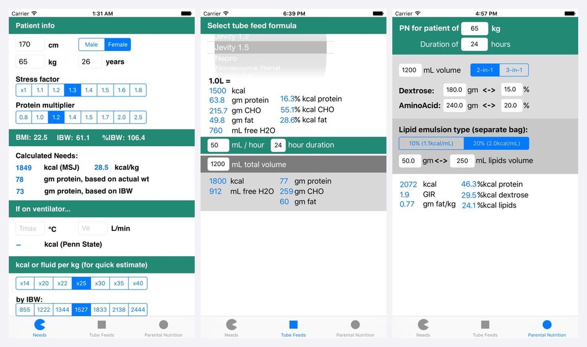

- **原价**：付费应用，现在免费
- **评分**：★4.5（27）
- **设备**：iPhone / iPad
- **最低系统**：iOS 7.0
- **大小**：1.1 MB
- **语言**：仅英文
- **简介**：由斯坦福医院和圣克拉拉谷医疗中心经验丰富的研发人员设计，将所有营养支持需求尽在掌握。
- **领取**：[在 App Store 打开](https://apps.apple.com/us/app/id938468853)

!carousel
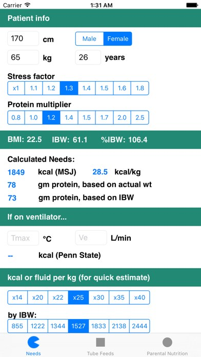
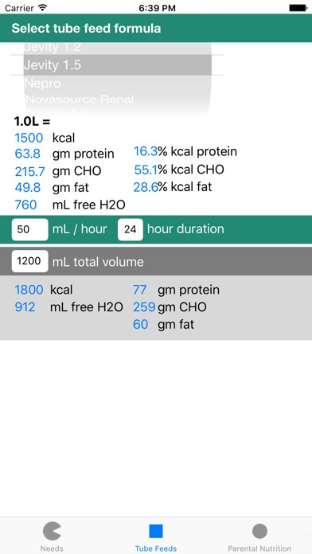

## 终身内购 0 元兑换（8 个）

这几个不是商店里直接降价到 0 元，而是开发者发的公开兑换码：点帖子里的兑换链接直接进 App Store 兑。每个兑换码一个 Apple 账号只能用一次，都是终身解锁、不是订阅，不会续费。

**怎么领**：先装上对应的免费 App → 点该款下面的兑换链接 → 自动跳到 App Store 兑换页，确认就行。不用绑卡，没有试用期。没有兑换链接的款，暂时只能先装 App，等开发者放出公开码。

### 娱乐（1 个）

#### 1. Foreverse - AI Story Studio

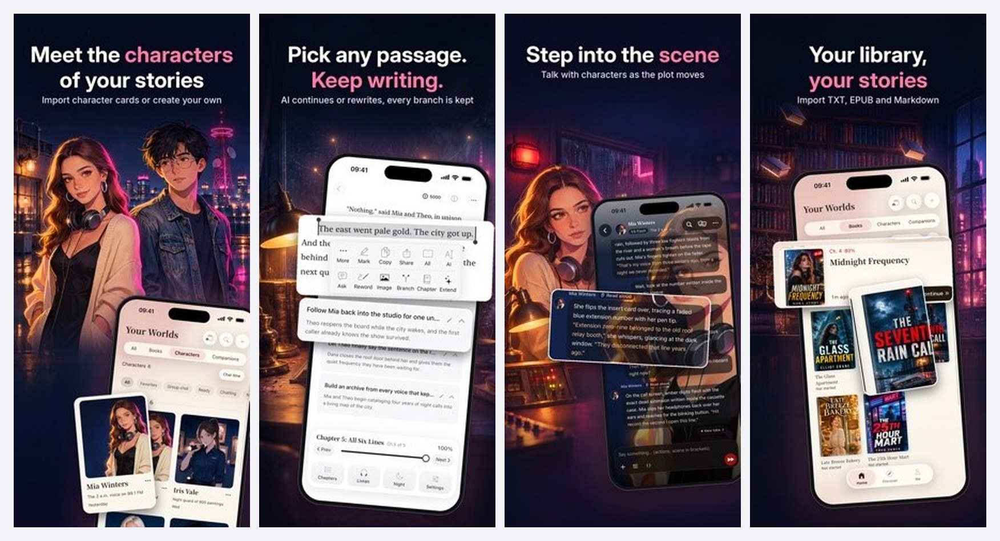

- **内购**：Large Reserve · 270,000 Credits
- **原价**：$39.99，兑换码 0 元领
- **评分**：★1.0（1）
- **设备**：iPhone / iPad
- **最低系统**：iOS 17.0
- **大小**：250.4 MB
- **语言**：中文、英文、日文、韩文、法文等 7 种
- **简介**：Foreverse 是一款用于阅读小说、编写互动故事和组织创意材料的人工智能工具。
- **兑换链接**：[点这里兑换](https://apps.apple.com/redeem?ctx=offercodes&id=6791037004&code=FOREVERSEWINTER)
- **App 链接**：[在 App Store 打开](https://apps.apple.com/us/app/id6791037004)
!carousel

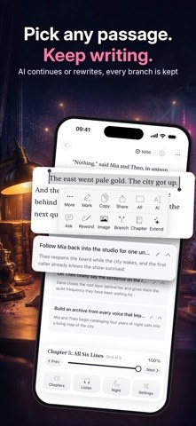

### 工具（3 个）

#### 1. WaterEject Pro: Speaker Clean

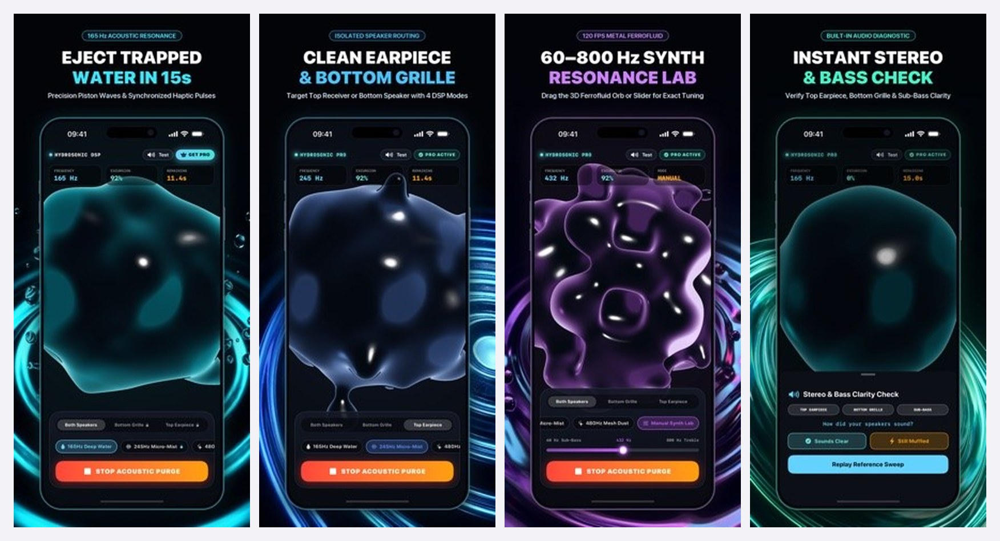

- **内购**：Lifetime Pro Unlock
- **原价**：$4.99，兑换码 0 元领
- **评分**：★5.0（1）
- **设备**：iPhone / iPad
- **最低系统**：iOS 17.0
- **大小**：2.5 MB
- **语言**：仅英文
- **简介**：你的 iPhone 是否在淋浴、下雨或泳池中被弄湿？
- **兑换链接**：[点这里兑换](https://apps.apple.com/redeem?ctx=offercodes&id=6826535510&code=GETFREEAPP)
- **App 链接**：[在 App Store 打开](https://apps.apple.com/us/app/id6826535510)
!carousel
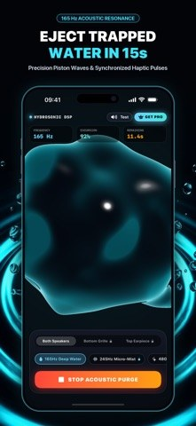
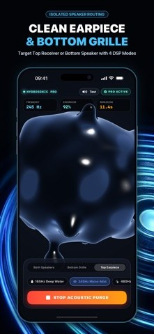

#### 2. Stud Finder Pro: Metal Scanner

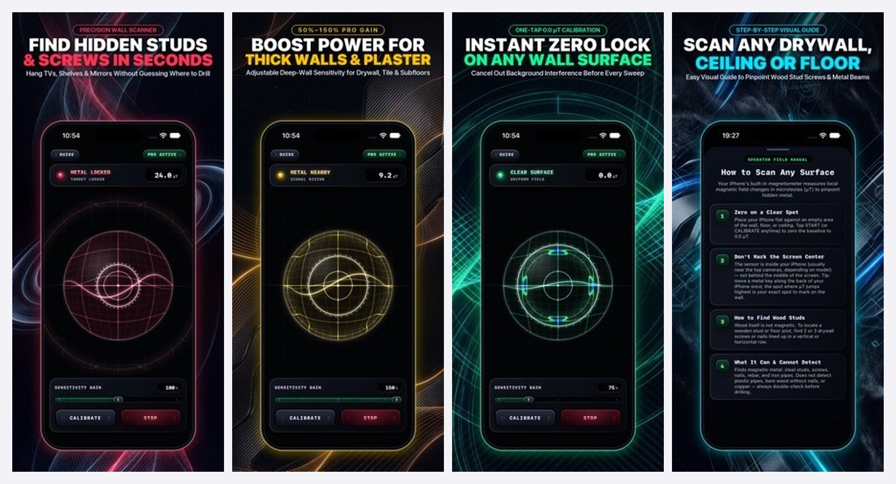

- **内购**：Lifetime Unlimited
- **原价**：$7.99，兑换码 0 元领
- **评分**：★5.0（1）
- **设备**：iPhone / iPad
- **最低系统**：iOS 17.0
- **大小**：2.9 MB
- **语言**：仅英文
- **简介**：Stud Finder Pro 将 iPhone 的内置 3D 磁力计和陀螺仪转变为高精度磁性墙壁扫描仪和金属探测器。
- **兑换链接**：[点这里兑换](https://apps.apple.com/redeem?ctx=offercodes&id=6828564560&code=GETFREEAPP)
- **App 链接**：[在 App Store 打开](https://apps.apple.com/us/app/id6828564560)
!carousel
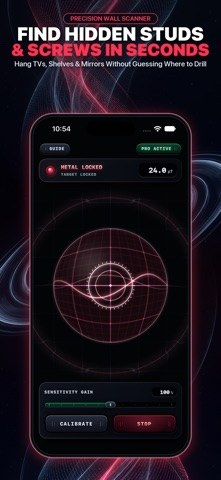
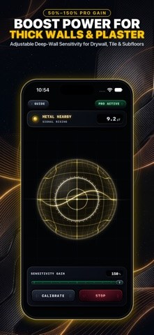

#### 3. Cube Solver 3D: Easy Solver AI

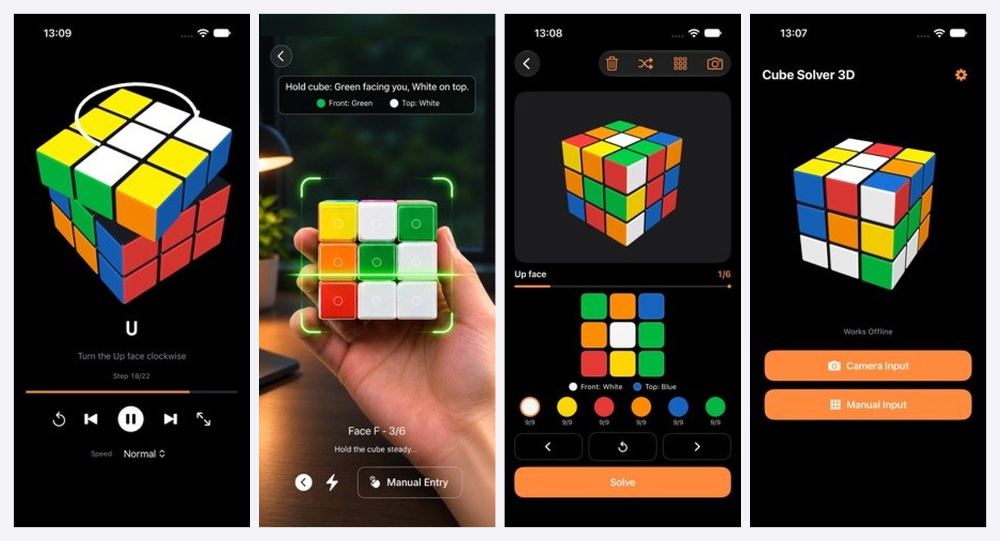

- **内购**：Unlock Premium
- **原价**：$3.99，兑换码 0 元领
- **设备**：iPhone / iPad
- **最低系统**：iOS 17.0
- **大小**：9.1 MB
- **语言**：中文、英文、西班牙文、葡萄牙文、越南文
- **简介**：Cube Solver 3D: Easy Solver 是一款简单实用的3D魔方求解器，支持相机扫描、手动输入颜色和3D动画分步指导
- **兑换链接**：[点这里兑换](https://apps.apple.com/redeem?ctx=offercodes&id=6838251324&code=3DCUBEFREE)
- **App 链接**：[在 App Store 打开](https://apps.apple.com/us/app/id6838251324)
!carousel
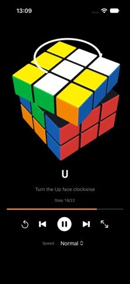
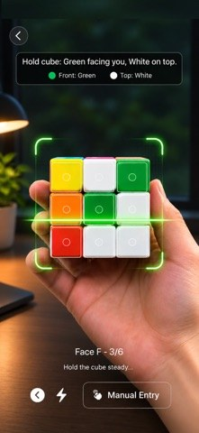

### 教育（1 个）

#### 1. LearnBack: Active Recall

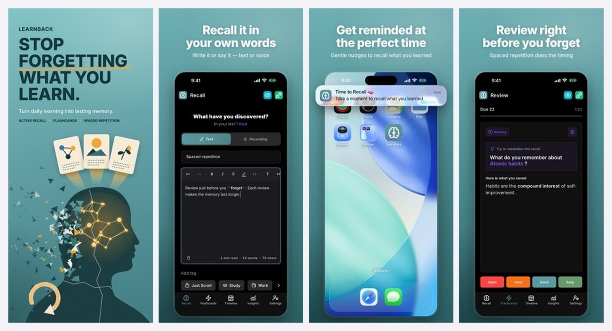

- **内购**：LearnBack Pro
- **原价**：$19.99，兑换码 0 元领
- **评分**：★5.0（25）
- **设备**：iPhone / iPad / Mac
- **最低系统**：iOS 14.0
- **大小**：56.6 MB
- **语言**：仅英文
- **简介**：不要忘记你读过的、观看过的和学习过的东西。
- **兑换链接**：[点这里兑换](https://apps.apple.com/redeem?ctx=offercodes&id=6757343516&code=FREEREDDITX9)
- **App 链接**：[在 App Store 打开](https://apps.apple.com/us/app/id6757343516)
!carousel

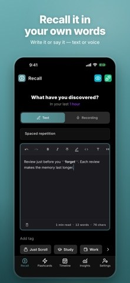

### 健康健美（1 个）

#### 1. Petals: Period & Cycle Tracker

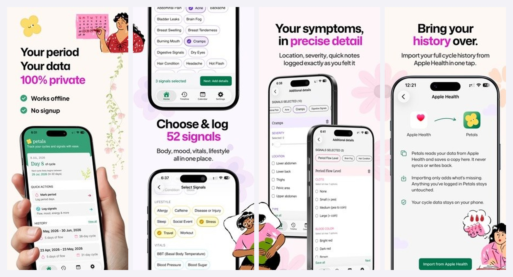

- **内购**：Lifetime Plus Family
- **原价**：$49.99，兑换码 0 元领
- **评分**：★4.9（7）
- **设备**：iPhone / iPad
- **最低系统**：iOS 18.6
- **大小**：14.8 MB
- **语言**：仅英文
- **简介**：你的周期，详细记录下来。
- **兑换链接**：[点这里兑换](https://apps.apple.com/redeem?ctx=offercodes&id=6751436384&code=OOAPPS)
- **App 链接**：[在 App Store 打开](https://apps.apple.com/us/app/id6751436384)
!carousel
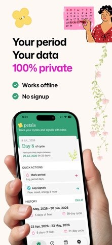
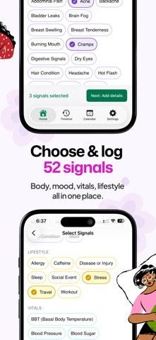

### 游戏（1 个）

#### 1. Voidcrown: Stellar Empires

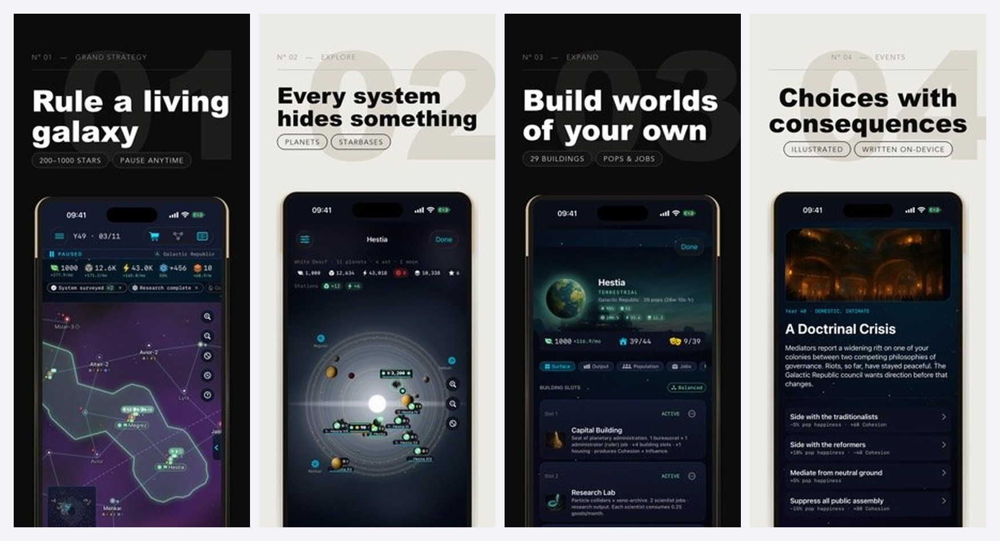

- **内购**：Voidcrown Full Game
- **原价**：$9.99，兑换码 0 元领
- **设备**：iPhone / iPad
- **最低系统**：iOS 26.0
- **大小**：50.9 MB
- **语言**：英文、西班牙文
- **简介**：在一个下午建立一个银河帝国。
- **兑换链接**：[点这里兑换](https://apps.apple.com/redeem?ctx=offercodes&id=6768304669&code=VOIDCROWN)
- **App 链接**：[在 App Store 打开](https://apps.apple.com/us/app/id6768304669)
!carousel
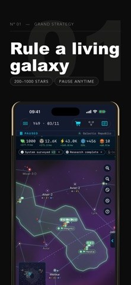
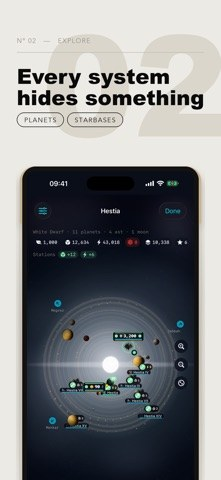

### 效率工具（1 个）

#### 1. Convo1

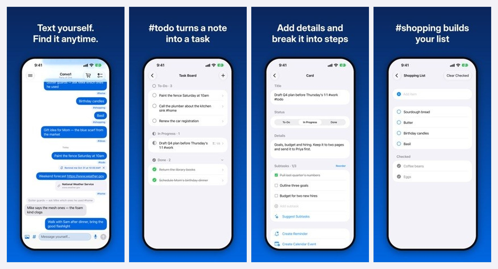

- **内购**：Convo1 Unlimited
- **原价**：$1.99，兑换码 0 元领
- **评分**：★5.0（5）
- **设备**：iPhone / iPad
- **最低系统**：iOS 27.0
- **大小**：5.2 MB
- **语言**：仅英文
- **简介**：你已经知道如何使用 Convo1。
- **兑换链接**：[点这里兑换](https://apps.apple.com/redeem?ctx=offercodes&id=6801723067&code=REDDITCONVO1)
- **App 链接**：[在 App Store 打开](https://apps.apple.com/us/app/id6801723067)
!carousel
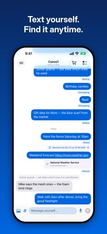
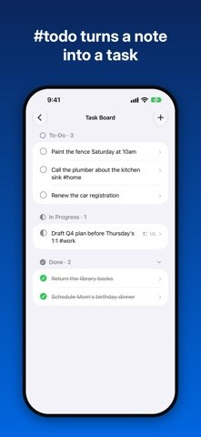

---

限免结束时间苹果不公布，一般 1–3 天，尽快领。
