今天 6 款付费 App 限时免费；另有 8 个终身内购可用兑换码 0 元领，原价加起来约 315 美元。都是今天刚确认的，限免随时可能结束，看到喜欢的就领。

## 今日极力推荐

1. **PepWork: Live Earnings** — 评分 5.0，原价 付费应用，把薪资换成眼前一点点增长的收入，把等待变成看得见的下班倒计时，让平凡的一天也有小小的成就感

## 付费应用限时免费（6 款）

点链接进 App Store 点“获取”就行。领的时候只点“获取”，不要买任何内购。

### 工具（1 款）

#### 1. PepWork: Live Earnings

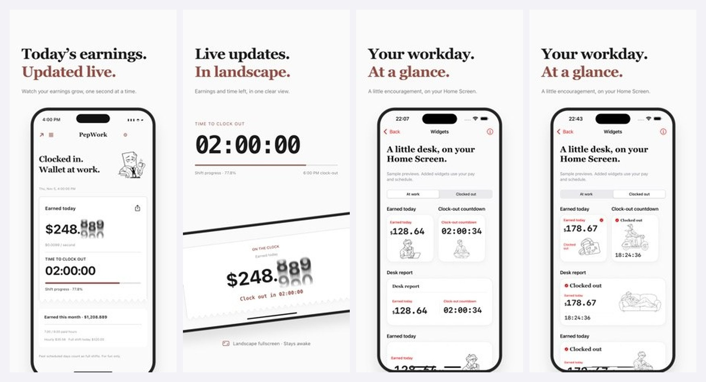

- **原价**：付费应用，现在免费
- **评分**：★5.0（2）
- **设备**：iPhone / iPad
- **最低系统**：iOS 16.0
- **大小**：6.9 MB
- **语言**：中文、英文
- **简介**：把薪资换成眼前一点点增长的收入，把等待变成看得见的下班倒计时，让平凡的一天也有小小的成就感
- **领取**：[在 App Store 打开](https://apps.apple.com/us/app/id6830954865)

!carousel
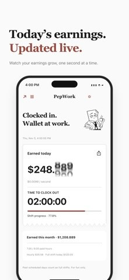
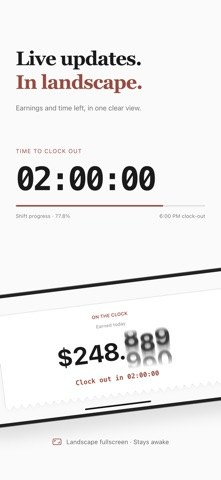

### 生活（1 款）

#### 1. Japa Mala Pro

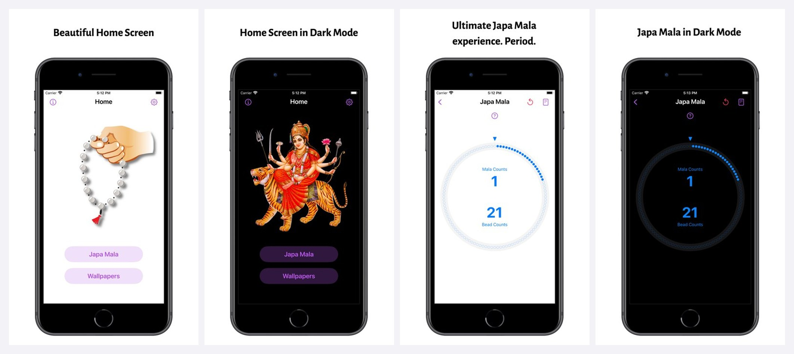

- **原价**：付费应用，现在免费
- **评分**：★5.0（10）
- **设备**：iPhone / iPad
- **最低系统**：iOS 15.0
- **大小**：52.5 MB
- **语言**：仅英文
- **简介**：- Japa Mala Pro 是一款将你日常念诵神的名字提升到一个全新水平的应用程序。
- **领取**：[在 App Store 打开](https://apps.apple.com/us/app/id6445903179)

!carousel
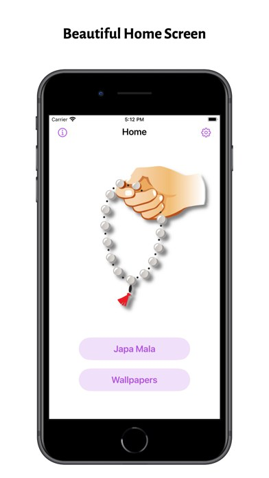
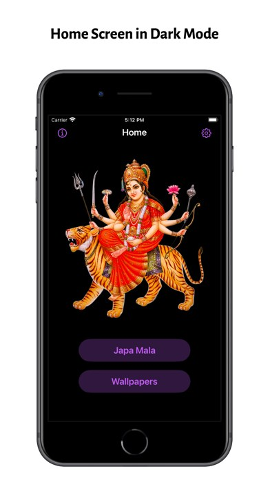

### 图形设计（1 款）

#### 1. Business Card Maker·

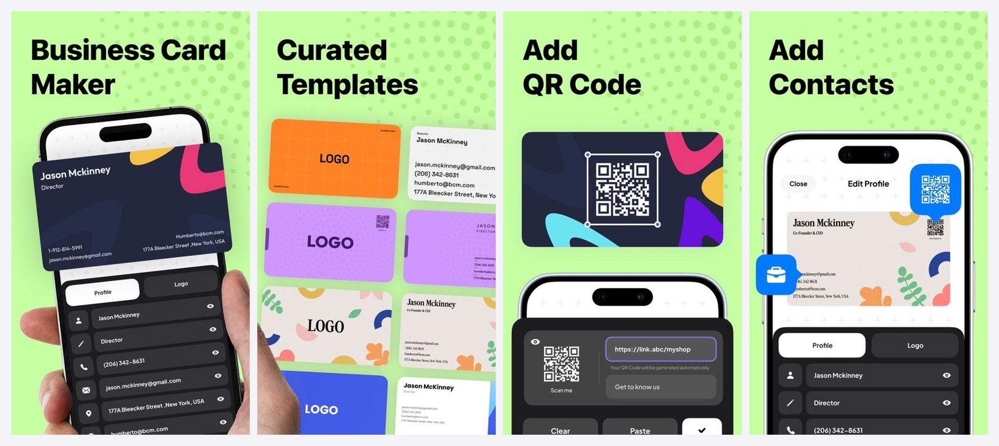

- **原价**：付费应用，现在免费
- **评分**：★4.8（127）
- **设备**：iPhone / iPad
- **最低系统**：iOS 17.0
- **大小**：396.0 MB
- **语言**：仅英文
- **简介**：名片制作器是现代专业人士的终极工具。
- **领取**：[在 App Store 打开](https://apps.apple.com/us/app/id6502953049)

!carousel
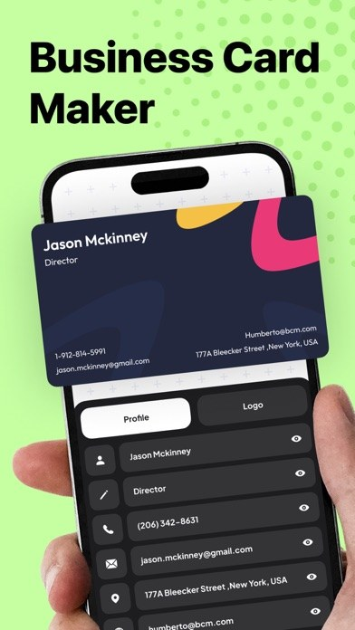

### 摄影与录像（1 款）

#### 1. Cassini Camera

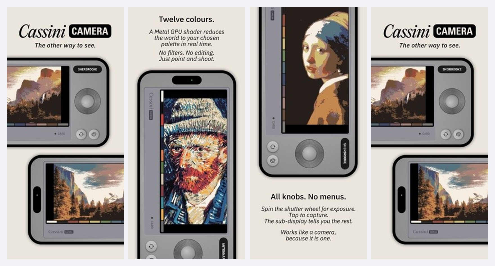

- **原价**：付费应用，现在免费
- **评分**：★4.7（3）
- **设备**：iPhone / iPad
- **最低系统**：iOS 26.2
- **大小**：3.0 MB
- **语言**：仅英文
- **简介**：Cassini Camera 是一款适用于 iPhone 的调色板量化摄影工具。
- **领取**：[在 App Store 打开](https://apps.apple.com/us/app/id6759523718)

!carousel
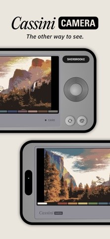
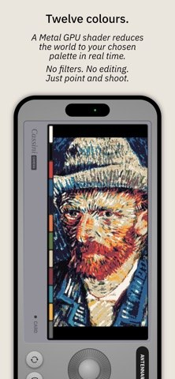

### 导航（1 款）

#### 1. GPS to SMS 2

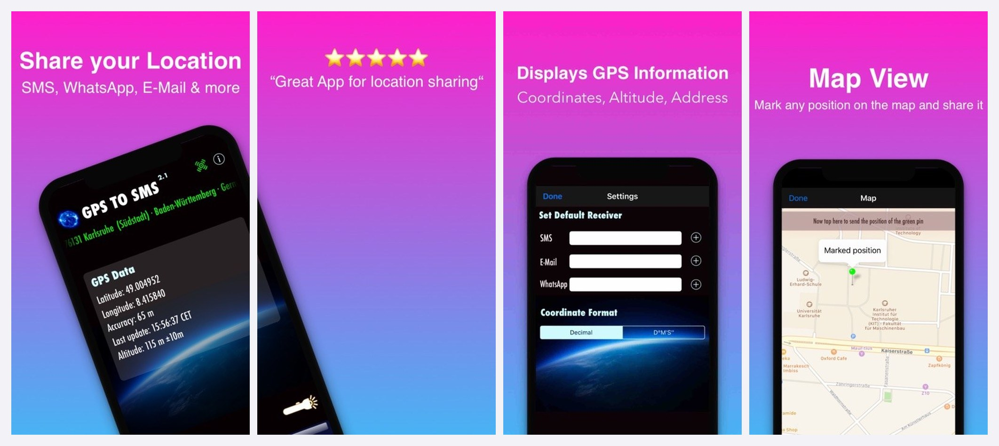

- **原价**：付费应用，现在免费
- **评分**：★4.6（47）
- **设备**：iPhone / iPad / Apple Watch
- **最低系统**：iOS 10.3
- **大小**：3.5 MB
- **语言**：英文、德文
- **简介**：使用案例： • 让你的孩子将他们的位置发送给你 • 在大型露天音乐节上将你的位置发送给朋友 • 如果你的汽车发生故障
- **领取**：[在 App Store 打开](https://apps.apple.com/us/app/id959271951)

!carousel
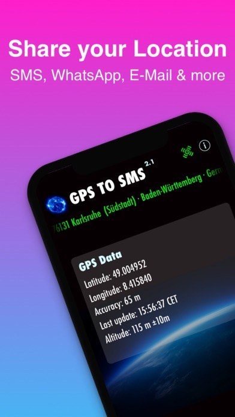

### 音乐（1 款）

#### 1. MEGAPLAY

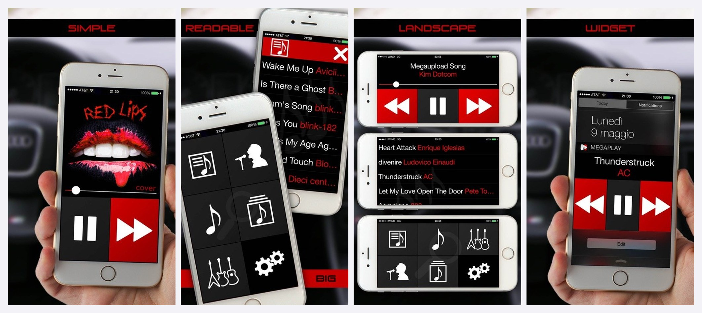

- **原价**：付费应用，现在免费
- **评分**：★4.2（20）
- **设备**：iPhone / iPad
- **最低系统**：iOS 16.0
- **大小**：10.6 MB
- **语言**：英文、意大利文
- **简介**：● 深色主题以节省电池。
- **领取**：[在 App Store 打开](https://apps.apple.com/us/app/id926320613)

!carousel
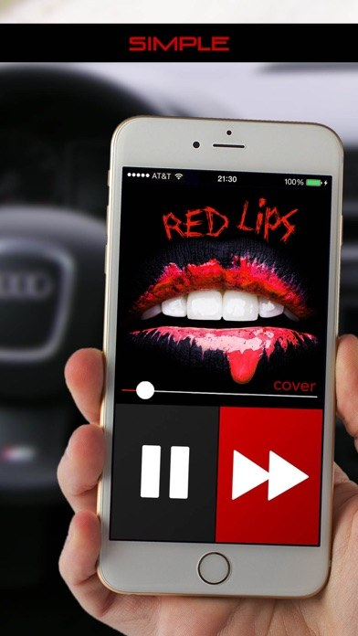
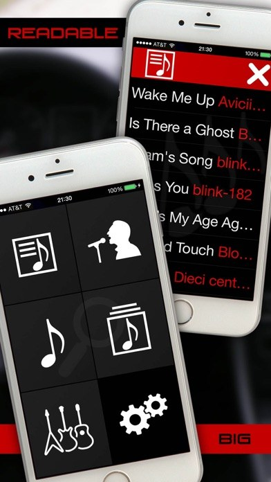

## 终身内购 0 元兑换（8 个）

这几个不是商店里直接降价到 0 元，而是开发者发的公开兑换码：点帖子里的兑换链接直接进 App Store 兑。每个兑换码一个 Apple 账号只能用一次，都是终身解锁、不是订阅，不会续费。

**怎么领**：先装上对应的免费 App → 点该款下面的兑换链接 → 自动跳到 App Store 兑换页，确认就行。不用绑卡，没有试用期。没有兑换链接的款，暂时只能先装 App，等开发者放出公开码。

### 医疗（1 个）

#### 1. Glucia - Blood Sugar Tracker

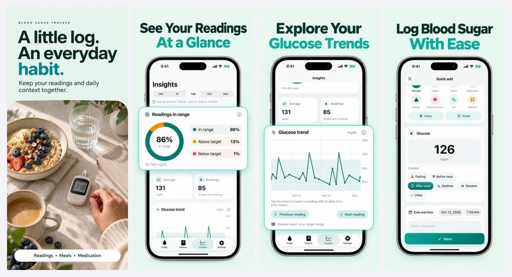

- **内购**：Lifetime Pro Access
- **原价**：$29.99，兑换码 0 元领
- **设备**：iPhone / iPad
- **最低系统**：iOS 17.0
- **大小**：45.2 MB
- **语言**：中文、英文、日文、韩文、法文等 18 种
- **简介**：Glucia 可让你轻松保存清晰、私密的血糖记录。
- **兑换链接**：[点这里兑换](https://apps.apple.com/redeem?ctx=offercodes&id=6818956215&code=ZXCVBNKJH)
- **App 链接**：[在 App Store 打开](https://apps.apple.com/us/app/id6818956215)
!carousel
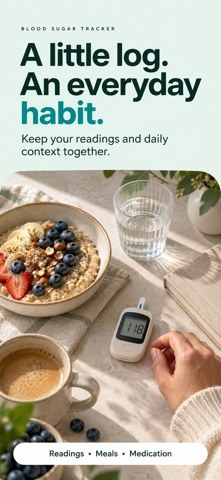
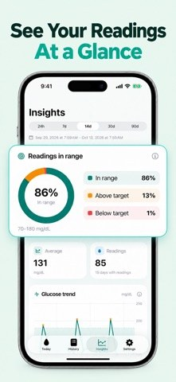

### 健康健美（2 个）

#### 1. AI Calorie Counter - Calery

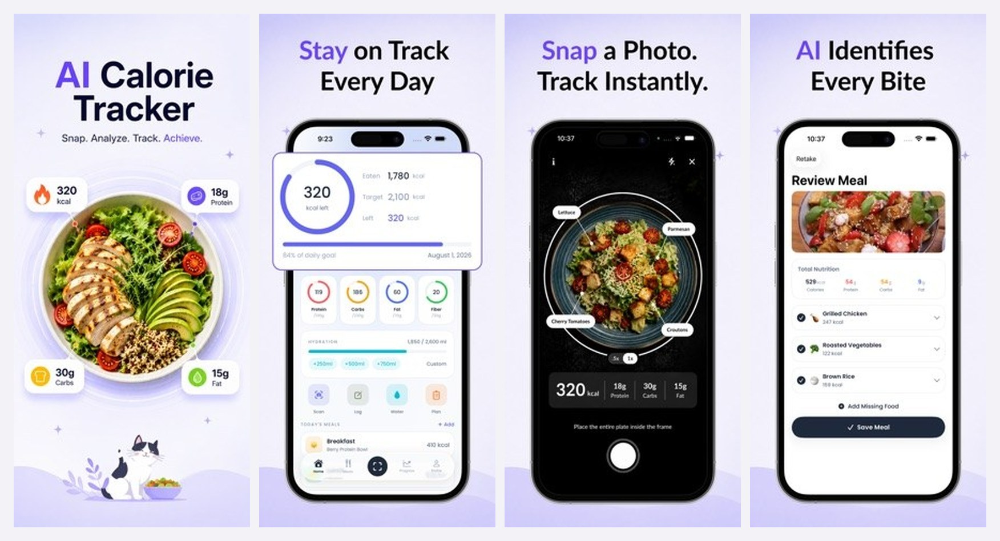

- **内购**：Lifetime Pro Access
- **原价**：$29.99，兑换码 0 元领
- **评分**：★5.0（4）
- **设备**：iPhone / iPad
- **最低系统**：iOS 16.0
- **大小**：32.8 MB
- **语言**：中文、英文、日文、韩文、法文等 16 种
- **简介**：使用 AI 卡路里计数器 - Calery 让每顿饭都变得有意义，这是一款简单的食物营养和宏观跟踪器
- **兑换链接**：[点这里兑换](https://apps.apple.com/redeem?ctx=offercodes&id=6789642091&code=DWPNJOOHH)
- **App 链接**：[在 App Store 打开](https://apps.apple.com/us/app/id6789642091)
!carousel

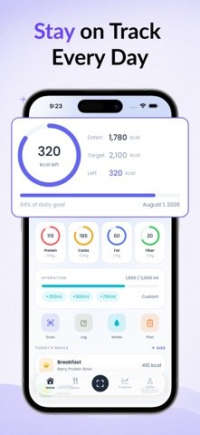

#### 2. Pufflo

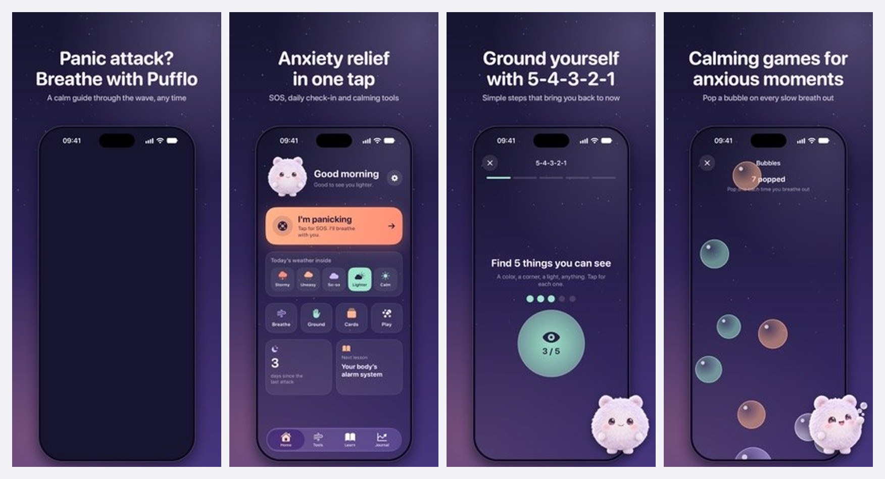

- **内购**：Pufflo Pro Lifetime
- **原价**：$69.99，兑换码 0 元领
- **评分**：★5.0（4）
- **设备**：iPhone / iPad
- **最低系统**：iOS 17.0
- **大小**：13.9 MB
- **语言**：中文、英文、日文、韩文、法文等 43 种
- **简介**：Pufflo是一款帮助应对惊恐发作和焦虑的自助应用
- **App 链接**：[在 App Store 打开](https://apps.apple.com/us/app/id6834941381)
!carousel

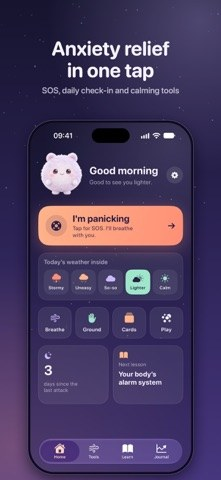

### 工具（1 个）

#### 1. Calculator & Cleaner: SuperC

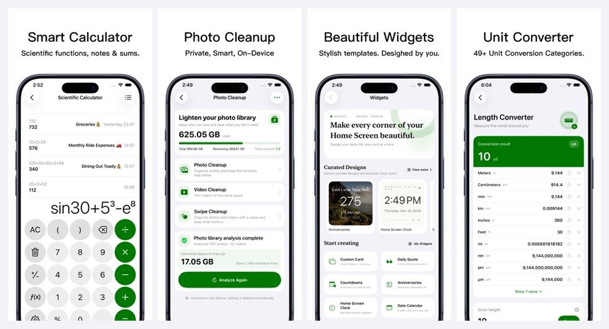

- **内购**：SuperC Lifetime Access
- **原价**：$39.99，兑换码 0 元领
- **评分**：★4.5（10）
- **设备**：iPhone / iPad
- **最低系统**：iOS 16.0
- **大小**：43.0 MB
- **语言**：中文、英文
- **简介**：灵珠计算器 - 多功能百宝箱 让日常所需，触手可及
- **兑换链接**：[点这里兑换](https://apps.apple.com/redeem?ctx=offercodes&id=6737301186&code=SUPERC2026)
- **App 链接**：[在 App Store 打开](https://apps.apple.com/us/app/id6737301186)
!carousel
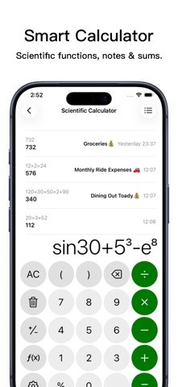
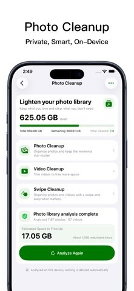

### 音乐（2 个）

#### 1. Piano Lessons

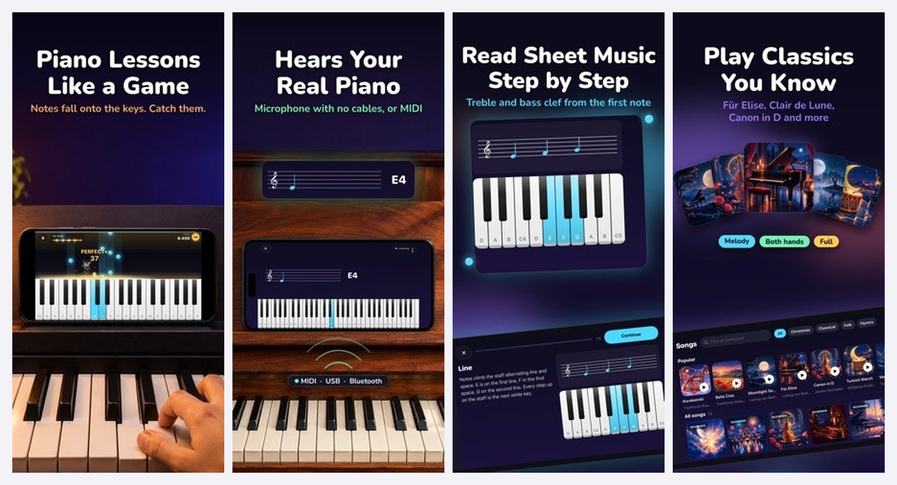

- **内购**：Nota Premium Lifetime
- **原价**：$39.99，兑换码 0 元领
- **评分**：★5.0（5）
- **设备**：iPhone / iPad
- **最低系统**：iOS 26.0
- **大小**：98.0 MB
- **语言**：中文、英文、日文、韩文、法文等 11 种
- **简介**：音符落向琴键，你来接住它们，每首曲子都是一个关卡，有连击、得分和可以赢取的星星
- **App 链接**：[在 App Store 打开](https://apps.apple.com/us/app/id6823678177)
!carousel

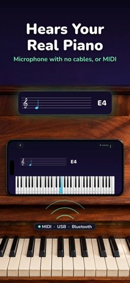

#### 2. Guitar Lessons

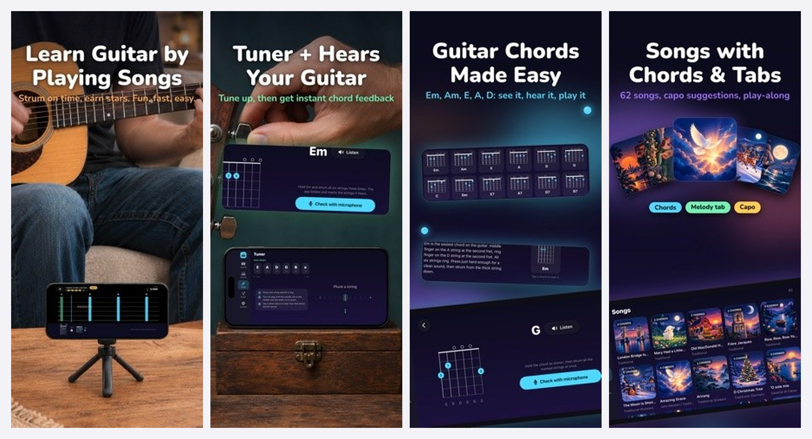

- **内购**：Nota Premium Lifetime
- **原价**：$39.99，兑换码 0 元领
- **评分**：★4.9（10）
- **设备**：iPhone / iPad
- **最低系统**：iOS 26.0
- **大小**：97.8 MB
- **语言**：中文、英文、日文、韩文、法文等 11 种
- **简介**：弹你熟悉的歌曲来学吉他：和弦块滑向判定线，到达时你扫弦即可，每首歌都是一个关卡，有连击、得分和可以赢取的星星
- **App 链接**：[在 App Store 打开](https://apps.apple.com/us/app/id6832286151)
!carousel

### 生活（1 个）

#### 1. Roomtect

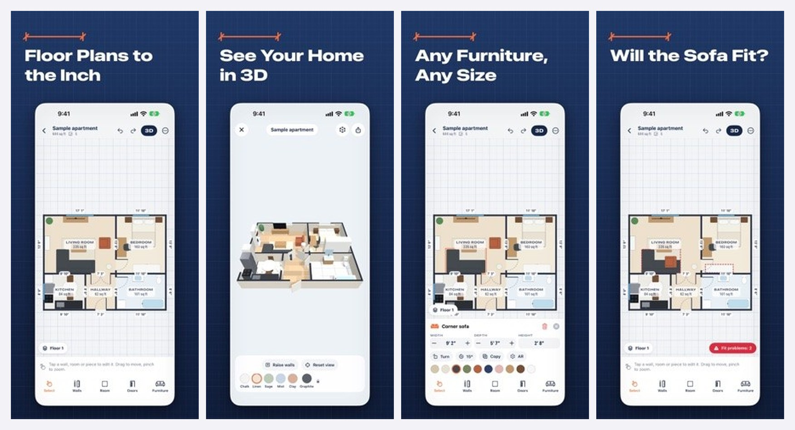

- **内购**：Roomtect Pro Lifetime
- **原价**：$24.99，兑换码 0 元领
- **评分**：★5.0（2）
- **设备**：iPhone / iPad / Mac
- **最低系统**：iOS 17.0
- **大小**：12.3 MB
- **语言**：中文、英文、日文、韩文、法文等 43 种
- **简介**：Roomtect 是一款以真实尺寸为基础的房屋与房间规划工具：绘制户型图，按真实尺寸摆放家具，在买家具、装修或搬家之前，先确认一切都放得下
- **App 链接**：[在 App Store 打开](https://apps.apple.com/us/app/id6834878822)
!carousel
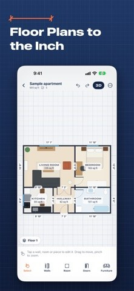
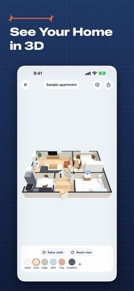

### 摄影与录像（1 个）

#### 1. Flashpix

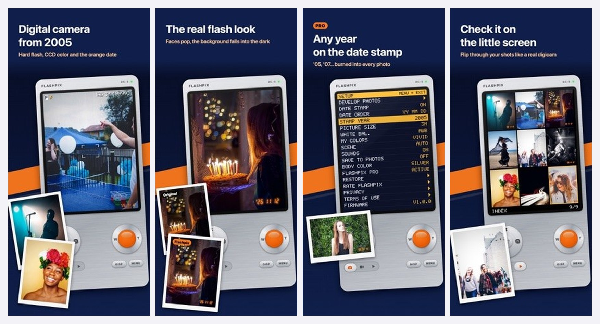

- **内购**：Flashpix Pro Lifetime
- **原价**：$39.99，兑换码 0 元领
- **评分**：★5.0（7）
- **设备**：iPhone / iPad
- **最低系统**：iOS 17.0
- **大小**：13.9 MB
- **语言**：中文、英文、日文、韩文、法文等 33 种
- **简介**：让手机变成一台2005年的数码相机
- **App 链接**：[在 App Store 打开](https://apps.apple.com/us/app/id6834137171)
!carousel
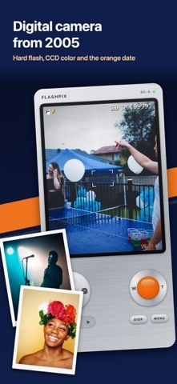
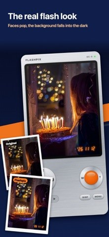

---

限免结束时间苹果不公布，一般 1–3 天，尽快领。
